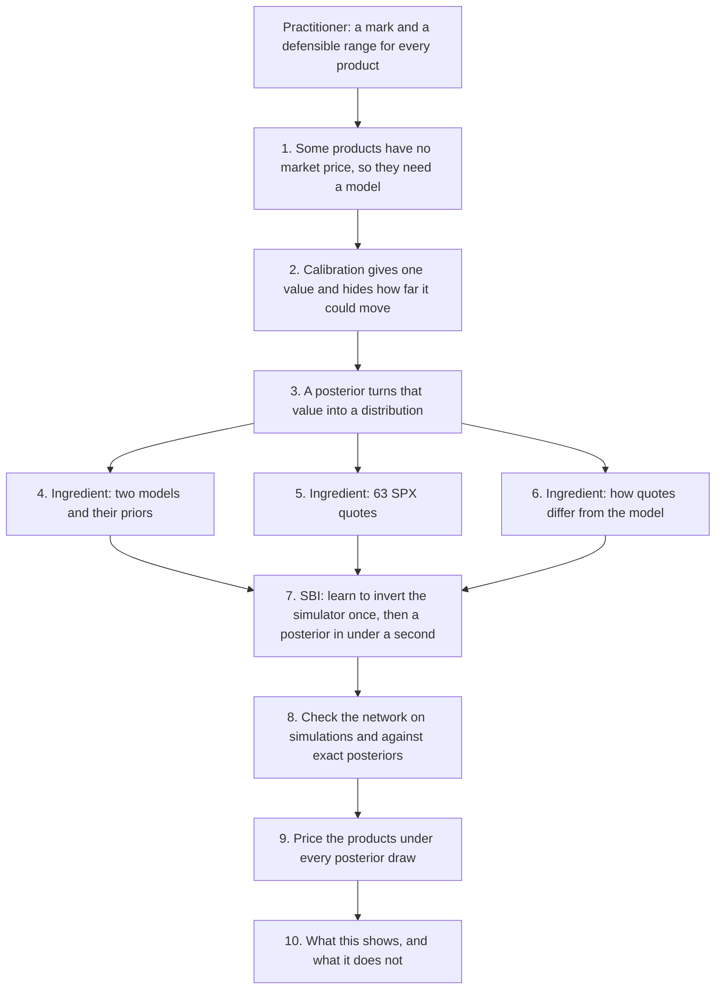

# Option application on SPX · Layer 1: overview

*Layer 1 of 3 · about 10 minutes · [Index](README.md) · [Layer 2](2-walkthrough.md) ·
[Layer 3](3-full-detail.md) · [Glossary](glossary.md) · Results as of 11 November 2026*

## Goals

1. Give a product that no market prices a value **and a range**, from a Bayesian
   posterior over the parameters of a model (step 3).
2. Show that simulation-based inference (SBI) makes this posterior fast enough for daily
   use, and cheap enough to test whether its 90% ranges contain the truth 90% of the time
   (steps 7 and 8).
3. State what the range covers and what it does not (step 10).

## Audience

The tutorial's audience, ICAIF '26, mixes AI researchers who know Bayesian inference but
not derivatives with practitioners who know derivatives but not SBI. Each must be able to
follow the other's half, so no finance background is assumed: terms in **bold** are
explained where they first appear, and in the [glossary](glossary.md).

## The practitioner's point of view

Every evening a bank values each position it holds. This is **marking** the position,
for the day's profit and loss (**P&L**) and the balance sheet. An instrument traded on an
exchange is **marked to market**, at its price. One that is not traded has no price to
read, so it is **marked to model**: valued by a model fed with market prices.

Such values are uncertain, and EU rules (Regulation 2016/101) make banks quantify the
uncertainty. Besides the mark, a bank computes a **prudent value**: a price at which it is
90% confident it could **exit** the position (sell what it owns, or buy back what it
owes), or better. The gap between the two, an **additional valuation adjustment (AVA)**,
is deducted from the bank's core capital. Today the range comes from alternative
calibrations and models, from consensus prices pooled across banks, or from expert
judgment.

So the practitioner needs, for every product, a mark and a range that can be defended.

## The steps at a glance



## 1. What has a price, and what does not

The problem starts with a distinction: some instruments have a market price and some do
not.

**Listed options.** An option on the S&P 500 index pays at its **maturity** $`T`$ an
amount set by the index level $`S_T`$ and a **strike** $`K`$: a **call** pays
$`\max(S_T-K,\,0)`$ and a **put** pays $`\max(K-S_T,\,0)`$. Options on the index itself,
**SPX**, trade on the Cboe exchange in thousands of strikes and maturities, each with a
**bid** (the best offer to buy) and an **ask** (the best offer to sell). We take the
midpoint as the price, and half the gap, the **half-spread** $`h`$, as its uncertainty.

Prices are compared as **implied volatilities**: the volatility $`\sigma`$ that makes the
Black–Scholes formula (the textbook model, with a constant volatility) reproduce the
price. Low strikes show a higher $`\sigma`$, because protection against a fall is in
demand. This curve across strikes and maturities is the **smile**; for an index it is
mostly a downward slope, the **skew**. Gaps are counted in **vol points**: 0.01 of
volatility.

**Products that are not listed.** Banks also sell products on the index privately (**over
the counter**), often inside notes sold to investors:
- a **forward-starting variance swap**, which pays the index's realized variance over a
  future window minus a strike agreed today;
- a **forward-start call**, whose strike is set in 6 months at the index level of that
  day, and which pays at 1 year;
- a **volatility swap**, which pays the realized volatility over a period minus a strike
  agreed today;
- a **down-and-in put**, a put that exists only if the index falls to a barrier, say 70%
  of today's level. Buyers of **autocallable** notes, a very common structured product,
  in effect sell this put to the bank.


**Figure 1.** Each panel follows simulated paths of the index. Forward start: the strike is
fixed at the dot (6 months) and the call pays at 1 year. Volatility swap: realized
volatility settles path by path, against one fixed strike. Down-and-in put: only the red
path touches the 70% barrier, so only there does the put exist. Forward-starting
variance: the expected variance averaged over a short and a later window.

These payoffs depend on the index's path or on its future variance. Listed options fix
the index's distribution at each listed maturity, but not how those distributions are
linked across dates. So these products must be marked to model.

## 2. Calibration gives one value and hides the rest

A product without a price needs a model, and a model needs its parameters $`\theta`$. It
values a payoff $`\Pi`$ as the expected discounted payoff,

```math
P(\theta) = D\,\mathbb{E}_\theta[\Pi],
```

with $`D`$ the **discount factor** (today's value of 1 paid at the payment date) and the
expectation taken under the model's **pricing probabilities** (under which the index grows
on average at the interest rate less its dividend yield, so that no trade earns a
riskless profit). **Calibration** picks the parameters whose prices best match the listed
ones, classically by least squares on implied volatilities,

```math
\hat\theta = \arg\min_\theta \sum_i \big(\sigma_i^{\text{market}} - \sigma_i^{\text{model}}(\theta)\big)^2 ,
```

and marks the product at $`P(\hat\theta)`$.

But listed options pin some combinations of parameters and leave others loose. Many
parameter sets fit almost equally well, yet value the products differently. One best fit
hides this.

## 3. The posterior turns one value into a distribution

To see how far the value can move, we replace the best fit by a distribution. Bayes' rule
gives the **posterior** of the parameters given the quotes $`y`$,

```math
p(\theta \mid y) \;\propto\; p(y \mid \theta)\; p(\theta),
```

from a **prior** $`p(\theta)`$ (which parameters are plausible before seeing data) and a
**likelihood** $`p(y \mid \theta)`$ (how probable the quotes are under $`\theta`$).
Pricing product $`j`$ under posterior draws $`\theta^{(s)}`$ gives values
$`P_j^{(s)}`$. Their mean is the **mark**. Their 10% quantile is the **prudent value** of
a product the bank owns, and their 90% quantile that of a product it owes. For a
**book**, the positions $`n_j`$ a desk holds, $`B^{(s)} = \sum_j n_j P_j^{(s)}`$ gives the
range of the whole book, including how the products offset each other.


**Figure 2.** Schematic. Left: each posterior draw is one complete set of parameters. Right:
pricing the product under every draw gives a distribution of values; its mean is the
mark, its 10% quantile the prudent value of a long position, and the gap between them
the reserve.

The posterior needs three ingredients: a model with its prior (step 4), the quotes
(step 5), and an error model linking the two (step 6). Together they describe how quotes
are generated: draw parameters, compute prices, add errors. That is a simulator, and
step 7 inverts it.

## 4. Two models

The first ingredient is the model. **Heston** lets the variance $`V_t`$ of index returns
move randomly around a long-run level:

```math
\frac{dS_t}{S_t} = (r-q)\,dt + \sqrt{V_t}\,dB_t,\qquad dV_t = \kappa(\bar{v} - V_t)\,dt + \xi\sqrt{V_t}\,dW_t,\qquad \mathrm{corr}(dB_t, dW_t) = \rho ,
```

with $`r-q`$ the interest rate less the dividend yield. Its parameters are today's
variance $`v_0`$, the long-run variance $`\bar{v}`$, the speed of **mean reversion**
$`\kappa`$, the **vol of vol** $`\xi`$, and the correlation $`\rho`$ (negative:
volatility rises when the index falls). A Fourier integral prices the quotes in
milliseconds, so its exact posterior can be computed in minutes and serves as the
reference.

**Rough Bergomi** makes volatility **rough**, far more irregular than in Heston. The
variance is the exponential of $`\eta\,Y_t`$, with
$`Y_t = \sqrt{2H}\int_0^t (t-s)^{H-1/2}\,dW_s`$, rescaled so that its expected value
follows a curve $`\xi_0(t)`$ given by three numbers. The Hurst exponent $`H \lt 1/2`$ sets
the roughness, $`\eta`$ is the vol of vol and $`\rho`$ the correlation with the index.
Roughness makes the skew steepen at short maturities, as index smiles do. The model has
no pricing formula: every price comes from Monte Carlo simulation, so its exact posterior
takes about a day.

Both models get wide uniform priors, the same quotes and the same error model. Neither
sees information the other does not.

## 5. Which quotes

The second ingredient is the data: 63 actual quotes of SPX options from the Cboe chain of
9 November 2026, read at 15:13 New York time. They sit on seven expiries, from 7 days to
about 11 months, with nine strikes per expiry.

The strikes are placed in **standardized moneyness**, $`z = \ln(K/F)/(0.16\sqrt{T})`$:
the distance of the strike $`K`$ from the **forward** $`F`$ (the price agreed today for
the index at $`T`$), in standard deviations of the index at a volatility of 16%, close to
SPX's at-the-money level. The targets are $`z`$ = −5, −3.5, −2.25, −1.25, −0.5 and 0 for
puts, and +0.5, +1 and +2 for calls.


**Figure 3.** Left: the smile, implied volatility against $`z`$ for each expiry; deep puts
cost up to 42% in volatility terms, calls about 13%. Right: the design, nine quotes per
expiry; the colour is the half-spread, mostly well under 0.1 vol points.

The design is heavy in **out-of-the-money** puts (strikes below the forward), because
each region of the smile pins something different:
- deep puts: how much volatility fluctuates and how fast it reverts;
- calls: the correlation between index and volatility;
- short maturities: today's variance; long ones: the long-run level.

A region left out leaves its quantities loose, and with them the products that depend on
them: without the expiries beyond 2 months, the long-run level becomes 16 times less
certain.

## 6. How quotes differ from the model

The third ingredient links the first two. Each quote $`i`$ is modelled as the model's
price plus an error whose size is the quote's half-spread $`h_i`$ times a common
multiplier $`c`$:

```math
y_i = P_i(\theta) + c\,h_i\,Z_i ,
```

with $`Z_i`$ independent standard normals. The true price lies somewhere between bid and
ask, so the half-spread is the natural scale of its uncertainty. The multiplier $`c`$ is
inferred with the model's parameters, between 0.5 and 2: the data say how large the
errors are.

On the SPX quotes, $`c`$ goes straight to its upper limit of 2. The reason is in Figure
4: even at its best parameters, Heston misses the quotes by about 1.4 vol points, while
their half-spreads are about 0.06. The misses are also **smooth**: neighbouring quotes are
missed by similar amounts.


**Figure 4.** Left: market quotes (dots) and Heston's best fit (lines) for three expiries;
at 7 days Heston cannot produce the steep skew of deep puts. Right: market minus model,
for all expiries; the red band, ± one median half-spread, is barely visible.

So on the market the model, not the quotes, is the main source of error. The posterior
is then a statement about the parameters of Heston, given that Heston is the model; it
does not include the model's own error. Step 10 returns to this.

## 7. Computing the posterior: simulation-based inference

With the three ingredients the posterior is defined; computing it is the next problem.
For Heston an exact posterior takes 7 to 15 CPU-minutes; for rough Bergomi about a day.
Testing that ranges are right needs posteriors on hundreds of simulated surfaces, which
exact methods cannot afford.


**Figure 5.** CPU time for one posterior: the network after training, the exact Heston
posterior by MCMC, and rough Bergomi by importance sampling.

SBI inverts the simulator of steps 4–6. Drawing $`\theta`$ from the prior, and then
quotes $`y`$ from the simulator, gives a pair from the joint distribution

```math
p(\theta, y) = p(\theta)\,p(y \mid \theta) = p(y)\,p(\theta \mid y),
```

so $`\theta`$ is a posterior draw for its own $`y`$. A neural network
$`q(\theta \mid y)`$ trained on many such pairs learns to return the posterior for any
quotes. For Heston it is trained once, on 300,000 simulated sets of prices; after that a
posterior takes under a second. The cost is **amortized** over every later posterior.

One step is essential: the network reads the quotes **whitened**, that is, rotated and
rescaled so that they are uncorrelated with unit variance. All quotes move together with
the parameters, by far more than the errors, so without whitening the network cannot see
the small differences that reveal $`c`$.

## 8. Checking it

The network's posterior is an approximation, so it is trusted only as far as it passes
checks:
- **On simulated surfaces** with known parameters: is each parameter recovered, and do
  90% intervals contain the truth 90% of the time?
- **Against exact posteriors** computed by MCMC, on simulated surfaces and on the market
  quotes: do the two agree?
- **On the market itself:** does the model describe the quotes (step 6)?


**Figure 6.** Heston network on 512 simulated surfaces. Left: how often central intervals
contain the truth, against their nominal level. Right: rank of the truth among posterior
draws; a calibrated posterior stays inside the grey band.

For Heston the results are good for five of six parameters: their 90% intervals contain
the truth 89–92% of the time, and their ranks pass the calibration test. Today's variance
$`v_0`$ has intervals that are too wide (97% coverage). On simulated surfaces the network
stays close to the exact posterior: centred within about one reference standard deviation,
with intervals up to about 3 times wider. On the market quotes it does not, because the
market lies outside what the network saw in training: its misfit is larger than any error
the training allowed. Market results therefore use the exact posterior.

## 9. From the posterior to the products

With a checked posterior, the products can be priced under every draw.

The **forward-starting variance** has a closed form under both models, so it is computed
for every draw directly. Two windows are reported: a short one, from today to 3 weeks, and
a later one, from 2.7 to 10.7 months. At Heston's market posterior they correspond to
volatilities of 17.7% and 22.6%. The short window is pinned by the short expiries, the
later one by the long expiries.

The **forward-start call**, the **volatility swap** and the **down-and-in put** depend on
the whole path, so each draw prices them by simulation, with the same random numbers for
every draw so that the spread reflects the parameters, not simulation noise. Each product
then gets a mark, a range, a prudent value and a **reserve** (the gap between mark and
prudent value), and the book gets its own range.

## 10. What the results show, and what they do not

They show, for Heston on SPX:
- a network, trained once, that returns calibrated posteriors in under a second for five
  of six parameters, with intervals for $`v_0`$ that are too wide;
- what each region of quotes pins, and so which products the quotes leave open;
- that Heston misses the SPX smile by about 20 times the quotes' own uncertainty, mostly
  at short maturities and deep strikes.

They do not:
- cover the model's own error. The ranges are uncertainty about one model's parameters.
  When the model misfits, as Heston does here, a range that ignores the misfit is too
  narrow; a smooth model-error term in the likelihood is the natural extension;
- check the products against a true value on real data, which is never observed;
- show hedging under parameter uncertainty;
- establish that a posterior is an accepted basis for a prudent value. That is our
  proposal, not current practice.

Rough Bergomi, built for the short-maturity skew that Heston misses, follows the same
steps; its simulations are being generated and its results will complete the comparison.

## Back to the goals, the audience and the practitioner

**Goals.** Steps 3 and 9 give every product a mark and a range from one posterior
(goal 1). Steps 7 and 8 make the posterior fast and tested: under a second per posterior,
checked on 512 simulated surfaces and against exact posteriors (goal 2). Step 10 states
the limits (goal 3).

**Audience.** In the tutorial, the Heston notebook runs steps 4 to 9 against an exact
posterior; the rough Bergomi notebook repeats them where only SBI makes the checks
affordable. Attendees should leave able to say, for their own model, whether they need a
range like this, what it costs, and how to check it.

**Practitioner.** A desk and its **product control** (the team, independent of the
traders, that verifies the marks) would get every day, from one consistent calculation, a
mark and a range for every product and for the book, with tested coverage, and a measure
of how well the model fits that day's quotes. They would still choose the models, handle
the model risk beyond one model's parameters, and need their regulator to accept a
posterior as the basis of a prudent value.
