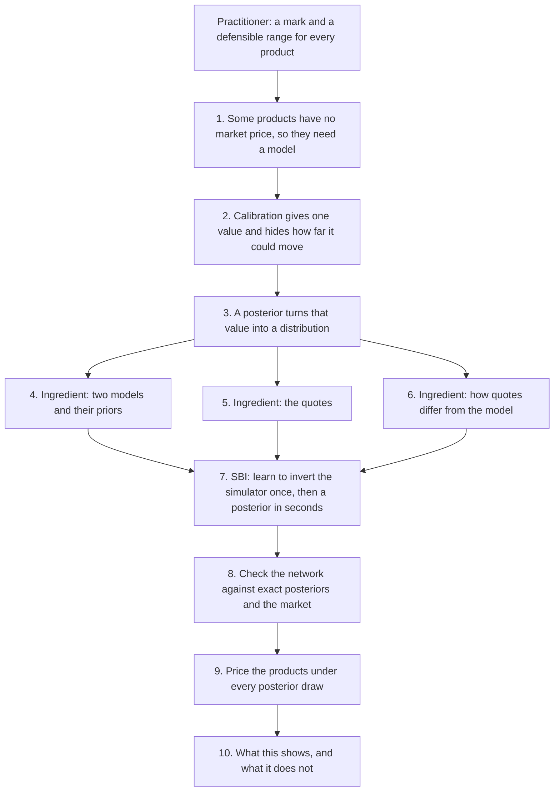

# Option application on SPX · Layer 1: overview

*Layer 1 of 3 · about 10 minutes · [Index](README.md) · [Layer 2](2-walkthrough.md) · [Glossary](glossary.md)*

*10 November 2026: what we are building for the tutorial of 14 November
([PR #81](https://github.com/fmuia/sbi4finance/pull/81)). There are no results yet;
"first checks" are quick runs of 9 November. The details are in
[Layer 2](2-walkthrough.md) and, until Layer 3 replaces it, [the plan](../OPTION-APPLICATION-PLAN.md).*

## Goals

1. Give a product that no market prices a value **and a range**, from a Bayesian
   posterior over a model's parameters (step 3).
2. Show that simulation-based inference (SBI) makes this posterior fast enough for daily
   use, and cheap enough to test whether its 90% ranges contain the truth 90% of the time
   (steps 7 and 8).
3. State what the range covers and what it does not (step 10).

## Audience

The tutorial's audience, ICAIF '26, mixes AI researchers who know Bayesian inference but
not derivatives with practitioners who know derivatives but not SBI. Each must be able to
follow the other's half. This document is for us and assumes no finance background: terms
in **bold** are explained where they first appear, and in the [glossary](glossary.md).

## The practitioner's point of view

Every evening a bank values each position it holds. This is **marking** the position,
for the day's profit and loss (**P&L**) and the balance sheet. An instrument traded on an
exchange is **marked to market**, at its price. One that is not traded has no price to
read, so it is **marked to model**: valued by a model fed with market prices.

Such values are uncertain, and EU rules (Regulation 2016/101) make banks quantify this.
Besides the mark, a bank computes a **prudent value**: a price at which it is 90%
confident it could **exit** the position (sell what it owns, or buy back what it owes),
or better. The gap, an **additional valuation adjustment (AVA)**, is deducted from the
bank's core capital. Today the range comes from alternative calibrations and models, from
consensus prices pooled across banks, or from expert judgment.

So the practitioner needs, for every product, a mark and a range that can be defended.

## The steps at a glance



## 1. What has a price, and what does not

The problem starts with a distinction: some instruments have a market price and some do
not.

**Listed options.** An option on the S&P 500 index pays at its **maturity** $`T`$ an
amount set by the index level $`S_T`$ and a **strike** $`K`$: a **call** pays
$`\max(S_T-K,\,0)`$ and a **put** pays $`\max(K-S_T,\,0)`$. Options on the index itself,
**SPX**, trade on the Cboe exchange in thousands of strikes and maturities, each with a
**bid** (the best offer to buy) and an **ask** (the best offer to sell). We take the
midpoint as the price, and half the gap, the **half-spread** $`h`$, as its uncertainty.

Prices are compared as **implied volatilities**: the volatility $`\sigma`$ that makes the
Black–Scholes formula (the textbook model, with a constant volatility) reproduce the
price. Low strikes show a higher $`\sigma`$, because protection against a fall is in
demand. This curve across strikes and maturities is the **smile**; for an index it is
mostly a downward slope, the **skew**. Gaps are counted in **vol points**: 0.01 of
volatility.

**Products that are not listed.** Banks also sell products on the index privately (**over
the counter**), often inside notes sold to investors. We value three:
- a **forward-start call**, whose strike is set in 6 months at the index level of that
  day (adjusted for interest and dividends), and which pays at 1 year;
- **volatility swaps** over 3 months and 1 year, which pay the index's realized
  volatility over the period minus a strike agreed today;
- a 1-year **down-and-in put** with strike 100% and barrier 70%: a put that exists only
  if the index closes at or below 70% of today's level on some day. Buyers of
  **autocallable** notes, a very common structured product, in effect sell this put to the
  bank.

These payoffs depend on the index's path. Listed options fix the index's distribution at
each listed maturity, but not how those distributions are linked across dates. So the
three products must be marked to model.

## 2. Calibration gives one value and hides the rest

A product without a price needs a model, and a model needs its parameters $`\theta`$. It
values a payoff $`\Pi`$ as the expected discounted payoff,

```math
P(\theta) = D\,\mathbb{E}_\theta[\Pi],
```

with $`D`$ the **discount factor** (today's value of 1 paid at the payment date) and the
expectation taken under the model's **pricing probabilities** (under which the index grows
on average at the interest rate less its dividend yield, so that no trade earns a
riskless profit). **Calibration** picks the parameters whose prices best match the listed
ones, classically by least squares on implied volatilities,

```math
\hat\theta = \arg\min_\theta \sum_i \big(\sigma_i^{\text{market}} - \sigma_i^{\text{model}}(\theta)\big)^2 ,
```

and marks the product at $`P(\hat\theta)`$.

But listed options pin some combinations of parameters and leave others loose. Many
parameter sets fit almost equally well, yet value the forward start or the barrier put
differently. One best fit hides this.

## 3. The posterior turns one value into a distribution

To see how far the value can move, we replace the best fit by a distribution. Bayes' rule
gives the **posterior** of the parameters given the quotes $`y`$,

```math
p(\theta \mid y) \;\propto\; p(y \mid \theta)\; p(\theta),
```

from a **prior** $`p(\theta)`$ (which parameters are plausible before seeing data) and a
**likelihood** $`p(y \mid \theta)`$ (how probable the quotes are under $`\theta`$).
Pricing product $`j`$ under posterior draws $`\theta^{(s)}`$ gives values
$`P_j^{(s)}`$. Their mean is the **mark**. Their 10% quantile is the **prudent value** of
a product the bank owns, and their 90% quantile that of a product it owes. For a
**book**, the positions $`n_j`$ a desk holds, $`B^{(s)} = \sum_j n_j P_j^{(s)}`$ gives the
range of the whole book, including how the products offset each other.

The posterior needs three ingredients: a model with its prior (step 4), the quotes
(step 5), and an error model linking the two (step 6). Together they describe how quotes
are generated: draw parameters, compute prices, add errors. That is a simulator, and
step 7 inverts it.

## 4. Two models

The first ingredient is the model. **Heston** lets the variance $`V_t`$ of index returns
move randomly around a long-run level:

```math
\frac{dS_t}{S_t} = (r-q)\,dt + \sqrt{V_t}\,dB_t,\qquad dV_t = \kappa(\bar{v} - V_t)\,dt + \xi\sqrt{V_t}\,dW_t,\qquad \mathrm{corr}(dB_t, dW_t) = \rho ,
```

with $`r-q`$ the interest rate less the dividend yield. Its parameters are today's
variance $`v_0`$, the long-run variance $`\bar{v}`$, the speed of **mean reversion**
$`\kappa`$, the **vol of vol** $`\xi`$, and the correlation $`\rho`$ (negative:
volatility rises when the index falls). A Fourier integral prices the quotes in
milliseconds, so the exact posterior takes minutes and serves as the reference.

**Rough Bergomi** makes volatility **rough**, far more irregular than in Heston. The
variance is the exponential of $`\eta\,Y_t`$, with
$`Y_t = \sqrt{2H}\int_0^t (t-s)^{H-1/2}\,dW_s`$, rescaled so that its expected value
follows a curve $`\xi_0(t)`$ given by three numbers. The Hurst exponent $`H \lt 1/2`$ sets
the roughness, $`\eta`$ is the vol of vol and $`\rho`$ the correlation with the index. Roughness makes the skew
steepen at short maturities, as index smiles do; whether rough Bergomi fits SPX better is
debated, and step 10 compares the two. It has no pricing formula: every price comes from
Monte Carlo simulation, so its exact posterior takes hours.

Both models get wide uniform priors, the same quotes, the same error model and the same
curve family for the expected variance. Neither sees information the other does not.

## 5. Which quotes

The second ingredient is the data: a fixed **observation design** of 54 SPX quotes from
Alex's pilot, with maturities from 1 week to 1 year. Because it is fixed, one trained
network serves every day: the closing quotes of 9 to 12 November are read at the same 54
places.

The design is heavy in **out-of-the-money** puts (strikes below today's level), because
each region of the smile pins something different (first checks):
- deep puts: how fast volatility reverts and how much it fluctuates, on which the
  volatility swaps and the barrier put depend;
- quotes near today's level: today's volatility;
- calls: the correlation;
- short maturities: the vol of vol; longer ones: the long-run level.

A region left out leaves its quantities loose, and with them the products that depend on
them.

## 6. How quotes differ from the model

The third ingredient links the first two. In implied-volatility units, quote $`i`$ is
modelled as

```math
\sigma_i^{\text{market}} = \sigma_i^{\text{model}}(\theta) + h_i\,Z_i + \tau\,U_i ,
```

with two error terms:
- **Quote uncertainty**, $`h_i Z_i`$. The true price lies between bid and ask, so this
  error has the size of the half-spread; the $`Z_i`$ are independent standard normals.
  SPX's median half-spread is 0.06 vol points (first checks).
- **Model error**, $`\tau U_i`$. Heston misses SPX by about 1 vol point, 17 times the
  half-spread, and **smoothly**: misses at neighbouring strikes or maturities correlate at
  about 0.8 (first checks). So $`U`$ is a smooth random curve, standard normal at each
  quote and correlated between neighbours. Its size $`\tau`$ is inferred together with
  $`\theta`$: the data say how wrong the model is.

**Why smoothness matters.** Counted as independent noise, 54 misses are 54 independent
pieces of evidence. In fact they are a few smooth bumps, worth a handful. The posterior
then comes out too narrow: precise, but wrong. In first runs on data with smooth errors of
the measured size, networks trained with independent errors covered the truth 18–58% of
the time instead of 90%.

## 7. Computing the posterior: simulation-based inference

With the three ingredients the posterior is defined; computing it is the next problem.
Exact posteriors are too costly to use everywhere: rough Bergomi's takes 7–14 CPU-hours
per day, and testing coverage needs posteriors on hundreds of simulated days (300 would
take 2,100–4,200 CPU-hours).

SBI inverts the simulator of steps 4–6. Drawing $`\theta`$ from the prior, and then quotes
$`y`$ from the simulator, gives a pair from

```math
p(\theta, y) = p(\theta)\,p(y \mid \theta) = p(y)\,p(\theta \mid y),
```

so $`\theta`$ is a posterior draw for its own $`y`$. A neural network
$`q(\theta \mid y)`$ trained on many such pairs learns to return the posterior for any
quotes. The cost is paid once, in simulating 100,000 sets of prices per model and
training the network. After that, each day's posterior takes seconds; the cost is
**amortized**.

## 8. Checking it

The network's posterior is an approximation, trusted only as far as it passes these
checks:

| | Question |
| --- | --- |
| V1 | Can the model, its prior and its error model produce data like each real day? |
| V2 | Do the exact fits leave residuals like those the error model describes? |
| V3 | On 2,000 simulated days, do the 90% intervals contain the true parameters 90% of the time? |
| V4 | Does the network match the exact posterior (MCMC for Heston, importance sampling for rough Bergomi)? |
| V5 | Do the fits predict quotes left out of them? |
| V6 | Do they match two prices never fitted: the **variance swap**, priced from all the listed options without a model (as the VIX index is), and a listed 2-year put? |

If V3 or V4 fails, the results on real days come from the exact posterior, and the
failure is reported. Alex's pilot network, trained with independent errors, fails V4 on
the real day; a dedicated test asks whether the smooth error of step 6 explains this.

## 9. From the posterior to the products

With a checked posterior, the products can be priced. For each of 1,000 posterior draws,
simulate index paths and average each product's discounted payoff, using the same random
numbers for every draw (**common random numbers**) so that the spread reflects the
parameters, not simulation noise. Each product gets a mark, a 5–95% range, a prudent
value and a **reserve** (the gap between mark and prudent value). An example book gets
its reserve, set against the sum of its products' reserves.

These are compared with three simpler answers: the best fit alone, which has no range; a
linearized range around it (the **delta method**); and refits that leave out one maturity
at a time.

## 10. What the results will show, and what they will not

On SPX from 9 to 12 November, and on simulated days, the results will show:
- one posterior pricing every product, each with a range as wide as the quotes leave it
  open;
- ranges that add up coherently across a book;
- in simulation, 90% product ranges containing the truth about 90% of the time, against
  the simpler answers;
- that "precise but wrong" comes from the error model;
- how wrong each model is ($`\tau`$), and where;
- how marks and ranges move from day to day;
- Heston against rough Bergomi on the same information.

They will not:
- cover what the quotes cannot reveal. The ranges are one model's parameter uncertainty
  under the stated error model. The forward start depends on the smile 6 months ahead,
  which no quote shows; that is model risk, which two models expose only in part. The
  ranges are not a full model-risk reserve;
- test the forward start or the barrier put against a true value on real data, which is
  never observed (V5 and V6 are the real-data checks);
- show hedging under parameter uncertainty;
- establish that a posterior is an accepted basis for a prudent value. That is our
  proposal, not current practice.

## Back to the goals, the audience and the practitioner

**Goals.** Steps 3 and 9 give every product a mark and a range from one posterior
(goal 1). Steps 7 and 8 make the posterior fast and tested, with an exact reference where
one is affordable (goal 2). Step 10 states the limits (goal 3).

**Audience.** In the tutorial, the Heston notebook runs steps 4 to 9 against an exact
posterior; the rough Bergomi notebook repeats them where only SBI makes the checks
affordable. Attendees should leave able to say, for their own model, whether they need a
range like this, what it costs, and how to check it.

**Practitioner.** A desk and its **product control** (the team, independent of the
traders, that verifies the marks) would get every day, from one consistent calculation, a
mark and a range for every product and for the book, with tested coverage. They would
still choose the models and the error model, handle the model risk beyond one model's
parameters, and need their regulator to accept a posterior as the basis of a prudent
value.
