# Option application on SPX · Layer 2: walkthrough

*Layer 2 of 3 · about 30 minutes · [Index](README.md) · [Layer 1](1-overview.md) ·
[Layer 3](3-full-detail.md) · [Glossary](glossary.md) · Results as of 13 November 2026*

Each step of [Layer 1](1-overview.md), one level deeper: what we do, why, the formulas
that carry it, and the numbers behind each choice. The steps have the same numbers in
every layer, and the symbols are those of the tutorial's Heston notebook.

## Goals

1. **A value and a range for products that no market prices.** For products on the
   S&P 500 that are not listed (a forward-starting variance swap, a forward-start call and
   a volatility swap), give a mark, a 90% range and a prudent value, from one posterior of
   the model's parameters given 63 SPX quotes. The model is Heston; rough Bergomi, built
   for what Heston misses, follows the same steps.
2. **SBI makes this fast and testable.** A network trained once returns a posterior in
   under a second. It is tested on hundreds of simulated surfaces with known parameters,
   and against exact posteriors wherever they can be computed.
3. **The model and the limits.** Check the model against the market, and state what the
   range covers (one model's parameter uncertainty, under a stated error model) and what
   it does not (the model's own error, hedging, regulatory acceptance).

Three things decide whether such a posterior can be used, and they run through the steps
below: the error model, which says how far quotes may sit from the model (step 6); the way
the network reads its inputs (step 7); and whether the model describes the market at all
(steps 6, 8 and 9).

## Audience

The ICAIF '26 tutorial lasts two hours and speaks to two groups. AI and statistics
researchers know posteriors, MCMC and neural networks but not options; finance
practitioners know options and calibration but not SBI. Every step below is written so
that each group can follow the other's part: finance terms and statistical checks are
both explained where they first appear.

In the tutorial this material is the Heston notebook,
`lab/notebooks/heston_spx_calibration.py`. It runs steps 4 to 9 for Heston on the SPX
quotes in six stages (model, simulate, train, infer, check and use), compares every
posterior with an exact one, and closes with what Heston misses (steps 6 and 10). Rough
Bergomi on SPX follows the same steps once its simulations are complete.

## The practitioner's point of view

**The daily cycle.** At each close, a bank's trading desk values every position it
holds. This is **marking**, and the marks give the day's profit and loss (**P&L**) and the
balance sheet. A separate function, **product control**, independent of the traders,
checks the marks against market data and computes valuation adjustments. There are two
cases:
- **Mark to market.** A listed option has a quote, and its mark is the market price,
  usually the midpoint of bid and ask.
- **Mark to model.** A product agreed privately, **over the counter**, has no quote. Its
  mark is computed with a model **calibrated** to listed prices: the model's parameters
  are set so that it reproduces them.

**What the rules ask for.**
- *Accounting.* Positions are carried at **fair value**, the price an orderly sale would
  fetch (IFRS 13). A fair value that depends significantly on inputs nobody quotes is
  "Level 3", and the bank must disclose how much it would change under reasonably
  possible alternative inputs (IFRS 13, paragraph 93(h)).
- *Prudent valuation (EU).* Regulation 2016/101 asks for a **prudent value**: a point
  where the bank is "90 % confident" it could **exit** the position at that price or
  better (Article 9(5)(a), Article 11(3)). The shortfall of the prudent value from the
  fair value is an **additional valuation adjustment (AVA)**, deducted from Common Equity
  Tier 1, the bank's core capital (CRR, Article 34).
- Two of the AVA categories concern calibration. **Market price uncertainty**
  (Article 9) covers the uncertainty of valuation inputs; Article 11(1) sends there the
  "model risk which arises due to calibrations from market derived parameters". **Model
  risk** (Article 11) covers "a range of different models or model calibrations, which
  are used by market participants", to be measured where possible by "a range of
  plausible valuations produced from alternative appropriate modelling and calibration
  approaches".
- The individual AVAs are then aggregated with a factor $`\alpha = 50\%`$ (the
  Regulation's Annex). Under its Method 1, each exposure counts for
  $`(1-\alpha)(\mathrm{FV} - \mathrm{PV})`$, half its standalone size: a fixed allowance
  for the fact that many positions do not all reach their 90% points at once.

**What practitioners do today.** They run one point calibration per day. They build the
range from alternative calibrations and models, from consensus services that pool banks'
prices (some publish 10th and 90th percentiles for prudent valuation), or from expert
judgment, which the Regulation allows where data cannot give a range (Articles 9(5)(b)
and 11(4)). The hard cases are the inputs nobody quotes: the future shape of the smile,
the deep wings, the vol of vol. Those are what the products below depend on.

**What we propose.** Make the range part of the calibration: a posterior over the
parameters, carried through every product. The spread that comes from calibrating to
quotes is an Article 9 input; the spread between models, or between calibrations of one
model to different quotes (step 9), is an Article 11 question.
That a posterior is an acceptable basis for an AVA is our proposal, not established
practice.

So, for every product, the practitioner needs a mark and a range that can be defended,
and for the book a range that accounts for how the products offset each other.

## Symbols

| Symbol | Meaning |
| --- | --- |
| $`S_t`$, $`F(T)`$, $`D(T)`$ | index level at time $`t`$; forward and discount factor for expiry $`T`$ |
| $`K`$, $`T`$ | strike; time to expiry in years |
| $`\delta = \ln(K/F)/(\sigma_{\text{ref}}\sqrt{T})`$ | standardized moneyness, with $`\sigma_{\text{ref}} = 0.16`$ (step 5) |
| $`i = 1, \dots, n`$ | the $`n = 63`$ quotes |
| $`y_i`$, $`h_i`$ | mid price and half-spread of quote $`i`$ |
| $`\theta`$ | everything inferred: the model's parameters and the multiplier $`c`$. For Heston, $`\theta = (v_0, \kappa, v_\infty, \sigma_v, \rho, c)`$ |
| $`P_i(\theta)`$ | the model's price of quote $`i`$ |
| $`c`$, $`\epsilon_i`$ | multiplier of the half-spreads; standard normal error of quote $`i`$ (step 6) |
| $`r_i(\theta) = (y_i - P_i(\theta))/h_i`$ | scaled residual: the model's miss on quote $`i`$, in half-spreads |
| $`p(\theta)`$, $`p(y \mid \theta)`$, $`p(\theta \mid y)`$ | prior, likelihood, posterior |
| $`q_\phi(\theta \mid y)`$ | the network's approximation of the posterior; $`\phi`$ are its weights (step 7) |
| $`\theta^{(s)}`$, $`s = 1, \dots, S`$ | draws from a posterior |
| $`G_j(\theta)`$, $`G_j^{(s)} = G_j(\theta^{(s)})`$ | value of product $`j`$ as a function of the parameters; its value under draw $`s`$ |
| $`\omega_j`$ | position in product $`j`$ (negative when short) |
| $`x = y/h`$, $`\tilde x = W(x - \mu)`$ | quotes in half-spreads; the same, whitened (step 7) |
| $`k = \ln(K/F)`$, $`\psi(T)`$ | log-moneyness; at-the-money skew of expiry $`T`$, the slope of implied volatility in $`k`$ at $`k = 0`$ (step 4) |

## 1. What has a price, and what does not

The problem starts with what the market prices directly.

**Options.** A **call** with strike $`K`$ and maturity $`T`$ pays $`(S_T-K)^+`$ at
$`T`$, and a **put** pays $`(K-S_T)^+`$, where $`x^+ = \max(x, 0)`$ and $`S_T`$ is the
index level at $`T`$. SPX options, on the S&P 500 index itself, are **European** (they
can be exercised only at maturity) and **cash-settled**. We use the **SPXW** series,
settled on the index's closing level, which expire on almost every trading day.

**Discount, forward and forward units.** A payment at $`T`$ is worth $`D(T)`$ today, the
**discount factor**. The **forward** $`F(T)`$ is the price agreed today for the index
delivered at $`T`$; with interest rate $`r`$ and dividend yield $`q`$,
$`F(T) = S_0\,e^{(r-q)T}`$. Both are read from the quotes by **put–call parity**, which
holds exactly for European options:

```math
C(K,T) - P(K,T) = D(T)\,\big(F(T) - K\big).
```

For each expiry, a straight-line fit of $`C - P`$ against $`K`$, over pairs of
near-the-money calls and puts kept aside for this purpose, gives $`D(T)`$ from its slope
and $`F(T)`$ from its intercept. Prices are then expressed in **forward units** (divided by $`D(T)F(T)`$).

**Implied volatility and the smile.** The Black–Scholes formula prices an option as if
the index had a constant volatility $`\sigma`$. The $`\sigma`$ that reproduces quote $`i`$ is
its **implied volatility** $`\sigma^{\text{imp}}_i`$. Across strikes and maturities it forms the **smile**; for SPX,
mostly a downward **skew** (Figure 3, step 5). A quote's **vega** $`\nu`$, the sensitivity
of its price to its implied volatility, converts between price and **vol points** (0.01
of volatility): a half-spread $`h`$ in price is $`h/\nu`$ in volatility.

**The products.** Banks sell over-the-counter products on the index, often inside
**structured notes** sold to investors.

| Product | Payoff | What it depends on |
| --- | --- | --- |
| Forward-starting variance swap, window $`[t_1, t_2]`$ | Realized variance over the window minus a strike agreed today | The expected variance over the window: the term structure of the smile |
| Forward-start call, 3 to 6 months | $`(S_{T_2}/S_{T_1} - 1)^+`$ per unit of notional, paid at $`T_2`$ = 6 months, with $`T_1`$ = 3 months | The **forward smile**: the smile that will prevail in 3 months, which no listed option shows |
| Volatility swap, 3 months | Realized volatility minus a strike agreed today | The variance level, and how much it fluctuates (the vol of vol) |

**Realized variance** over $`n_d`$ trading days with closes $`S_{t_0}, \dots, S_{t_{n_d}}`$
is the annualized mean of the squared daily log returns, and **realized volatility** is
its square root:

```math
\mathrm{RV} = \frac{252}{n_d}\sum_{k=1}^{n_d} \Big(\ln\frac{S_{t_k}}{S_{t_{k-1}}}\Big)^2 .
```

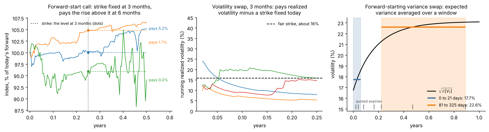

**Figure 1.** Simulated paths of the index under Heston, at the mean of its SPX posterior
(step 4), in forward units. Left: each forward-start call fixes its strike at the dot,
3 months in, and pays the rise above it at 6 months. Centre: running realized volatility
over 3 months, path by path, against one fixed strike. At these parameters the variance
stays low most of the time and spikes now and then, so most paths realize less than the
strike and a few much more. Right: the expected variance over time and its average over
two windows, the strikes of two forward-starting variance swaps.

**Why they need a model.** Listed options at one maturity fix the distribution of
$`S_T`$ at that maturity: the second derivative of the call price in the strike is the
discounted density of $`S_T`$ (Breeden and Litzenberger),

```math
\frac{\partial^2 C}{\partial K^2}(K,T) = D(T)\,p_T(K).
```

They say nothing about how the distributions at different dates are joined. A forward
start depends on the joint law of $`S_{T_1}`$ and $`S_{T_2}`$, a volatility swap on the
whole path of the variance. Two models that agree on every listed price can disagree on
both. The forward-starting variance swap is a
partial exception: for a continuous path, its strike follows from the strips of listed
options at the two window ends (the construction behind the VIX index), so a model fitted
to some quotes must reproduce it there.

## 2. Calibration gives one value and hides the rest

A product without a price needs a model, and a model needs its parameters $`\theta`$. The
model values a payoff $`\Pi`$ as its expected discounted payoff,

```math
G(\theta) = D(T)\,\mathbb{E}_\theta[\Pi],
```

where the expectation is under the model's **pricing probabilities** (also called the
risk-neutral measure). Under them the index in forward units, $`X_t = S_t/F(t)`$, has no
drift, so that no trading strategy earns a riskless profit.

**The classical answer.** Calibrate by least squares, for example on implied
volatilities,

```math
\hat\theta = \arg\min_\theta \sum_{i=1}^{n} \big(\sigma^{\text{imp}}_i - \sigma^{\text{model}}_i(\theta)\big)^2 ,
```

from several starting points, and mark the product at $`G(\hat\theta)`$.

**What it hides.** The quotes pin some directions in parameter space tightly and leave
others loose, and which ones depends on which quotes there are (step 5). Some loose
directions barely move the listed prices but move a product a lot. The forward start is
the clearest case: listed prices constrain the forward smile only through the model's
dynamics. A single best fit reports none of this.

**Two classical ways to put a range on it:**
- the **delta method**: linearize the prices around $`\hat\theta`$, take the covariance
  of $`\hat\theta`$ from the curvature of the fit, and carry it to the product through
  the product's gradient. It is exact for linear problems and can mislead where the fit
  is curved or runs into the edge of the parameter range;
- **refits on subsets**: recalibrate to parts of the quotes, such as the short expiries
  only, the long ones, or the quotes near the money, and take the spread of the resulting
  product values. Step 9 does this on SPX.

The posterior of step 3 needs no linearization, and it states its assumptions.

## 3. The posterior turns one value into a distribution

To see how far the value can move, we replace the single best fit by a distribution.
Bayes' rule gives the **posterior**, the distribution of the parameters given the quotes
$`y`$:

```math
p(\theta \mid y) \;\propto\; p(y \mid \theta)\; p(\theta).
```

The **prior** $`p(\theta)`$ says which parameters are plausible before seeing data (step
4). The **likelihood** $`p(y \mid \theta)`$ says how probable the quotes are under
$`\theta`$; it comes from the error model (step 6).

**From parameters to products.** The value of product $`j`$ is a function
$`G_j(\theta)`$ of the parameters, so the posterior over $`\theta`$ induces a distribution
over the value. With draws $`\theta^{(1)}, \dots, \theta^{(S)}`$ from the posterior:

```math
G_j^{(s)} = G_j\big(\theta^{(s)}\big),\qquad s = 1, \dots, S .
```

From these $`S`$ values, with $`q_\alpha`$ their $`\alpha`$-quantile:

```math
\underbrace{\bar G_j = \frac1S \sum_{s=1}^{S} G_j^{(s)}}_{\text{mark}},\qquad
\underbrace{\mathrm{PV}_j = q_{0.10}\ \ \text{if long},\quad q_{0.90}\ \ \text{if short}}_{\text{prudent value}},\qquad
\underbrace{R_j = \big|\bar G_j - \mathrm{PV}_j\big|}_{\text{reserve}} .
```

The prudent value is taken on the side that hurts the position: the 10% quantile for a
product the bank owns, the 90% quantile for one it owes.

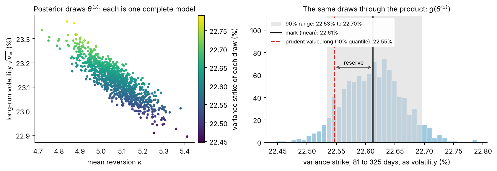

**Figure 2.** The exact SPX posterior of Heston, 1,000 draws, and what it implies for one
product. Left: the draws $`\theta^{(s)}`$ in the plane of two parameters, coloured by the
product's value under each draw; the parameters are strongly correlated (−0.87). Right:
the value under every draw, here the 81-to-325-day variance strike of step 9 as a
volatility: mark 22.61%, 90% range 22.53% to 22.70%, prudent value of a long position
22.55%.

**The book.** A desk holds positions $`\omega_j`$ in several products. Each posterior draw
is one complete, consistent set of parameters, so it prices every product at once, and
the book's value under draw $`s`$ is

```math
B^{(s)} = \sum_j \omega_j\,G_j^{(s)} .
```

The book's prudent value is the 10% quantile of $`B^{(1)}, \dots, B^{(S)}`$, and its
reserve $`R_{\text{book}}`$ the gap from their mean. The ratio
$`R_{\text{book}}/\sum_j |\omega_j|\,R_j`$ measures how much the products offset each other
under the posterior; the Regulation replaces this offset with the fixed factor
$`\alpha = 50\%`$. A book is among the next steps (step 10).

**The three ingredients.** The posterior needs a model with its prior (step 4), the
quotes (step 5), and an error model that turns the two into a likelihood (step 6).
Together they define how quotes are generated:

```math
\theta \sim p(\theta),\qquad y_i = P_i(\theta) + \text{error}_i,\quad i = 1, \dots, n ,
```

with $`P_i(\theta)`$ the model's price of quote $`i`$. This is a simulator, and step 7
learns to invert it.

## 4. The model

The first ingredient is the model.

**Heston.** In forward units, the index and its variance follow

```math
\frac{dX_t}{X_t} = \sqrt{V_t}\,dW^F_t,\qquad dV_t = \kappa\,(v_\infty - V_t)\,dt + \sigma_v\sqrt{V_t}\,dW^V_t,\qquad dW^F_t\,dW^V_t = \rho\,dt ,
```

where $`X_t = S_t/F(t)`$ is the index in forward units, $`V_t`$ its variance, and $`W^F`$
and $`W^V`$ are Brownian motions with correlation $`\rho`$:

| Parameter | Meaning | Prior (uniform) | SPX, 9 November (exact posterior mean) |
| --- | --- | --- | --- |
| $`v_0`$ | today's variance | 0.01 to 0.16 (volatility 10% to 40%) | 0.0281 (volatility 16.8%) |
| $`v_\infty`$ | long-run variance | 0.01 to 0.16 | 0.0535 (volatility 23.1%) |
| $`\kappa`$ | speed of **mean reversion** towards $`v_\infty`$ | 0.1 to 10 | 5.07 |
| $`\sigma_v`$ | **vol of vol**: how much the variance fluctuates | 0.1 to 3 | 1.80 |
| $`\rho`$ | correlation of index and variance shocks | −0.95 to −0.1 | −0.70 |

The SPX values violate the **Feller condition** $`2\kappa v_\infty \ge \sigma_v^2`$, which keeps
the variance away from zero ($`2\kappa v_\infty = 0.54`$ against $`\sigma_v^2 = 3.26`$, six
times the limit). That is allowed: the model is still well defined, and its prices are
still exact.

Four features shape every Heston smile.

*Mean reversion sets the term structure.* The variance reverts on average to
$`v_\infty`$:

```math
\mathbb{E}[V_t] = v_\infty + (v_0 - v_\infty)\,e^{-\kappa t}.
```

So $`v_0`$ sets the short expiries and $`v_\infty`$ the long ones, and a shock to the
variance halves in $`\ln 2/\kappa`$ years. Averaged over a window, $`\mathbb{E}[V_t]`$ is
the strike of a forward-starting variance swap (step 9).

*Skew and curvature.* With $`\rho \lt 0`$, volatility rises when prices fall, so puts cost
more: the skew. A larger $`\sigma_v`$ makes the variance more random and fattens both
tails: the curvature. It also steepens the skew, and breaks the Feller condition.

*A ceiling on the short-expiry skew.* Write $`k = \ln(K/F)`$ for log-moneyness and
$`\psi(T)`$ for the **at-the-money skew**, the slope of implied volatility in $`k`$ at the
money for expiry $`T`$. Over a few days the variance barely moves from $`v_0`$, and

```math
|\psi(T)| \;\to\; \frac{|\rho|\,\sigma_v}{4\sqrt{v_0}}\qquad \text{as } T \to 0 .
```

For expiries well below the reversion time $`1/\kappa`$ the skew sits at this ceiling and
grows no further. Index skews keep steepening at short expiries; step 6 shows what this
costs Heston on SPX.

*Prices in closed form.* The characteristic function of $`\ln X_T`$ is known in closed
form, and one Fourier integral turns it into an option price. The integral is written
relative to a Black–Scholes price with the same expected variance, which keeps it
accurate for deep, nearly worthless options. It is computed on a ladder of finer grids
until two consecutive grids agree within 0.01 of the quote's half-spread. All 63 prices
take milliseconds, so the posterior can also be computed directly, by MCMC (step 8).

**The next model: rough Bergomi.** The variance is the exponential of a rough Gaussian
process:

```math
V_t = \xi_0(t)\,\exp\!\Big(\eta\,Y_t - \tfrac12\,\eta^2\,t^{2H}\Big),\qquad Y_t = \sqrt{2H}\int_0^t (t-s)^{H-1/2}\,dW^V_s ,
```

and the index follows $`dX_t/X_t = \sqrt{V_t}\,dW^F_t`$ with $`dW^F_t\,dW^V_t = \rho\,dt`$.
Since $`\mathrm{Var}(Y_t) = t^{2H}`$, the correction term makes $`\mathbb{E}[V_t] = \xi_0(t)`$:
the curve $`\xi_0`$ is the expected future variance.

The **Hurst exponent** $`H`$ sets the roughness. The kernel $`(t-s)^{H-1/2}`$ blows up as
$`s \to t`$ when $`H \lt 1/2`$, so the latest shocks weigh most and paths are much
rougher than Brownian motion; estimates from realized volatility put $`H`$ near 0.1. The
at-the-money skew then grows like $`T^{H-1/2}`$ as maturity shrinks, with no ceiling:
the shape of index smiles at short maturities, where Heston falls short (Figure 6,
step 6).

The curve has the same shape as Heston's expected variance:

```math
\xi_0(t) = \xi_l + (\xi_s - \xi_l)\,e^{-\lambda t},
```

with a short-term level $`\xi_s`$, a long-term level $`\xi_l`$ and a speed $`\lambda`$.
So both models describe the variance level in the same way.

**Priors,** uniform: $`H`$ from 0.02 to 0.35, $`\eta`$ from 0.5 to 3.5, $`\rho`$ from −0.99
to −0.2, $`\xi_s`$ and $`\xi_l`$ from 0.01 to 0.16, $`\lambda`$ from 0.25 to 8 per year.

*Pricing.* There is no formula, only Monte Carlo simulation, on a time grid built for
each expiry. Given a path of $`W^V`$, $`\ln X_T`$ is Gaussian, so each path contributes a
Black–Scholes price; paired ("antithetic") paths and control variates reduce the noise
further. Paths are added, up to about 2 million, until the Monte Carlo standard error
falls below a fixed target (about 0.0001 in forward-unit price). Pricing the 63 quotes
once costs 1–2 CPU-minutes, so its simulations, which step 7 describes, are the expensive
part. They are being generated; its network and checks follow the steps below.

## 5. Which quotes

The second ingredient is the data the posterior conditions on.

**Data.** The Cboe chain of SPX options on 9 November 2026, read at 15:13 New York time.
The raw file stays outside Git, identified by its SHA-256 hash.

**Coordinates.** Strikes are placed by **standardized moneyness**,

```math
\delta = \frac{\ln(K/F)}{\sigma_{\text{ref}}\,\sqrt{T}},\qquad \sigma_{\text{ref}} = 0.16 ,
```

the distance of the strike from the forward in units of $`\sigma_{\text{ref}}\sqrt{T}`$,
the standard deviation the log index would have at expiry under a 16% volatility. (That
day, SPX's at-the-money implied volatilities ran from 15.2% at 7 days to 17.1% at 325
days.) $`\delta`$ only places and labels strikes: prices use each contract's actual
strike, forward and expiry. Time $`T`$ is exact calendar time to the expiry's 16:00
close, in years of 365 days.

**The design.** For each of seven expiries chosen near 1 and 2 weeks and 1, 2, 3, 6 and
12 months, take the actual quote nearest to each of nine targets: $`\delta`$ = −5, −3.5,
−2.25, −1.25, −0.5 and 0 (puts), +0.5, +1 and +2 (calls). Quotes must be distinct, have
a positive bid below the ask and a half-spread at most 25% of the mid, and stay apart from
the parity pairs used for the forwards.

| Expiry | Days | Quotes | Note |
| --- | ---: | ---: | --- |
| 16 Nov 2026 | 7 | 9 | |
| 23 Nov 2026 | 14 | 9 | |
| 9 Dec 2026 | 30 | 9 | |
| 8 Jan 2027 | 60 | 9 | |
| 29 Jan 2027 | 81 | 9 | |
| 30 Apr 2027 | 172 | 9 | |
| 30 Sep 2027 | 325 | 9 | latest expiry settled on the close; last call at $`\delta = +1.5`$, the furthest available |

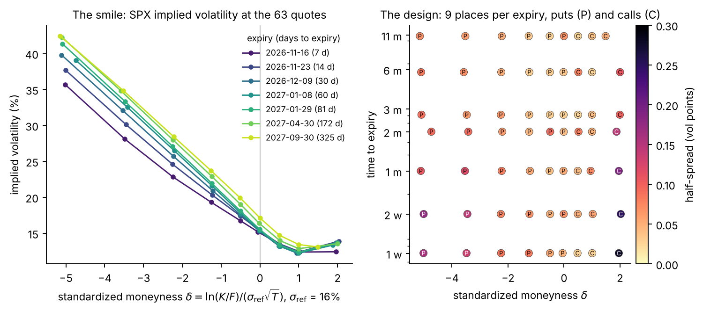

**Figure 3.** Left: the smile at the 63 quotes, one line per expiry. Deep puts trade at up to
42% volatility, calls near 13%. Right: the design in $`(\delta, T)`$, with each quote's
half-spread in vol points as colour. Half-spreads have a median of 0.064 vol points and
range from 0.025 to 0.28; the widest are far calls at short maturities.

On the scale of $`\delta`$ the seven smiles are nearly parallel: from the money to the
deepest put, implied volatility rises 20.5 vol points at 7 days and 25.3 at 325 days. The
skew per unit of $`\delta`$ is about the same at one week as at eleven months, and that is
the feature the model must reproduce.

Using actual quotes, rather than points interpolated on a grid, adds no reading error.
Because the design is fixed, one trained network serves this snapshot. Every new design
needs its own simulations and its own network.

**What each region pins.** A local calculation shows how much each region of quotes
contributes. Let $`\mathcal{J} = \partial P/\partial\theta`$ be the sensitivities of the
63 prices to the five Heston parameters, at the mean of the SPX posterior. With errors of
one half-spread, the information the quotes carry and the posterior covariance it implies
are

```math
\mathcal{I} = \mathcal{J}^\top\,\mathrm{diag}(1/h^2)\,\mathcal{J},\qquad \mathrm{Cov}(\theta \mid y) \approx \mathcal{I}^{-1} .
```

Removing the rows of one region from $`\mathcal{J}`$ gives the covariance without that
region. The figure shows by how much each standard deviation then rises:

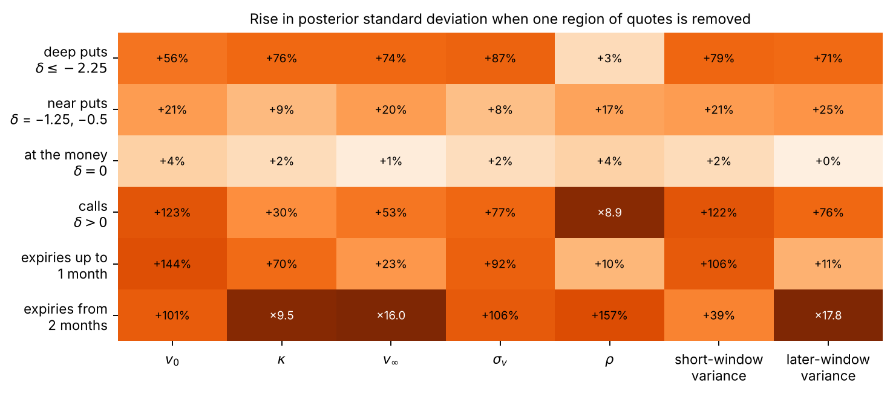

**Figure 4.** Rise in the posterior standard deviation of each parameter, and of two
forward-starting variances (step 9), when one region of the 63 quotes is removed. Local
calculation from the curvature of the likelihood at Heston's SPX posterior mean.

- The calls pin $`\rho`$: without them its uncertainty grows 8.9 times.
- The expiries beyond 2 months pin the long-run level: without them $`v_\infty`$ and the
  later-window variance become 16 and 18 times less certain, and $`\kappa`$ 9.5 times.
- The expiries up to a month pin today's variance and the short-window variance.
- The deep puts matter for every parameter except $`\rho`$, by 56% to 87%.
- The at-the-money point adds little once its neighbours are there.

So a design must reach deep puts and far calls, at short and long maturities. Covering
these regions matters more than adding points inside them.

## 6. How quotes differ from the model

The third ingredient links the first two: it is the likelihood.

**Observation equation.** For the $`n = 63`$ quotes,

```math
y_i = P_i(\theta) + c\,h_i\,\epsilon_i,\qquad \epsilon_i \sim \mathcal N(0, 1)\ \text{independent},\qquad c \sim U(0.5,\ 2) .
```

The three factors of the error term play different roles:
- $`h_i`$ is **data**: the quote's half-spread, known and fixed. The price at which a
  trade would happen lies between bid and ask, so the half-spread is the natural scale of
  a quote's uncertainty; reading it as one standard deviation is a convention.
- $`\epsilon_i`$ is the **random error**, a fresh standard normal draw for every quote.
- $`c`$ is an **unknown**: one multiplier for all quotes, inferred with the model's
  parameters. The data say how large the errors are.

The equation has a single source of error, quote noise. It assumes that the model, at the
right parameters, prices every contract exactly.

**Likelihood.** Each $`y_i`$ is normal with mean $`P_i(\theta)`$ and standard deviation
$`c\,h_i`$. With the scaled residuals $`r_i(\theta) = (y_i - P_i(\theta))/h_i`$, the
model's misses in half-spreads,

```math
\log p(y \mid \theta) = -\frac{1}{2c^2}\sum_{i=1}^{n} r_i(\theta)^2 - n\ln c - \sum_{i=1}^{n} \ln h_i - \frac n2 \ln 2\pi .
```

The term $`-n\ln c`$ matters: it stops $`c`$ from growing to explain everything. At fixed
model parameters the best $`c`$ is the root mean square of the scaled residuals,
$`\hat c = \sqrt{\frac1n\sum_i r_i(\theta)^2}`$.

**How precisely the multiplier can be known.** At the true parameters $`r_i = c\,\epsilon_i`$,
so $`\hat c`$ estimates $`c`$ from the size of the errors. The five Heston parameters
absorb about 5 of the 63 directions in which the quotes can move; the other 58 carry only
error. So $`c`$ is estimated from about 58 independent pieces of evidence, to a relative
precision of about $`1/\sqrt{2 \times 58} \approx 9\%`$: a 90% interval about 0.3 times
$`c`$ wide. The data determine $`c`$ well, provided the estimator can read them (step 7).

**The fixed-scale case.** With $`c`$ known and equal to 1, the posterior is "Heston with
quote errors of one half-spread". Fixing $`c`$ at 0.5 or 2 instead halves or doubles the
widths of the Heston parameters' posteriors. The error model sets the width of every
range that follows.

**What the SPX quotes say.** On the market, the exact posterior puts $`c`$ at its upper
bound: a median of 1.9995 out of a maximum of 2. Figure 5 shows why. It compares the quotes with the
model at the mean $`\bar\theta`$ of the exact posterior, through the misses in vol points,
$`e_i = \sigma^{\text{imp}}_i - \sigma^{\text{model}}_i(\bar\theta)`$.

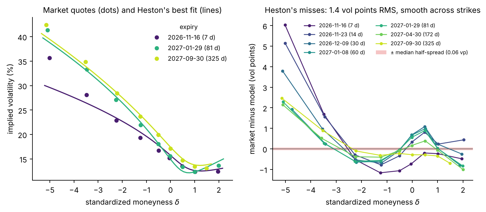

**Figure 5.** Left: market quotes (dots) and Heston at its exact posterior mean (lines), for
three expiries. At 7 days the model cannot produce the steep skew of deep puts. Right:
the misses $`e_i`$ in vol points, for all seven expiries. The red band, ± one median
half-spread, is barely visible.

- The root mean square of the misses $`e_i`$ is 1.38 vol points, and the largest is 6.0,
  at the deepest 7-day put. The median half-spread is 0.064 vol points.
- In half-spreads, the root mean square of the scaled residuals $`r_i(\bar\theta)`$ is
  13.4; the error model allows about $`c \le 2`$.
- The misses are smooth: neighbouring strikes of one expiry miss by similar amounts
  (correlation 0.66), and so do adjacent expiries (0.94).

**Four signs that the model is wrong.** All four come from the exact posterior; the
network plays no part in them.
- $`c`$ sits at its bound of 2.
- The fit misses at every expiry: per expiry, the root mean square of the scaled
  residuals is 10.7 to 17.0 half-spreads.
- The misses are systematic: the deepest put is priced too low at every expiry, by 1.9 to
  6.0 vol points, and the 14 puts with $`\delta \lt -3`$ give 42% of the squared misfit.
- The fit needs extreme parameters: $`\sigma_v^2 = 3.26`$ against
  $`2\kappa v_\infty = 0.54`$, six times past the Feller limit.

The multiplier $`c`$ scales every error by the same factor, so it cannot improve the fit,
only measure it: at the posterior mean, the likelihood of $`c`$ peaks at
$`\hat c = 13.4`$, far beyond the prior's bound.

**Which feature is missing.** Measure each smile's skew $`\psi(T)`$ and curvature at the
money from a quadratic in $`k`$ through the five quotes nearest the money (Figure 6).

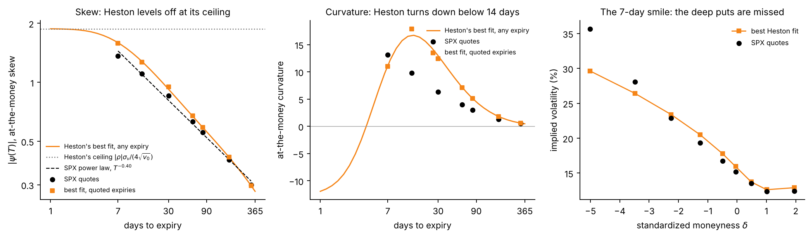

**Figure 6.** Heston's best fit against the SPX quotes at short expiries. Left: the
at-the-money skew, with Heston's skew at any expiry, its ceiling
$`|\rho|\,\sigma_v/(4\sqrt{v_0})`$ and a power law fitted to the SPX skews. Centre: the
at-the-money curvature. Right: the 7-day smile.

- *Skew.* The SPX skew follows a power law, $`|\psi(T)| \propto T^{-0.40}`$, and keeps
  growing as the expiry shrinks. Over the quoted expiries the fit follows it within 16%,
  but its 7-day skew is already 85% of Heston's ceiling of 1.88, so shorter expiries could
  add at most 15%.
- *Curvature.* The SPX smile gets more curved as the expiry shrinks: 6.3, 9.8 and 13.1 at
  30, 14 and 7 days. The fit's curvature peaks at 14 days and falls below it, to 11.0 at
  7 days.
- *The 7-day smile.* Near the money the fit is within 1.2 vol points; at the deepest put it
  is 6.0 too low. With one diffusive variance factor, Heston cannot put that much crash
  risk into one week without breaking the rest of the smile.

So what Heston lacks is a short-expiry smile that keeps steepening.

**What it means.** On SPX the model, not the quotes, is the main source of error. The
posterior is then the uncertainty of Heston's parameters given that Heston is the model,
with an error scale capped at twice the half-spread: it does not include the model's own
error, and its ranges are narrower than the misfit warrants. Widening the prior on $`c`$
would not fix this, because independent errors would count the 63 smooth misses as 63
independent pieces of evidence, when they are a few smooth bumps. The natural extension is
a smooth **model-error** term,

```math
y_i = P_i(\theta) + c\,h_i\,\epsilon_i + \tau\,\nu_i\,U_i ,
```

with $`U = (U_1, \dots, U_n)`$ a smooth random curve across strikes and maturities
(jointly normal, with correlation close to 1 between neighbouring quotes), $`\nu_i`$ the
quote's vega and $`\tau`$ the model error's size in vol points, inferred with the rest.
[Layer 3](3-full-detail.md) gives its form and shows that the 63 quotes determine
$`\tau`$ to about 10–15%. Such a term lets the posterior admit the misfit instead of
pushing $`c`$ against its bound. The misfit itself stays: removing it needs a different
model, such as rough Bergomi.

## 7. Computing the posterior: simulation-based inference

With the three ingredients the posterior is defined,

```math
p(\theta \mid y) \;\propto\; p(\theta)\,p(y \mid \theta) ,
```

and computing it is the next problem. This step has six parts: what one posterior costs
when computed directly; how many posteriors the work needs; how the cost can be paid once,
on simulated data; the two ways a network can use such data; what the network that does
the work here takes in and returns; and how its input must be prepared.

**What one posterior costs when computed directly.** To evaluate the likelihood
$`p(y \mid \theta)`$ of step 6 at one $`\theta`$, the only thing to compute is the 63
model prices $`P(\theta)`$. Call that one **pricing**:
- Heston: 63 Fourier integrals, 3 to 11 ms;
- rough Bergomi: a Monte Carlo simulation, 1 to 2 CPU-minutes.

There is no formula for the posterior. The standard method, **MCMC** (Markov chain Monte
Carlo), draws from it by proposing values of $`\theta`$ one after another and evaluating
the likelihood at each. So

```math
\text{cost of one posterior} = (\text{number of likelihood evaluations}) \times (\text{cost of one pricing}) .
```

For Heston, MCMC used about 180,000 evaluations per posterior, counting a short run that
failed its convergence checks and the longer run that passed: 17 to 32 minutes on one
processor core. The same number for rough Bergomi would take 125 to 220 CPU-days.

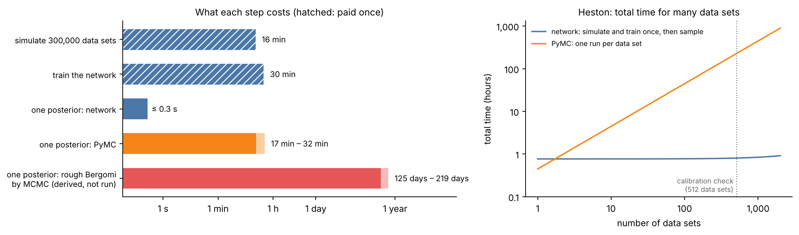

**Figure 7.** Left: the cost of each step, on a logarithmic scale. The Heston times are
measured; the rough Bergomi time follows from the number of evaluations and the measured
cost of one pricing. Right: the total time for many sets of quotes. Simulation and
training are paid once, 46 minutes in all; MCMC is paid again for every set.

**How many posteriors the work needs.**

| Purpose | Posteriors |
| --- | --- |
| Each model's posterior on the market quotes (step 9) | 1 per model and day |
| Checking that 90% ranges contain the truth 90% of the time (step 8): this needs cases where the truth is known, so simulated surfaces, each with its own posterior | 512 per model |
| Comparison with exact posteriors (step 8) | 3 per model |
| Daily use | 1 per model, day and underlying |

By MCMC, the 512 posteriors of the check would cost about 230 hours for Heston, at the
27 minutes of an average run, and 175 to 310 CPU-years for rough Bergomi. The check, not
the market posterior, is what makes the direct route unaffordable.

**The idea: do the pricings once, on simulated parameters.** Simulate $`N`$ = 300,000
pairs, the **bank**:

```math
\theta^{(n)} \sim p(\theta),\qquad y^{(n)} = P\big(\theta^{(n)}\big) + c^{(n)}\,h \odot \epsilon^{(n)},\qquad n = 1, \dots, N ,
```

with $`\odot`$ the elementwise product and $`\epsilon^{(n)}`$ a vector of 63
independent standard normals. This costs 300,000 pricings, fewer than two posteriors by
MCMC. A pair made this way is a draw from the joint density, which factors both ways:

```math
p(\theta)\,p(y \mid \theta) = p(y)\,p(\theta \mid y) .
```

Read from the right: among all simulated pairs whose quotes equal a given $`y`$, the
parameters are distributed as the posterior $`p(\theta \mid y)`$. The bank is a table of
examples of "quotes, and a draw from their posterior". A neural network with weights
$`\phi`$ learns from all the pairs how the distribution of $`\theta`$ changes with $`y`$,
and returns an approximation $`q_\phi(\theta \mid y)`$ of the posterior for any $`y`$.
After training, a posterior takes under 0.3 s and no pricing. The cost of inference is
paid once, in the bank and the training: it is **amortized**.

- Heston: the bank took 16 minutes and the training 30 minutes, on the processor of a
  laptop.
- Rough Bergomi: its bank of 300,000 rows has been running on Brown's Oscar cluster since
  11 November, on up to 192 processor cores (47 to 59 hours if they stay busy). Rows that
  ran out of time are recomputed separately. Validation and test rows (5,000 and 7,000)
  follow.

**Two ways to use the simulations.** A network can learn either of two maps from
simulated data. A **neural pricer** learns the prices,
$`\widehat P_\psi(\vartheta) \approx P(\vartheta)`$ for the five pricing parameters
$`\vartheta = (v_0, \kappa, v_\infty, \sigma_v, \rho)`$, and replaces the pricer in the
likelihood of step 6:

```math
\log \widehat p(y \mid \vartheta, c) = -\frac12 \sum_{i=1}^{63} \Big[\Big(\frac{y_i - \widehat P_{\psi,i}(\vartheta)}{c\,h_i}\Big)^2 + 2\ln(c\,h_i)\Big] + \text{constant} .
```

MCMC then samples this likelihood with the same prior, once for every set of quotes, and
two things must be checked: the pricer's errors against the quote noise, and each run's
convergence. An **amortized estimator**, the route taken here, learns the posterior itself
from noisy simulated quotes, so a new set of quotes needs no MCMC; it is checked by the
calibration of its posteriors across simulated sets and against exact posteriors
(step 8). For Heston, Fourier pricing is fast, and the exact reference uses the pricer
directly. A neural pricer pays off where pricing is expensive, as for rough Bergomi.

**What the network takes in and what it returns.**

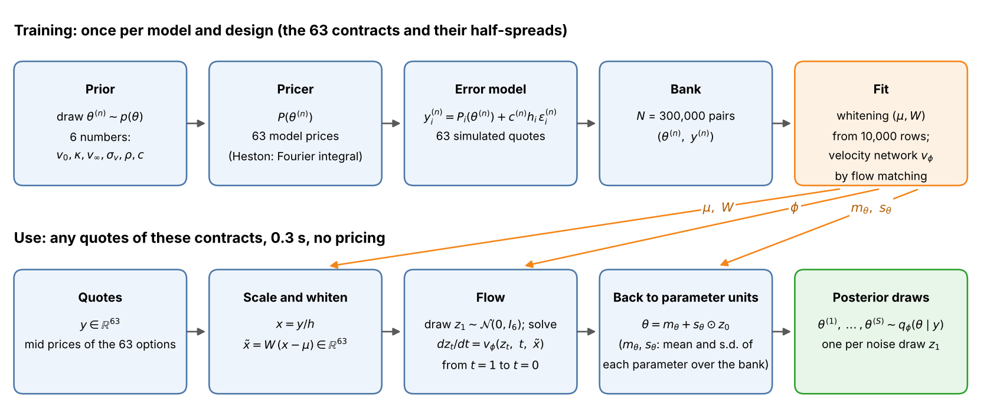

**Figure 8.** Top: training, done once. Bottom: use, for any quotes of the 63 contracts.

| Object | Symbol | Size |
| --- | --- | ---: |
| Quotes | $`y`$ | 63 |
| Scaled quotes: each quote divided by its half-spread | $`x = y/h`$ | 63 |
| Whitened quotes: the network's input (below) | $`\tilde x = W(x - \mu)`$ | 63 |
| Unknowns | $`\theta = (v_0, \kappa, v_\infty, \sigma_v, \rho, c)`$ | 6 |
| Standardized unknowns: each minus its mean, divided by its standard deviation over the bank | $`\tilde\theta = (\theta - m_\theta)/s_\theta`$ | 6 |
| Noise, drawn afresh for every posterior draw | $`z_1 \sim \mathcal N(0, I_6)`$ | 6 |
| Velocity network, the only trained function: three hidden layers of 128 units | $`v_\phi(z_t, t, \tilde x)`$ | 70 in, 6 out |
| Posterior draws: the output | $`\theta^{(1)}, \dots, \theta^{(S)}`$ | $`S`$ × 6 |

To produce one posterior draw for quotes $`y`$: compute $`\tilde x`$; draw noise $`z_1`$;
move it from time $`t = 1`$ to $`t = 0`$ along the velocity field,

```math
\frac{dz_t}{dt} = v_\phi(z_t,\ t,\ \tilde x) ;
```

and return $`\theta = m_\theta + s_\theta \odot z_0`$. The distribution of the draws so
produced is $`q_\phi(\theta \mid y)`$. The multiplier $`c`$ is an output, never an input,
and the strikes and expiries are not inputs either: they are the same for every surface.

**How the network is trained: flow matching.** Take a bank row
$`(\tilde\theta^{(n)}, \tilde x^{(n)})`$, an independent noise vector $`z_1`$ and a time
$`t`$ between 0 and 1. The point

```math
z_t = (1 - t)\,\tilde\theta^{(n)} + t\,z_1
```

lies on the straight line from the row's parameters (at $`t = 0`$) to the noise (at
$`t = 1`$), and moves along it with velocity $`z_1 - \tilde\theta^{(n)}`$. The network is
trained to predict that velocity from the point, the time and the row's quotes:

```math
\mathcal{L}(\phi) = \mathbb{E}\Big[\big\| v_\phi\big(z_t,\ t,\ \tilde x^{(n)}\big) - \big(z_1 - \tilde\theta^{(n)}\big) \big\|^2\Big] .
```

Many lines cross at the same point and time, so the network cannot follow each one;
least squares makes it learn their average velocity, among the rows with the same quotes.
Moving points along this averaged velocity carries the whole noise distribution at
$`t = 1`$ onto the distribution of the parameters of those rows at $`t = 0`$, which is the
posterior ([Layer 3](3-full-detail.md), 7.5, gives the derivation). No likelihood is ever
evaluated.

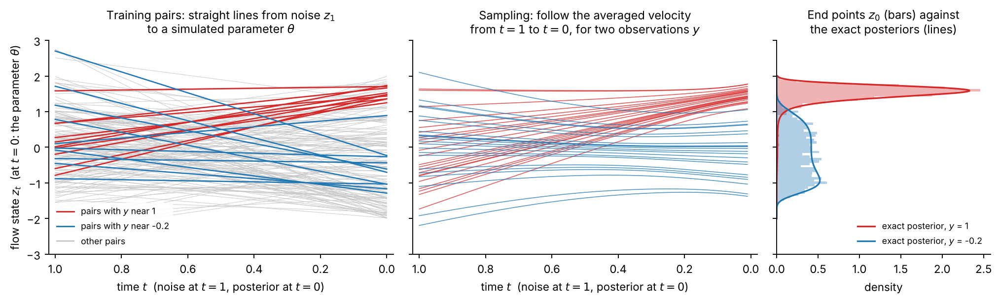

**Figure 9.** A toy model with one parameter, $`\theta \sim U(-2, 2)`$ and
$`y = \theta^3/4 + 0.3\,\epsilon`$, where the averaged velocity can be computed
exactly. Left: training pairs, one straight line each, from noise (at $`t = 1`$) to a
simulated parameter (at $`t = 0`$); red and blue mark the pairs whose simulated $`y`$ is
near 1 or near −0.2. Centre: points started from the same noise follow the averaged
velocity for $`y = 1`$ (red) or $`y = -0.2`$ (blue). Right: where they end, against the
two exact posteriors. The observation enters only as an input of the velocity, and that is
enough to send the same noise to two different posteriors.

**Preparing the input: whitening.** Write $`s(\theta) = P(\theta)/h`$ for the model prices
in half-spreads. The scaled quotes are

```math
x = s(\theta) + c\,\epsilon .
```

Across the bank, the first term moves all 63 quotes together by hundreds to thousands of
half-spreads, along a few directions; the second moves each quote independently by $`c`$
half-spreads. The information about $`c`$ is the size of $`x`$ in the directions that the
parameters do not move, and those directions are tiny next to the others (Figure 10). A
network fed $`x`$ directly does not find them. **Whitening** makes every direction the
same size. From the first $`N_w`$ = 10,000 rows of the bank, compute the mean $`\mu`$ and
covariance $`\Sigma`$ of $`x`$, and the eigenvalues $`\lambda_k`$ and eigenvectors
$`u_k`$ (the columns of $`U`$) of $`\Sigma`$:

```math
\mu = \frac{1}{N_w}\sum_{n=1}^{N_w} x^{(n)},\qquad
\Sigma = \frac{1}{N_w - 1}\sum_{n=1}^{N_w} \big(x^{(n)} - \mu\big)\big(x^{(n)} - \mu\big)^\top = U\,\mathrm{diag}(\lambda_1, \dots, \lambda_{63})\,U^\top .
```

The whitened input is

```math
\tilde x = W\,(x - \mu),\qquad W = U\,\mathrm{diag}\big(\lambda_1^{-1/2}, \dots, \lambda_{63}^{-1/2}\big)\,U^\top,\qquad \mathrm{Cov}(\tilde x) = I_{63} :
```

rotate onto the directions $`u_k`$, divide each coordinate by its standard deviation
$`\sqrt{\lambda_k}`$, rotate back. $`W`$ is invertible, so no information is lost and the
exact posterior is unchanged; only the network's task becomes easier.

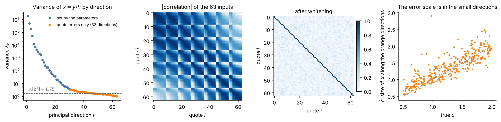

**Figure 10.** From the 1,000 sets of quotes the notebook simulates from the prior;
$`\mu`$ and the directions are fitted on 700 of them and shown on the other 300. First
panel: the variances $`\lambda_k`$ range from $`1.9 \times 10^6`$ to 1.0; 33 of the 63
directions (orange) are at the level of the quote errors, $`\mathbb{E}[c^2] = 1.75`$. Second
and third panels: correlations between the 63 inputs before and after whitening. Last
panel: the root-mean-square size $`\hat c`$ of $`x - \mu`$ along the 33 orange directions,
against the true $`c`$: the error scale can be read there (correlation 0.84).

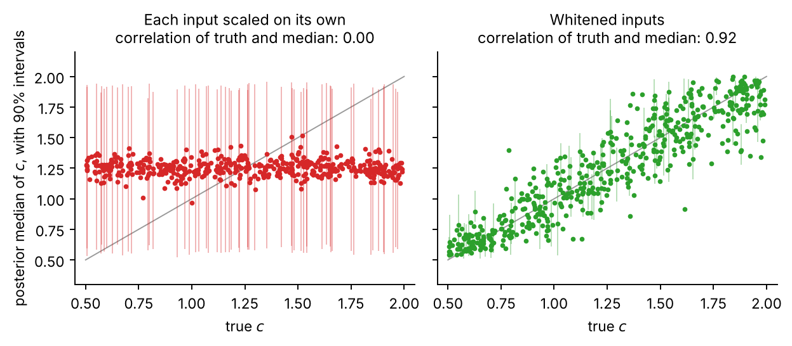

**Figure 11.** A controlled comparison: same simulated data (a 54-quote design), same
network, same initial weights; only the input scaling differs. Left: each input scaled on
its own; the network returns the prior of $`c`$ whatever the data (correlation of the true
$`c`$ with its posterior median 0.00). Right: whitened inputs (0.92).

Rules: fit $`\mu`$ and $`W`$ on training rows only; store them with the network and apply
the same transform at training and at use, the market included; fit a new one for every
new design or model.

**The training run.** 300 passes over the 300,000 rows in batches of 256 (351,600
updates), with the AdamW optimizer; the learning rate rises from $`5 \times 10^{-5}`$ to
$`5 \times 10^{-4}`$ over the first 5% of the updates and then decays to zero along a
cosine. Each row keeps one error draw $`\epsilon^{(n)}`$ for the whole run. The targets
$`\tilde\theta`$ are not forced to stay inside the prior ranges; draws that fall outside
are kept and counted (step 8). Rough Bergomi uses the same recipe, with seven unknowns and
its own $`\mu`$ and $`W`$.

In BayesFlow the estimator has three parts: an adapter that names the parameters and the
whitened quotes, a `FlowMatching` inference network with three layers of 128 units and
dropout 0.1, and a `BasicWorkflow` that standardizes the parameters and trains with
`fit_offline` on the stored pairs. There is no summary network: the 63 numbers enter
directly. The notebook also lets a reader train a small network in about a minute, on
3,000 simulated sets for 40 passes, check it on 100 new ones, and compare the width of
its posteriors with those of the network trained on 300,000.

## 8. Checking it

The network's $`q_\phi(\theta \mid y)`$ is an approximation, and the model behind it is an
assumption. Five checks test them, in the order of the notebook:

| Check | Question | What to look for |
| --- | --- | --- |
| Posterior predictive | Can the inferred parameters regenerate the quotes? | observed quotes inside the replicated range |
| Calibration | Does a 90% interval contain the truth 90% of the time? | coverage near nominal, uniform ranks |
| Recovery | Does the posterior median find the true parameters? | medians on the diagonal, short intervals |
| Exact posterior | Does the network reproduce the posterior of one set of quotes? | agreement with the reference |
| The model on the market | Can Heston describe the market at all? | misses within the assumed errors |

Calibration, recovery and the comparison test the network on quotes the model itself
generates, where the model is right by construction. The first and last test the model.

**The exact posteriors.** MCMC on $`p(\theta)\,p(y \mid \theta)`$ with PyMC's
DEMetropolisZ sampler, which needs no gradients: the likelihood calls the Fourier pricer
as a black box. Four chains start from fits to the data alone and from dispersed points,
never from the truth or the network. A short run of 2,000 tuning steps and 2,000 draws
per chain comes first; it failed the checks in all three cases, so a run of 6,000 and
12,000 followed. A run is accepted when the chains agree ($`\hat R \le 1.01`$) and give at
least 400 effective draws, in the bulk and in the tails, for every component. Three
cases:
- simulated quotes with market-like parameters, within 15% of the SPX posterior medians,
  and $`c = 1`$;
- simulated quotes of a stressed market, a high-volatility draw from the prior
  (volatility starts at 37% and reverts towards 29%), and $`c = 1`$;
- the SPX quotes.

All three pass, with $`\hat R`$ at most 1.003 and at least 1,958 effective draws, after
about 180,000 likelihood evaluations and 17 to 32 minutes each.

**1. Posterior predictive check.** Draw $`\theta^{(m)}`$ from the posterior, price the 63
contracts and add fresh errors with each draw's own $`c`$:

```math
\tilde y^{(m)}_i = P_i\big(\theta^{(m)}\big) + c^{(m)}\,h_i\,\epsilon^{(m)}_i .
```

If the model and the posterior are right, the observed quotes look like one more
replicated set $`\tilde y^{(m)}`$.

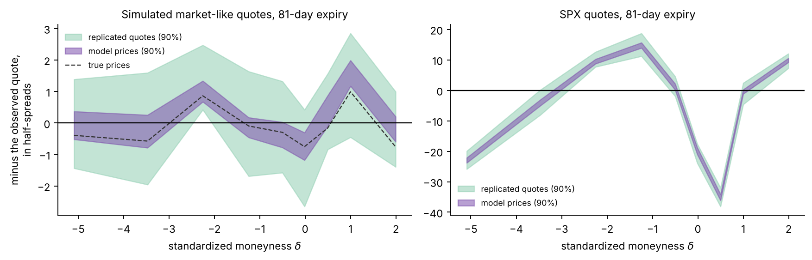

**Figure 12.** The posterior predictive check at the 81-day expiry, from 40 draws of the
exact posterior, in half-spreads: model prices minus the observed quotes (purple) and
replicated quotes minus the observed quotes (green). Left: simulated market-like quotes;
the replicated band covers zero, and the model prices follow the true prices (dashed)
more closely than any single quote measures them. Right: the SPX quotes, missed by up to
35 half-spreads.

On the simulated sets the quotes look like a replicated set: at 81 days the posterior-mean
prices miss them by 0.7 and 1.1 half-spreads, root mean square, in line with
$`c \approx 1`$. On the SPX quotes they do not: 17 half-spreads at 81 days, and 13.4 over
all 63 quotes, where the error model allows at most 2.

**2. Calibration on simulated quotes.** $`M`$ = 512 surfaces simulated from the prior,
each with its known parameters $`\theta^\ast_m`$, and $`L`$ = 512 network draws
$`\theta^{(m,l)}`$ for each. For component $`j`$ of $`\theta`$:
- **coverage** at level $`\alpha`$ is the share of surfaces whose truth lies in the
  central interval $`I^\alpha_{m,j}`$ of the draws; it should equal $`\alpha`$;
- the **rank** of the truth is the share of the draws below it; if $`q_\phi`$ is the
  posterior, the truth is one more draw from it, and the ranks are uniform between 0 and
  1 across surfaces.

```math
\widehat{\mathrm{cov}}_j(\alpha) = \frac1M \sum_{m=1}^{M} \mathbf{1}\big\{\theta^{\ast}_{m,j} \in I^{\alpha}_{m,j}\big\},\qquad
u_{m,j} = \frac1L \sum_{l=1}^{L} \mathbf{1}\big\{\theta^{(m,l)}_j \lt \theta^{\ast}_{m,j}\big\} .
```

The rank plot shows, for each component, the share of ranks below each level $`z`$ minus
$`z`$ itself. A calibrated network keeps all six curves inside a band built so that this
happens with probability 95% (Säilynoja, Bürkner and Vehtari, 2022).

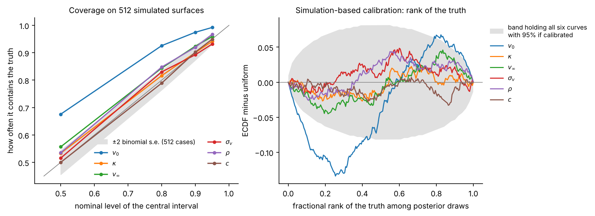

**Figure 13.** Left: $`\widehat{\mathrm{cov}}_j(\alpha)`$ against $`\alpha`$; a calibrated
posterior lies on the diagonal, within the grey band. Right: the share of ranks below each
level minus the level; a calibrated posterior keeps all six curves inside the grey band.

| | $`v_0`$ | $`\kappa`$ | $`v_\infty`$ | $`\sigma_v`$ | $`\rho`$ | $`c`$ |
| --- | ---: | ---: | ---: | ---: | ---: | ---: |
| $`\widehat{\mathrm{cov}}_j(0.9)`$ | 97.5% | 90.0% | 92.4% | 89.3% | 92.0% | 90.2% |
| Rank plot | leaves the band | inside | inside | inside | inside | inside |

Five of the six components are calibrated. The intervals for $`v_0`$ are about 1.4 times
as wide as they should be: the truth falls near their centre too often, so the network is
cautious there, not overconfident. About 3% of the draws fall slightly outside the prior
ranges, most often for $`c`$ and $`\rho`$; they are kept, not clipped.

**3. Recovery.** On the same 512 surfaces: the correlation between the posterior median
and the truth, and the average width of the 90% interval as a share of the prior range.

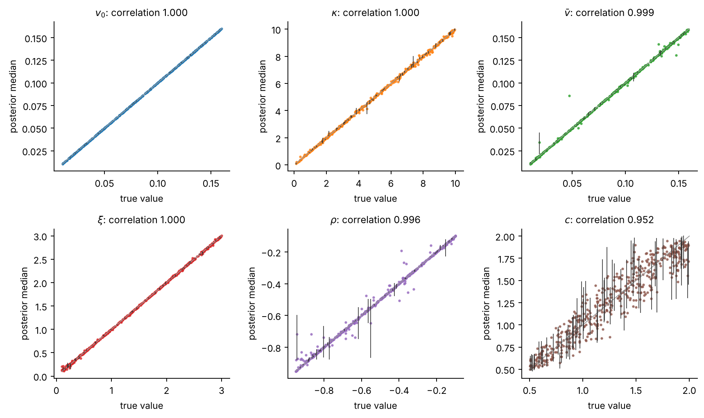

**Figure 14.** True value against posterior median for each component, with 90% intervals
on 60 surfaces.

| | $`v_0`$ | $`\kappa`$ | $`v_\infty`$ | $`\sigma_v`$ | $`\rho`$ | $`c`$ |
| --- | ---: | ---: | ---: | ---: | ---: | ---: |
| Correlation of median and truth | 0.99999 | 0.9997 | 0.9987 | 0.9999 | 0.996 | 0.95 |
| Average 90% interval, share of the prior range | 0.35% | 2.0% | 1.3% | 1.2% | 3.4% | 28% |

The five Heston parameters are recovered almost exactly. The multiplier $`c`$, read from
the errors alone, has wider intervals: 28% of its prior range on average.

**4. Comparison with the exact posterior.** For each case and component, two numbers: the
**centre gap**, the difference of the means in reference standard deviations, and the
**width ratio** of the 90% intervals,

```math
\mathrm{ME}_j = \frac{\big|\,\mathbb{E}_{q_\phi}[\theta_j \mid y] - \mathbb{E}_{p}[\theta_j \mid y]\,\big|}{\mathrm{sd}_{p}(\theta_j \mid y)},\qquad
\mathrm{WR}_j = \frac{q^{0.95}_{\phi, j} - q^{0.05}_{\phi, j}}{q^{0.95}_{p, j} - q^{0.05}_{p, j}} ,
```

with $`q^{\alpha}_{\phi, j}`$ and $`q^{\alpha}_{p, j}`$ the $`\alpha`$-quantiles of
$`\theta_j`$ under the network and under the reference $`p`$. Exact agreement is
$`\mathrm{ME}_j = 0`$ and $`\mathrm{WR}_j = 1`$; we count $`\mathrm{ME}_j \lt 0.3`$ with
$`0.75 \le \mathrm{WR}_j \le 1.25`$ as agreement.

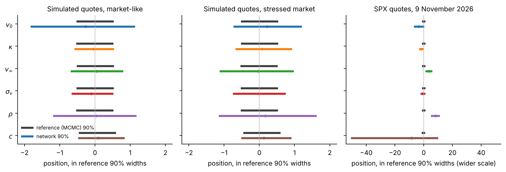

**Figure 15.** For each case and component, the 90% interval of the reference (grey) and of
the network (colour), centred on the reference median and measured in reference widths.

- On the two simulated sets, $`\mathrm{ME}_j`$ is at most 0.97 (median 0.31) and
  $`\mathrm{WR}_j`$ runs from 1.07 to 2.9, largest for $`v_0`$ and $`\rho`$. One of the
  12 parameter posteriors meets both criteria, and none is narrower than the reference:
  the network is centred close to the exact posterior and wider than it.
- On the SPX quotes the network is far from the reference: 21% of its draws have
  $`c \gt 2`$, and $`\mathrm{ME}_j`$ runs from 1.8 to 27 for the Heston parameters.
  Market results therefore use the reference posterior.

A calibrated posterior can still be too wide: a posterior equal to the prior would be
perfectly calibrated and useless. Only an exact reference shows how much sharpness is
lost, and calibration averages over many sets while a reference checks one. Both are
needed.

**5. The model on the market.**

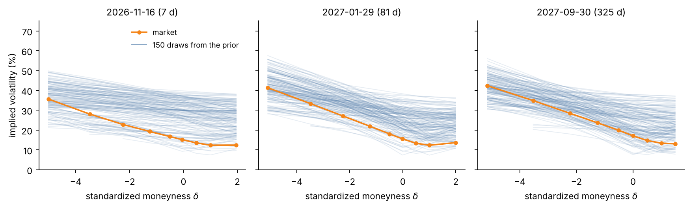

**Figure 16.** Implied volatilities of 150 sets of quotes drawn from the prior (blue) and of
the market (orange) at three expiries.

- *Could the generative model have produced the market?* Quote by quote, yes: among the
  1,000 sets of quotes simulated from the prior, each market quote lies between the 6th
  and the 56th percentile of its simulated values (Figure 16).
- *Does the fitted model reproduce all the quotes within the assumed errors?* No. The
  scaled residuals $`r_i`$ should have a root mean square of about $`c`$, at most 2; at
  the mean of the exact posterior it is 13.4, with the systematic pattern of step 6.
- *Why the network and the reference disagree on the market.* The network was trained on
  surfaces within $`c \le 2`$ half-spreads of a Heston surface. The market quotes are
  13.4 half-spreads from the nearest one, an input unlike any in the bank, and a learned
  function is reliable only on inputs that resemble its training data. The disagreement
  is a symptom of the model's misfit, not a failure of training: an amortized estimator
  should be trusted only on data its simulator could have produced.

## 9. From the posterior to the products

With a checked posterior, the products can be priced.

**Principle.** For each posterior draw $`\theta^{(s)}`$, compute each product's value
$`G_j^{(s)} = G_j(\theta^{(s)})`$. Where this needs simulation, all draws share the same
random numbers (**common random numbers**), so the spread across draws reflects the
parameters, not simulation noise. $`c`$ does not enter $`G_j`$: it describes how quotes
are observed, not how the index moves.

**Forward-starting variance.** The strike of a variance swap on the window
$`[t_1, t_2]`$ is the expected variance averaged over the window. Under Heston the
expected variance is $`\mathbb{E}[V_t] = v_\infty + (v_0 - v_\infty)\,e^{-\kappa t}`$
(step 4), so

```math
K_{\text{var}}(t_1, t_2) = \frac{1}{t_2 - t_1}\int_{t_1}^{t_2} \mathbb{E}[V_t]\,dt = v_\infty + (v_0 - v_\infty)\,e^{-\kappa t_1}\,\frac{1 - e^{-\kappa (t_2 - t_1)}}{\kappa\,(t_2 - t_1)} ,
```

and under rough Bergomi it is the average of $`\xi_0`$ over the window. Two windows are
marked: from today to 21 days, and from 81 to 325 days (two of the design's expiries).
With $`G = \sqrt{K_{\text{var}}(t_1, t_2)}`$, the strike as a volatility, under the exact
SPX posterior of Heston:

| Window | Mark $`\bar G`$ | 90% range | Prudent value, long | Reserve |
| --- | ---: | --- | ---: | ---: |
| 0 to 21 days | 17.73% | 17.69% to 17.78% | 17.70% | 0.036 vp |
| 81 to 325 days | 22.61% | 22.53% to 22.70% | 22.55% | 0.065 vp |

The ranges are a few hundredths of a vol point wide, while at these maturities Heston
misses the quotes by 0.8 to 2.2 vol points (step 6). They are the uncertainty of Heston's
parameters given that Heston is right. On the two simulated surfaces of step 8, the
network's values for both strikes lie within 0.9 reference standard deviations of the
reference's, with ranges 1.8 to 2.7 times as wide.

**Path-dependent products.** For each draw, simulate 4,096 paths of the variance over
6 months by the full-truncation Euler scheme, in 252 steps, with the same random numbers
for every draw. Given a variance path, the log index is Gaussian, so, with
$`I_t = \int_0^t V_s\,ds`$ the integrated variance:
- the *volatility swap* strike over $`T`$ = 3 months is the path average of
  $`\sqrt{I_T/T}`$;
- the *forward-start call* is a Black–Scholes formula on each variance path between
  $`T_1`$ = 3 months and $`T_2`$ = 6 months, averaged over the paths.

Both are computed in forward units, without discounting, under 40 posterior draws inside
the prior. On the market-like simulation the true parameters are known, so the true
prices are too.

**Refits.** Besides the posterior, Heston is refitted by least squares, in half-spreads,
to four parts of the SPX quotes: all 63; the three shortest expiries (7 to 30 days); the
four longest (60 to 325 days); and the quotes near the money ($`|\delta| \le 1.3`$). Each
refit prices the same products.

| | Forward-start call (% of notional) | Volatility swap (%) |
| --- | --- | --- |
| Market-like simulation: true value | 3.127 | 15.79 |
| Market-like simulation: exact posterior, 90% range | 3.125 to 3.139 | 15.77 to 15.80 |
| SPX: exact posterior, 90% range | 3.164 to 3.188 | 16.14 to 16.21 |
| SPX: refit to all 63 quotes | 3.170 | 16.16 |
| SPX: refit to the 3 shortest expiries | 3.579 | 17.63 |
| SPX: refit to the 4 longest expiries | 3.130 | 16.35 |
| SPX: refit to the quotes near the money | 3.282 | 16.21 |

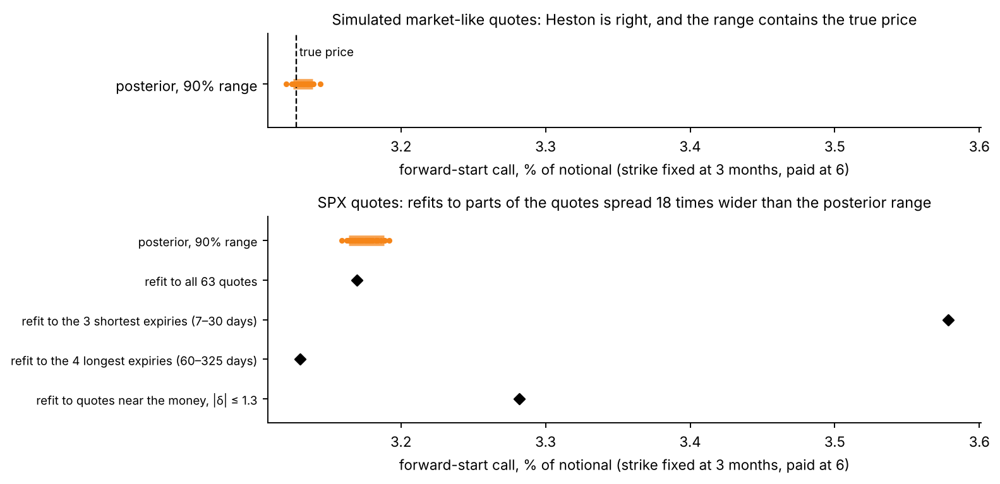

**Figure 17.** The forward-start call under 40 posterior draws (dots; the bar is the 90%
range) and under the four refits (diamonds). Top: the market-like simulation, where
Heston is right. Bottom: the SPX quotes.

- Where the model is right, both ranges contain the true value; the forward-start call's
  range is ±0.22% of its price.
- On SPX, the refits spread 18 times wider than the posterior range for the forward-start
  call and 21 times for the volatility swap. The refit to the shortest expiries pushes
  $`\kappa`$ to its upper bound of 10 and $`\sigma_v`$ to 2.1, to reach their skew.

A posterior measures uncertainty within the model. On SPX the model is wrong, so its
parameters depend on which quotes it is fitted to, and the posterior cannot see that. A
desk would hold a reserve sized to the refit spread, add a model-error term (step 6), or
use a better model. The posterior range matters most where the quotes leave the price
open: with few or wide quotes, or with a model flexible enough that the quotes do not pin
what the product depends on.

**Summaries.** Each product gets its mark $`\bar G_j`$, its 5–95% range, its prudent value
and its reserve $`R_j`$ (step 3). On SPX these measure the uncertainty within Heston; the
refit spread is the larger number.

## 10. What the results show, and what they do not

For Heston on SPX, the results show:
- a network, trained once (16 minutes of simulation and 30 of training), that returns a
  posterior in under 0.3 s, where MCMC takes 17 to 32 minutes;
- posteriors calibrated on 512 simulated surfaces for five of the six components of
  $`\theta`$, with intervals for $`v_0`$ about 1.4 times too wide;
- on single simulated surfaces, centres within one reference standard deviation of the
  exact posterior and intervals 1.1 to 2.9 times as wide: cautious, and less sharp than
  MCMC run on each set;
- that the error scale $`c`$ can be read by the network only once its inputs are
  whitened;
- what each region of quotes pins (Figure 4), and so which products the quotes leave
  open;
- that Heston misses the SPX quotes by 13.4 half-spreads, about 20 times the median
  half-spread in vol points, most at short maturities and in the deep put wing, because
  its short-expiry skew stops at a ceiling while the market's follows a power law;
- that on SPX, refits of the model to different parts of the quotes move product prices
  about 20 times more than the posterior range: model error dominates parameter
  uncertainty.

They do not:
- cover the model's own error. The ranges are uncertainty about one model's parameters.
  Where the model misfits, as Heston does on SPX, they are too narrow; the smooth
  model-error term of step 6 lets the posterior admit the misfit, and only a different
  model removes it;
- check the products against a true value on real data, which is never observed;
- show hedging under parameter uncertainty;
- establish that a posterior is an accepted basis for a prudent value. That is our
  proposal, not current practice.

**What remains.**
1. *Rough Bergomi.* Its bank of 300,000 simulated sets of quotes is being generated
   (step 7). Then its network; its checks as in step 8, with importance sampling as the
   exact reference (1,000 draws from the network, each weighted by
   $`p(\theta)\,p(y \mid \theta)/q_\phi(\theta \mid y)`$: 1,000 pricings instead of
   180,000); and the two models side by side on the same quotes.
2. *The model-error term* of step 6: exact posteriors first, then networks.
3. *Barrier options and a book.* The down-and-in put is the risk inside **autocallable**
   notes, among the most common structured products: their buyers in effect sell it to
   the bank, which is therefore long it. With it, a book of the products under the exact
   posterior.
4. *The intervals for today's variance,* $`v_0`$, which are too wide.
5. *More checks of the model on the market:* quotes left out of the fit, variance swaps
   from the full strip of listed options, and a listed 2-year put.

## Back to the goals, the audience and the practitioner

**Goals.**
1. *Marks and ranges* come from steps 3 and 9: one posterior, every product valued under
   every draw. On SPX the refits show that Heston's misfit, not the uncertainty of its
   parameters, sets how far a price can move.
2. *Fast and testable:* steps 7 and 8. Under 0.3 s per posterior; calibrated on 512
   simulated surfaces for five of six components; close to exact posteriors on simulated
   surfaces; exact posteriors carry the market results.
3. *The model and the limits:* steps 6, 8 and 10. The error model of step 6 is the choice
   that most affects the ranges, and the model's misfit is what they leave out.

**Audience.** Researchers in AI and statistics see a real inverse problem in which three
things, not the network's size, decide whether the posterior can be used: the error
model, the preparation of the network's inputs, and whether the model fits the data.
Practitioners see calibration ranges and refits from one consistent calculation, mapped
onto the prudent-valuation rules, with a plain statement of what they leave out. Both
should leave able to say, for their own model, whether they need this, what it costs, and
how to check it.

**Practitioner.** A desk and its product control would get, every day:
- a mark and a range for every product, from one consistent calculation, with tested
  coverage;
- a measure of how well the model fits that day's quotes ($`c`$ and the map of misses),
  which flags the days when a model stops describing the market;
- the spread of prices across refits to different quotes and, with a second model,
  across models.

They would still have to choose the models, handle the model risk beyond one model's
parameters (Article 11) and the other AVA categories, such as close-out costs, decide how
to hedge, take the method through model validation, and have their regulator accept it.
In the terms of the rules, the posterior's range is an input to Article 9, the spread
across refits and models belongs to Article 11, and the joint draws of a book would
measure the offset between products that the Regulation's aggregation sets at a fixed
50%.
