# Option application on SPX · Layer 3: full detail

*Layer 3 of 3 · reference · [Index](README.md) · [Layer 1](1-overview.md) ·
[Layer 2](2-walkthrough.md) · [Glossary](glossary.md) · Results as of 11 November 2026*

Each step gives the definitions, the derivations, the numbers behind each choice and the
implementation: code paths, settings and costs. The Heston results come from the study in
[PR #85](https://github.com/fmuia/sbi4finance/pull/85); the rough Bergomi data generation
is in [PR #88](https://github.com/fmuia/sbi4finance/pull/88). Every figure is drawn by
[`figure-sources/make_figures.py`](figure-sources/make_figures.py) from
[`figure-sources/data.json`](figure-sources/data.json), whose sources and their SHA-256 hashes are listed
in the file; [Evidence and figures](#evidence-and-figures) says which file each number
comes from.

## Goals

**1. A value and a range for products that no market prices.** Under Heston and rough
Bergomi, fitted to the same 63 SPX quotes with the same error model, report for each
product the posterior 5%, 50% and 95% quantiles, the mark, the prudent value at 90% and
the reserve, and the same for an example book. The products are a forward-starting
variance swap on two windows, a 6-month-to-1-year forward-start call, a 1-year volatility
swap and a 1-year down-and-in put.

**2. SBI makes this fast and testable.** The amortized posterior must be calibrated on
simulated surfaces, agree with reference posteriors where those can be computed, and
return a posterior in under a second, so that ranges can be produced every day and their
coverage tested on hundreds of simulated surfaces.

**3. The limits.** Each output is labelled with what it covers: parameter uncertainty
within one model, under a stated error model.

**Success criteria.**
- *Numerical:* option prices refined until two grids agree within 0.01 of the quote's
  half-spread (step 4); Monte Carlo errors of product prices at most 2% of their 90% range
  (step 9).
- *Inference:* coverage and rank tests on simulated surfaces; agreement with the reference
  posteriors (step 8). Where the network does not agree, results come from the reference.
- *Model:* the fit to the market is measured and reported (steps 6 and 8).

**Not goals.** Hedge ratios under the posterior; a complete model-risk reserve; a claim
that regulators accept a posterior-based AVA.

## Audience

The ICAIF '26 tutorial (two hours, 14 November) speaks to AI and statistics researchers
who know posteriors, MCMC and neural networks but not options, and to finance
practitioners who know options and calibration but not SBI. The material becomes:
- **Slot 4, Heston on SPX:** steps 1 to 9 with an exact posterior to check against;
- **Slot 5, rough Bergomi on SPX:** the same steps for a model priced only by simulation,
  then the two models side by side;
- **Slot 6, priors and misspecification:** the error scale and the model's misfit.

Background for each step, from the [course](../../../course/README.md):

| Step | Background in the course |
| --- | --- |
| 1 | [Lecture 1](../../../course/01-options-quotes-and-volatility.md) (options, quotes), [2](../../../course/02-no-arbitrage-without-a-model.md) (forwards, parity, forward units), [5](../../../course/05-implied-volatility-and-the-smile.md) (implied volatility, the variance swap) |
| 2 | [Lecture 7](../../../course/07-calibration-as-estimation.md) (least squares, Gauss–Newton interval) |
| 3 | [Lecture 6](../../../course/06-marking-a-product-the-smile-does-not-quote.md) (marking, the rules), [8](../../../course/08-bayesian-calibration.md) (posterior, propagation) |
| 4 | [Lecture 3](../../../course/03-brownian-motion-and-ito.md) (Itô), [4](../../../course/04-black-scholes.md) (Black–Scholes), [10](../../../course/10-heston.md) (Heston), [13](../../../course/13-rough-bergomi.md) (rough Bergomi) |
| 5, 6 | [Lecture 5](../../../course/05-implied-volatility-and-the-smile.md) (reading a chain), [7](../../../course/07-calibration-as-estimation.md) (observation models) |
| 7 | [Lecture 9](../../../course/09-amortized-inference.md) (amortized inference) |
| 8 | [Lectures 12](../../../course/12-the-amortized-workflow-on-heston.md) and [14](../../../course/14-why-the-exact-posterior-is-expensive.md) (checks, references, costs) |
| 9 | [Lectures 6](../../../course/06-marking-a-product-the-smile-does-not-quote.md), [11](../../../course/11-calibrating-heston.md) and [15](../../../course/15-a-liquid-smile-spy.md) (products under the posterior) |

The course's worked examples use SPY, a symmetric grid of 63 points and a fixed noise
level; the definitions below are the ones used for SPX.

## The practitioner's point of view

**The daily cycle.** At the close, the desk marks every position; the marks give the
day's P&L and the balance sheet. Product control, independent of the traders, verifies
the marks against market data and computes valuation adjustments; the bank then reports
fair values in its accounts and prudent values in its capital.

**Fair value (IFRS 13).** The price that would be received to sell an asset, or paid to
transfer a liability, in an orderly transaction between market participants. Its inputs
are ranked: quoted prices for the identical instrument in an active market (Level 1),
other observable inputs (Level 2), and unobservable inputs (Level 3). A listed SPX option
is Level 1. A forward start, a volatility swap or a barrier put whose value depends
significantly on inputs nobody quotes is Level 3, and the bank discloses how its value
would change under reasonably possible alternative inputs (paragraph 93(h)).

**Prudent value (EU).** Commission Delegated Regulation (EU) 2016/101, the technical
standard under CRR Article 105(14), asks for each fair-valued position a prudent value: a
point where the bank is "90 % confident" it could exit the valuation exposure "at that
price or better" (Article 9(5)(a) for market price uncertainty, Article 11(3) for model
risk). The difference between fair value and prudent value is an additional valuation
adjustment. CRR Article 34 then requires institutions to "deduct from Common Equity Tier
1 capital the amount of any additional value adjustments necessary". Three categories
matter here:
- **Market price uncertainty (Article 9)**, for the uncertainty of valuation inputs.
  Article 11(1) sends here the "model risk which arises due to calibrations from market
  derived parameters": the spread of a model calibrated to quotes is an Article 9 input.
- **Close-out costs (Article 10)**, for the cost of exiting at bid or ask rather than mid.
  The half-spreads of step 1 measure them for listed options; they are not computed here.
- **Model risk (Article 11)**, "due to the potential existence of a range of different
  models or model calibrations, which are used by market participants", to be measured
  where possible as "a range of plausible valuations produced from alternative
  appropriate modelling and calibration approaches" (Article 11(3)). Heston against rough
  Bergomi belongs here.

Where data cannot give a range, the Regulation allows an expert-based approach
(Articles 9(5)(b) and 11(4)).

**Aggregation.** The Annex combines the individual AVAs of these three categories over
valuation exposures. With FV the fair value, PV the prudent value and EV an expected value
from the range of possible values:

```math
\text{Method 1:}\ \ \mathrm{APVA} = (1-\alpha)\,(\mathrm{FV}-\mathrm{PV}),\qquad
\text{Method 2:}\ \ \mathrm{APVA} = \max\{0,\ (\mathrm{FV}-\mathrm{PV}) - \alpha\,(\mathrm{EV}-\mathrm{PV})\},\qquad
\mathrm{AVA} = \sum \mathrm{APVA},
```

with $`\alpha = 50\%`$. The factor is a fixed allowance for the fact that many exposures
do not reach their 90% points at once. When the fair value and EV are both the posterior
mean, the two methods coincide: each exposure counts for half of its standalone
adjustment. Step 9 measures the actual offset from the joint posterior draws, for
comparison; the regulatory factor stays fixed.

**Current practice.** One point calibration per day; ranges from alternative calibrations
and models, from consensus services that pool banks' prices (some publish 10th and 90th
percentiles for prudent valuation), or from expert judgment. The hard inputs are those
nobody quotes: the forward smile, the deep wings, the vol of vol. The course's
[practice sources](../../../course/practice-sources.md) list what is documented.

**What we propose.** The spread of a posterior over the parameters of a model calibrated
to quotes, carried through every product, is an Article 9 input; the comparison of two
models on the same information is an Article 11 question. That a posterior is an
acceptable basis for an AVA is our proposal, not established practice.

So the practitioner needs, for every product, a mark and a defensible range; for the
book, a range that accounts for offsets between products; and a statement of what the
range does not cover.

## Notation and conventions

**Time.** Valuation on 9 November 2026 at 20:13:37 UTC (15:13 New York). Each expiry
settles at 16:00 New York; maturities are exact calendar time in years of 365 days
(ACT/365F, actual seconds over $`365 \times 86{,}400`$).

**Spot, forward, discount.** $`S_t`$ is the index, $`F(t)`$ the forward for maturity
$`t`$, $`D(t)`$ the discount factor. With deterministic rates and dividends,

```math
S_t = F(t)\,X_t,\qquad X_0 = 1,\qquad \frac{dX_t}{X_t} = \sqrt{V_t}\,dB_t,\qquad B = \rho\,W + \sqrt{1-\rho^2}\,W^{\perp},
```

where $`V`$ is the instantaneous variance, $`W`$ drives $`V`$, and $`W^{\perp}`$ is
independent of $`W`$.

**Forward units.** A put with strike $`K`$ and maturity $`T`$ is worth
$`D(T)F(T)\,\mathbb{E}[(\tilde K - X_T)^+]`$ with $`\tilde K = K/F(T)`$. Its log-moneyness
is $`k = \ln \tilde K`$ and its **standardized moneyness**
$`z = k/(0.16\sqrt T)`$: the distance from the forward in standard deviations at a 16%
volatility. $`z`$ is a coordinate for placing strikes, not the option's delta. Model
prices are computed in forward units.

**Implied volatility and vega.** $`\sigma_{\text{imp}}(k,T)`$ reproduces a forward-unit
price through Black–Scholes; the forward-unit vega is
$`\nu = \partial P/\partial\sigma = \sqrt T\,\varphi(d_1)`$, with $`\varphi`$ the standard
normal density. One vol point ("vp") is 0.01 of volatility.

**Half-spreads.** $`h_i`$ is quote $`i`$'s half-spread, $`(\text{ask}-\text{bid})/2`$, in
the same price units as its mid and its model price (the code's `half_spread`). Divided
by its vega, $`h_i/\nu_i`$, it is the same uncertainty in volatility.

**Integrated quantities along a path.**

```math
I_t = \int_0^t V_s\,ds,\qquad J_t = \int_0^t \sqrt{V_s}\,dW_s,\qquad J^{\perp}_t = \int_0^t \sqrt{V_s}\,dW^{\perp}_s ,
```

so that, by Itô's formula for $`\ln X`$,

```math
\ln X_t = \rho\,J_t + \sqrt{1-\rho^2}\,J^{\perp}_t - \tfrac12\,I_t,\qquad J^{\perp}_t \mid W \sim \mathcal N(0, I_t).
```

The conditional law holds because, given the whole path of $`W`$, $`J^{\perp}_t`$ is an
integral of a known function against an independent Brownian motion. This structure is
exact for both models and underlies every Monte Carlo estimator of steps 4 and 9.

**Parameters and their code names.**

| Symbol | Meaning | Code name |
| --- | --- | --- |
| $`v_0`$ | Heston initial variance | `initial_variance` |
| $`\bar{v}`$ | Heston long-run variance | `theta` |
| $`\kappa`$ | Heston mean-reversion speed | `kappa` |
| $`\xi`$ | Heston vol of vol | `vol_of_vol` |
| $`\rho`$ | correlation of index and variance shocks (both models) | `rho` |
| $`H`$, $`\eta`$ | rough Bergomi Hurst exponent and vol of vol | `hurst`, `eta` |
| $`\xi_s`$, $`\xi_l`$, $`\lambda`$ | rough Bergomi curve: short level, long level, decay | `short_variance`, `long_variance`, `decay` |
| $`c`$ | multiplier of the half-spread in the error model | `c` |

$`\theta`$ denotes either model's parameter vector, with or without $`c`$ as the context
says; the Heston code writes `phi` for its five physical parameters.

## 1. What has a price, and what does not

### 1.1 The data

- **Source.** Cboe delayed quotes for SPX options (`_SPX.json`), snapshot of 9 November
  2026; raw file 14.1 MB, SHA-256 `8c730e11…9458`, kept outside Git. The index stood at
  7,571.54.
- **Series.** SPXW, European and cash-settled on the closing value at 16:00 New York on
  the expiry, which list expiries on almost every trading day. Early-close, same-day and
  non-SPXW markets are excluded.
- **Quality.** A quote is usable if its bid is positive, its ask is above its bid and its
  half-spread is at most 25% of its mid.

### 1.2 Discount and forward

**Put–call parity.** A call minus a put with the same strike and maturity pays
$`(S_T-K)^+ - (K-S_T)^+ = S_T - K`$ at $`T`$, whatever happens, so its price is that of a
forward contract:

```math
C(K,T) - P(K,T) = D(T)\,\big(F(T) - K\big) = D(T)F(T) - D(T)\,K .
```

So $`C - P`$ is a straight line in $`K`$ with slope $`-D(T)`$ and intercept
$`D(T)F(T)`$. For each expiry it is fitted by weighted least squares over **carry
anchors**: every third strike within 5% of spot that has both a call and a put, at least
15 pairs, each weighted by the inverse of its combined half-spread. Eleven expiries carry
such a fit, which gives $`D(T)`$, $`F(T)`$ and their joint uncertainty: the seven of the
design (step 5) and four others, among them the 30 November expiry that closes the short
window of step 9. The anchors are never used as observations. SPX is European, so
parity holds exactly, with no early-exercise term.

### 1.3 Implied volatility, vega and half-spreads in vol points

In forward units the Black–Scholes put is

```math
p(\tilde K, T; \sigma) = \tilde K\,\Phi(-d_2) - \Phi(-d_1),\qquad d_{1} = \frac{-k + \sigma^2 T/2}{\sigma\sqrt T},\quad d_2 = d_1 - \sigma\sqrt T ,
```

and its vega is $`\nu = \sqrt T\,\varphi(d_1)`$. For each quote, the mid in forward units
gives the implied volatility by root-finding, and the half-spread in vol points is

```math
\frac{h}{\nu} = \frac{(\text{ask}-\text{bid})/2\,/\,(DF)}{\sqrt T\,\varphi\big(d_1(\sigma_{\text{imp}})\big)} ,
```

at the quote's own implied volatility. On the 63 quotes it ranges from 0.025 to 0.28 vp,
with a median of 0.064 (step 5).

### 1.4 The products and the checks

| Product | Payoff | Role |
| --- | --- | --- |
| Forward-starting variance swap, windows $`[0, 21\ \text{days}]`$ and $`[81, 325\ \text{days}]`$ | Realized variance over the window minus a strike agreed today | Marked; closed form for each draw |
| Forward-start call, $`T_1`$ = 6 months, $`T_2`$ = 1 year | $`(S_{T_2} - m\,S_{T_1})^+`$ at $`T_2`$, with $`m = F(T_2)/F(T_1)`$ | Marked; by simulation |
| Volatility swap, 1 year | $`\sqrt{\mathrm{RV}_T} - K_{\text{vol}}`$ per unit notional | Marked; by simulation |
| Down-and-in put, 1 year, strike $`K = S_0`$, barrier $`B = 0.7\,S_0`$, daily closes | $`(K - S_T)^+\,\mathbf{1}\{\min_i S_{t_i} \le B\}`$ | Marked; by simulation |
| Variance swap at a listed expiry | $`\mathrm{RV}_T - K_{\text{var}}`$ | Check against the strip of listed options |
| Listed 2-year 90% put | A listed option beyond the last fitted expiry | Check of extrapolation in maturity |

Realized variance over $`N`$ daily log returns $`r_i`$ is $`\mathrm{RV} = (252/N)\sum_i r_i^2`$;
for a continuous path it tends to $`I_T/T`$. The fair strikes are
$`K_{\text{var}}(t_1,t_2) = \mathbb{E}[I_{t_2} - I_{t_1}]/(t_2-t_1)`$ and
$`K_{\text{vol}}(T) = \mathbb{E}[\sqrt{I_T/T}]`$ under the pricing probabilities. The
down-and-in put is the risk inside autocallable notes: their buyers in effect sell it to
the issuing bank, which is therefore long it.

**The region of the smile each product needs.**
- *Forward-starting variance:* the term structure of the variance level, so the
  expiries around the window ends; the strips of listed options at those expiries fix it
  for a continuous path (1.5).
- *Forward start:* the near-the-money level and skew at 6 to 12 months, and above all the
  forward smile, the smile that will prevail at $`T_1`$, which no listed option fixes. It
  comes from the model's dynamics, inferred from the skew's term structure.
- *Volatility swap:* the variance level, plus the vol of vol, from the wings and the short
  maturities, since $`K_{\text{vol}} \approx \sqrt{K_{\text{var}}}`$ minus a convexity term
  (step 9).
- *Down-and-in put:* puts at and below 70% out to 1 year, and the spot–volatility
  dynamics ($`\rho`$ and the vol of vol). At 1 year the barrier sits near $`z = -2.5`$.

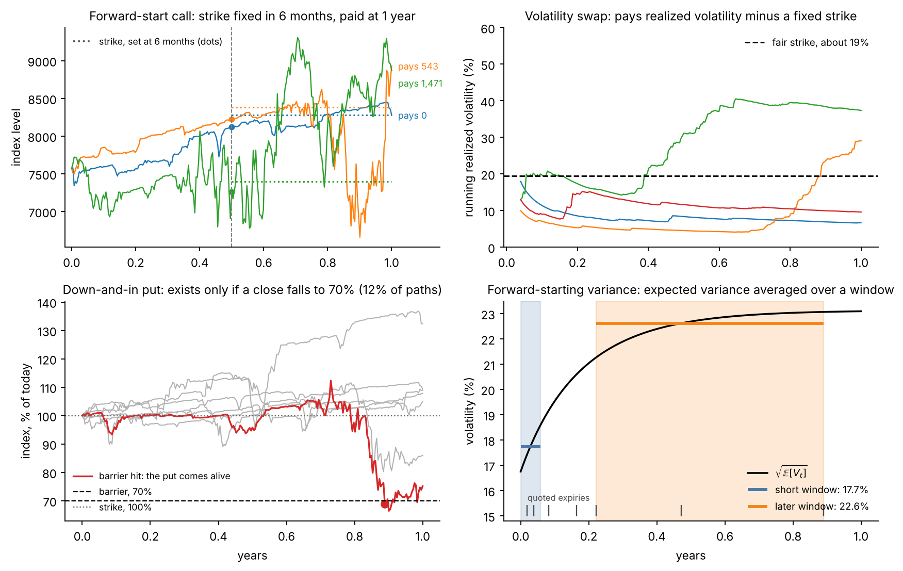

**Figure 1.** Simulated paths of the index under Heston at its SPX posterior mean (step 4).
Top left: each forward-start call fixes its strike at the dot, 6 months in, and pays at 1
year. Top right: running realized volatility, path by path, against one fixed strike.
Bottom left: about 12% of paths touch the 70% barrier; on those, the put exists. Bottom
right: the expected variance over time and its average over the two windows, the strikes
of the two forward-starting variance swaps.

### 1.5 What listed options determine: two derivations

**Marginals, not the joint law (Breeden–Litzenberger).** Write the call price as
$`C(K) = D\int (s-K)^+ p_T(s)\,ds`$. Differentiating twice in $`K`$,

```math
\frac{\partial C}{\partial K} = -D\int_K^\infty p_T(s)\,ds,\qquad \frac{\partial^2 C}{\partial K^2} = D\,p_T(K).
```

So the calls at one maturity, across all strikes, fix the distribution of $`S_T`$ at that
maturity and the price of every payoff $`g(S_T)`$. They say nothing about how the laws at
two dates are joined, which a forward start, a volatility swap or a barrier needs.

**The variance swap from the strip.** For a continuous path, Itô's formula gives
$`d\ln X_t = dX_t/X_t - \tfrac12 V_t\,dt`$, so

```math
I_T = \int_0^T V_t\,dt = 2\int_0^T \frac{dX_t}{X_t} - 2\ln X_T .
```

The first term is a martingale under the pricing probabilities, so
$`\mathbb{E}[I_T] = -2\,\mathbb{E}[\ln X_T]`$. For any $`x \gt 0`$,

```math
-\ln x = (1 - x) + \int_0^1 \frac{(\tilde k - x)^+}{\tilde k^2}\,d\tilde k + \int_1^\infty \frac{(x - \tilde k)^+}{\tilde k^2}\,d\tilde k ,
```

as can be checked by differentiating both sides twice. Taking expectations, the first term
vanishes because $`\mathbb{E}[X_T] = 1`$, and the integrals become forward-unit put and
call prices. With $`\tilde k = e^k`$,

```math
K_{\text{var}}(T)\,T = \mathbb{E}[I_T] = 2\int \frac{\mathrm{OTM}(\tilde k)}{\tilde k^2}\,d\tilde k = 2\int \mathrm{OTM}(k)\,e^{-k}\,dk =: w(T),
```

where $`\mathrm{OTM}`$ is the out-of-the-money forward-unit price (puts for $`k \lt 0`$,
calls for $`k \gt 0`$). This is the VIX construction; the forward-starting strike is
$`(w(t_2) - w(t_1))/(t_2 - t_1)`$.

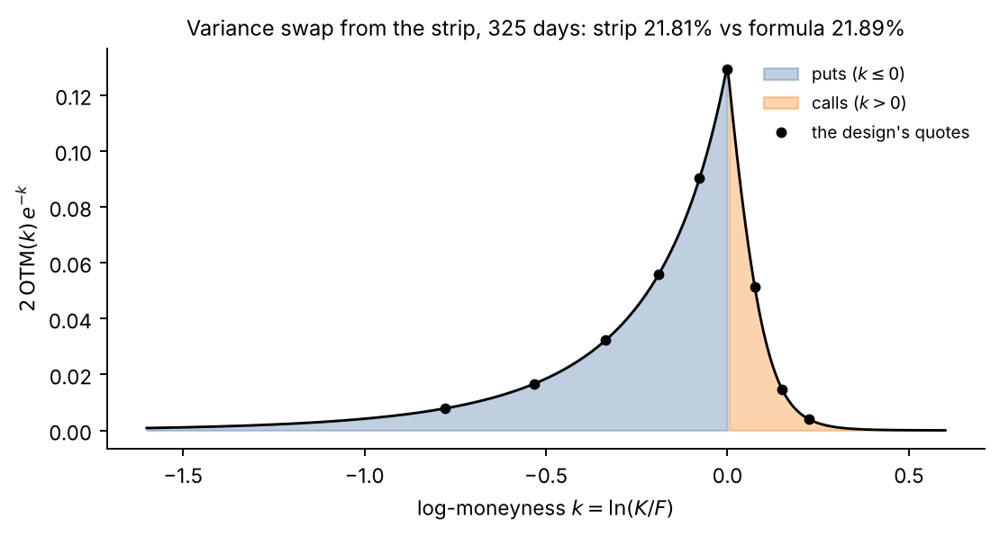

**Figure 2.** The integrand $`2\,\mathrm{OTM}(k)\,e^{-k}`$ for the 325-day expiry, from Heston
prices at the SPX posterior mean; the area is $`w(T)`$. Integrated over the strip it gives
a variance-swap volatility of 21.81%, against 21.89% from the closed form of step 4: the
difference is the truncated tails. Most of the area comes from puts, and the design's nine
quotes (dots) sample it.

In practice the errors of the strip construction are strike discretization, truncation of
the wings and jumps, reported as a tolerance.

## 2. Calibration gives one value and hides the rest

### 2.1 Pricing under the model

Under the pricing probabilities $`X`$ is a martingale, and a payoff $`\Pi`$ paid at $`T`$
is worth

```math
P_\Pi(\theta) = D(T)\,\mathbb{E}_\theta[\Pi] .
```

For a vanilla this is a function of the law of $`X_T`$ alone; for the products of 1.4 it
depends on the law of the path.

### 2.2 The classical answer

Least squares, in implied volatility or in price weighted by the half-spreads, from
several starting points spread over the prior box; the mark is $`P_\Pi(\hat\theta)`$. The
maximum-likelihood version uses the likelihood of step 6 and estimates the error scale
with $`\theta`$.

### 2.3 What it hides: weak directions

Near $`\hat\theta`$, write the 63 prices as $`P(\theta) \approx P(\hat\theta) +
\mathcal{J}\,(\theta - \hat\theta)`$, with $`\mathcal{J} = \partial P/\partial\theta`$ the
$`n \times p`$ Jacobian. Under Gaussian errors with covariance $`\Sigma`$ the
log-likelihood is locally quadratic, with curvature $`\mathcal{J}^\top\Sigma^{-1}\mathcal{J}`$,
the Fisher information. Its eigenvectors with small eigenvalues are directions in which
the parameters can move far while the quotes barely change. A product $`P_j`$ that loads
on such a direction ($`\nabla P_j^\top v \ne 0`$ for a weak eigenvector $`v`$) inherits a
large uncertainty. Which directions are weak depends on which quotes exist (5.2).

### 2.4 Two classical ranges

**The delta method.** Linearizing as above, the generalized least-squares estimator has

```math
\widehat{\mathrm{Cov}}(\hat\theta) = \big(\mathcal{J}^\top \hat\Sigma^{-1} \mathcal{J}\big)^{-1},\qquad
\mathrm{sd}_j = \sqrt{\nabla P_j^\top\,\widehat{\mathrm{Cov}}(\hat\theta)\,\nabla P_j},\qquad
\text{range: } P_j(\hat\theta) \pm 1.645\,\mathrm{sd}_j ,
```

with $`\hat\Sigma`$ the error covariance at the fit, Jacobians by central differences, and
common random numbers for rough Bergomi. It is exact when $`P`$ and $`P_j`$ are linear in
$`\theta`$ and the errors Gaussian; it misleads where the likelihood is curved, bounded by
the prior box, or has several modes.

**Expiry-drop refits.** Refit with each of the seven expiries removed in turn, and report
the minimum to maximum of the product values.

## 3. The posterior turns one value into a distribution

### 3.1 Posterior and push-forward

```math
p(\theta \mid y) \;\propto\; p(y \mid \theta)\,p(\theta).
```

A product's value is a function of the parameters, so the posterior over $`\theta`$
induces a distribution over the value, its push-forward. With posterior draws
$`\theta^{(1)},\dots,\theta^{(S)}`$, $`S = 1{,}000`$,

```math
\hat P_j^{(s)} = \hat P_j\big(\theta^{(s)};\ Z\big),\qquad s = 1,\dots,S,
```

where $`Z`$ is one fixed set of random normals shared by all draws (common random numbers,
step 9). The spread of $`\hat P_j^{(s)}`$ across $`s`$ is then due to the parameters, not
to Monte Carlo noise. The draws are the network's, or the reference's thinned (MCMC) or
resampled by their weights (importance sampling).

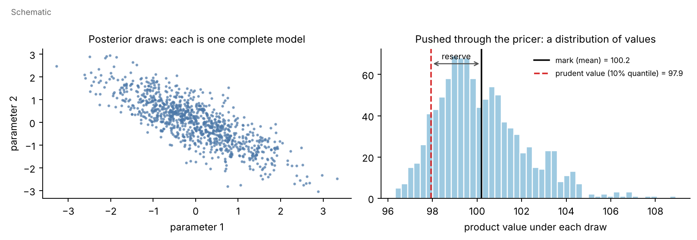

**Figure 3.** Schematic of the push-forward: correlated posterior draws (left) give a
distribution of values (right), with the mark at the mean and the prudent value of a long
position at the 10% quantile.

### 3.2 Summaries

- **Mark:** the posterior mean $`\bar P_j = \frac1S\sum_s \hat P_j^{(s)}`$, which minimizes
  the posterior expected squared error; the median and the point-calibration price are
  reported beside it.
- **Prudent value at 90%,** on the side that hurts the position:
  $`\mathrm{PV}_j = q_{0.10}`$ for a long position and $`q_{0.90}`$ for a short one, where
  $`q_\alpha`$ is the $`\alpha`$-quantile of $`\hat P_j^{(s)}`$.
- **Reserve:** $`R_j = |\bar P_j - \mathrm{PV}_j|`$.

### 3.3 The book

With positions $`n_j`$ (positive long, negative short), each draw prices the whole book:

```math
B^{(s)} = \sum_j n_j\,\hat P_j^{(s)},\qquad \mathrm{PV}_{\text{book}} = q_{0.10}\big(B^{(s)}\big),\qquad R_{\text{book}} = \bar B - \mathrm{PV}_{\text{book}} .
```

The example book is long one down-and-in put (as an autocallable issuer is), long one
forward start and short one 1-year volatility swap. Report the **diversification ratio**
$`R_{\text{book}} / \sum_j R_j`$, which the joint draws measure and the Regulation sets at
$`1-\alpha = 0.5`$, and the **correlation matrix** of $`\hat P_j^{(s)}`$ across draws,
which explains it. The products are in different units (index points per unit of index
for the put and the forward start, vol points per unit of vega notional for the volatility
swap), so the book fixes the swap's vega notional in currency.

### 3.4 The simulator the next steps build

The posterior needs a prior (step 4), the quotes (step 5) and a likelihood (step 6).
Together they define the generative model

```math
\theta \sim p(\theta),\qquad y = P(\theta) + \varepsilon,\qquad \varepsilon \mid \theta \sim p(\varepsilon \mid \theta),
```

with $`P(\theta)`$ the clean prices at the 63 quotes. Step 7 learns to invert it; step 8
checks the inversion.

## 4. Two models

Both models move the index in forward units as $`dX_t/X_t = \sqrt{V_t}\,dB_t`$ and differ
in how the variance $`V`$ behaves.

### 4.1 Heston

```math
\frac{dX_t}{X_t} = \sqrt{V_t}\,dB_t,\qquad dV_t = \kappa\,(\bar{v} - V_t)\,dt + \xi\sqrt{V_t}\,dW_t,\qquad dB_t\,dW_t = \rho\,dt,\qquad V_0 = v_0 .
```

| Parameter | Meaning | Prior (uniform) | SPX, exact posterior mean ± sd |
| --- | --- | --- | --- |
| $`v_0`$ | today's variance | 0.01 to 0.16 | 0.02807 ± 0.00010 (volatility 16.75%) |
| $`\kappa`$ | speed of mean reversion, per year | 0.1 to 10 | 5.07 ± 0.10 |
| $`\bar{v}`$ | long-run variance | 0.01 to 0.16 | 0.05349 ± 0.00033 (volatility 23.13%) |
| $`\xi`$ | vol of vol | 0.1 to 3 | 1.804 ± 0.019 |
| $`\rho`$ | correlation of index and variance shocks | −0.95 to −0.1 | −0.6967 ± 0.0018 |
| $`c`$ | error multiplier (step 6) | 0.5 to 2 | 1.9993 ± 0.0007 |

Given the model and the error law, the quotes pin every parameter to a small fraction of
its prior range; step 6 explains why $`c`$ sits at its upper bound.

**Feller condition.** $`2\kappa\bar{v} \ge \xi^2`$ keeps the variance strictly positive.
At the SPX posterior mean $`2\kappa\bar{v} = 0.54`$ and $`\xi^2 = 3.26`$. It is not
imposed: zero is then reachable, but the process is well defined and Fourier prices stay
exact.

**Expected variance.** Taking expectations of the variance equation removes the $`dW`$
term, which has mean zero, so $`d\,\mathbb{E}[V_t] = \kappa\,(\bar{v} - \mathbb{E}[V_t])\,dt`$
and

```math
\mathbb{E}[V_t] = \bar{v} + (v_0 - \bar{v})\,e^{-\kappa t} .
```

Averaging over a window gives the strike of a forward-starting variance swap (1.4):

```math
K_{\text{var}}(t_1, t_2) = \frac{1}{t_2 - t_1}\int_{t_1}^{t_2}\mathbb{E}[V_t]\,dt = \bar{v} + (v_0 - \bar{v})\,e^{-\kappa t_1}\,\frac{1 - e^{-\kappa (t_2 - t_1)}}{\kappa\,(t_2 - t_1)} ,
```

and $`t_1 = 0`$ gives the ordinary variance-swap strike $`K_{\text{var}}(T)`$.

**Characteristic function** of $`\ln X_T`$ (`heston_options.model.characteristic_function`),
in the form that avoids branch-cut jumps, with $`b = \kappa - \rho\xi iu`$,
$`d = \sqrt{b^2 + \xi^2(u^2 + iu)}`$ and $`g = (b-d)/(b+d)`$:

```math
\ln\varphi_T(u) = \frac{\kappa\bar{v}}{\xi^2}\Big[(b-d)\,T - 2\ln\frac{1-g\,e^{-dT}}{1-g}\Big] + v_0\,\frac{b-d}{\xi^2}\,\frac{1-e^{-dT}}{1-g\,e^{-dT}} .
```

**Call price in forward units** (Lewis's formula: the payoff's Fourier transform, with the
integration contour moved to $`\mathrm{Im}\,u = -1/2`$; derivation in
[Lecture 10](../../../course/10-heston.md)), with $`k = \ln\tilde K`$:

```math
\frac{C}{DF} = 1 - \frac{\sqrt{\tilde K}}{\pi}\int_0^\infty \frac{\mathrm{Re}\big[e^{-iuk}\,\varphi_T(u - \tfrac i2)\big]}{u^2 + \tfrac14}\,du .
```

**The Black control variate** (`heston_options.control_variate`). A lognormal $`X_T`$ with
mean 1 and total variance $`w`$ has $`\varphi^{B}_T(u - \tfrac i2) = e^{-\frac12 w\,(u^2 + \frac14)}`$,
and the same formula prices it exactly. Subtracting the two formulas,

```math
\frac{P}{DF} = p_{\text{Black}}(\tilde K, w) + \frac{\sqrt{\tilde K}}{\pi}\int_0^\infty \frac{\mathrm{Re}\big[e^{-iuk}\,\big(\varphi^{B}_T(u - \tfrac i2) - \varphi_T(u - \tfrac i2)\big)\big]}{u^2 + \tfrac14}\,du ,
```

for calls and puts alike, since the parity terms cancel between the two models. Here
$`p_{\text{Black}}(\tilde K, w)`$ is the forward-unit Black–Scholes price of the same
option (1.3) with total variance $`\sigma^2 T = w`$, and we take
$`w = \mathbb{E}[I_T] = T\,K_{\text{var}}(T)`$. The integral is the same as before, so the
price is unchanged; what changes is the arithmetic. A deep put is worth very little (the
7-day put at $`z = -5`$ is worth $`2\times10^{-4}`$ in forward units), and the plain formula
obtains it as a difference of numbers close to 1, losing digits. Here the Black price
carries the value with full relative precision and the integral is a small correction.

**Quadrature and its accuracy gate.** Gauss–Legendre on $`[0, U]`$ with $`N`$ nodes, on the
ladder $`(N, U)`$ = (256, 150), (512, 300), (1,024, 600), (2,048, 1,200), (4,096, 2,400),
(8,192, 4,800), (16,384, 9,600). A rung is accepted when its prices and the next rung's
lie within the no-arbitrage bounds and agree within $`0.01\,h_i`$ for every quote, that is
$`0.02\,c_{\min}h_i`$ with $`c_{\min} = 0.5`$: refinement moves no price by more than 2% of
the smallest error the prior allows. A frozen replay over 98 parameter points (64 drawn
from the prior, the 32 corners of the prior box, and two simulated cases) passes at every
point: the largest refinement difference is $`6.5\times10^{-5}`$ of the smallest error
standard deviation, and the largest change in log-likelihood $`4.7\times10^{-6}`$. The same
check repeated at reference-posterior draws (step 8) gives differences below
$`10^{-6}`$ of that standard deviation. One likelihood evaluation, 63 prices, costs 3 to
6 ms.

**Short maturities.** As $`T \to 0`$ Heston's at-the-money skew tends to a constant, while
index skews keep steepening. Step 6 shows the consequence on SPX.

### 4.2 Rough Bergomi

```math
V_t = \xi_0(t)\,\exp\!\Big(\eta\,Y_t - \tfrac12\,\eta^2\,t^{2H}\Big),\qquad Y_t = \sqrt{2H}\int_0^t (t-s)^{H-1/2}\,dW_s,\qquad \frac{dX_t}{X_t} = \sqrt{V_t}\,dB_t,\qquad dB_t\,dW_t = \rho\,dt .
```

**Variance of the driver.** $`\mathrm{Var}(Y_t) = 2H\int_0^t (t-s)^{2H-1}\,ds = t^{2H}`$.

**Mean.** $`Y_t`$ is Gaussian, so $`\mathbb{E}\big[e^{\eta Y_t - \frac12\eta^2 t^{2H}}\big] = 1`$
and $`\mathbb{E}[V_t] = \xi_0(t)`$: the curve is the expected future variance.

**Roughness.** For $`H \lt 1/2`$ the kernel $`(t-s)^{H-1/2}`$ diverges as $`s \to t`$, so
the latest shocks weigh most and paths are rougher than Brownian motion. The at-the-money
skew then grows like $`T^{H-1/2}`$ as $`T \to 0`$, the shape of index skews at short
maturities. Whether rough models describe SPX better than Markovian ones is debated (Abi
Jaber and Li, 2024); the two models here are compared on the same information.

**The curve** (`heston_exponential_v1`), inferred jointly with the other parameters:

```math
\xi_0(t) = \xi_l + (\xi_s - \xi_l)\,e^{-\lambda t},\qquad K_{\text{var}}(t_1, t_2) = \xi_l + (\xi_s - \xi_l)\,e^{-\lambda t_1}\,\frac{1 - e^{-\lambda (t_2 - t_1)}}{\lambda\,(t_2 - t_1)} .
```

It is the same family as Heston's $`\mathbb{E}[V_t]`$, with $`\xi_s`$, $`\xi_l`$ and
$`\lambda`$ in the roles of $`v_0`$, $`\bar{v}`$ and $`\kappa`$, so both models learn the
variance level from the quotes in the same way.

**Priors,** uniform and independent: $`H`$ from 0.02 to 0.35, $`\eta`$ from 0.5 to 3.5,
$`\rho`$ from −0.99 to −0.2, $`\xi_s`$ and $`\xi_l`$ from 0.01 to 0.16, $`\lambda`$ from
0.25 to 8 per year, and $`c`$ from 0.5 to 2 as for Heston.

**Simulation.** The hybrid scheme of Bennedsen, Lunde and Pakkanen: the singular cell of
the kernel next to $`t`$ is simulated exactly, older cells with averaged kernel values, and
the convolution by FFT. The normalizer is the discrete $`\mathrm{Var}(Y_i)`$, so
$`\mathbb{E}[V_i] = \xi_0(t_i)`$ holds exactly on the grid. Each of the seven expiries has
its own grid, ending exactly at its ACT/365F maturity: 622, 1,241, 664, 1,327, 1,791, 950
and 1,796 steps, which is about 128 steps per business day up to two weeks, 32 up to three
months and 8 beyond.

**The vanilla estimator** (`shared.pricing.rough_block`). Split
$`-\tfrac12 I_T = -\tfrac12\rho^2 I_T - \tfrac12(1-\rho^2)I_T`$ in the decomposition of
$`\ln X_T`$ (notation section):

```math
X_T = \underbrace{e^{\rho J_T - \frac12\rho^2 I_T}}_{F'} \times e^{\sqrt{1-\rho^2}\,J^{\perp}_T - \frac12(1-\rho^2) I_T} .
```

Given $`W`$, the second factor is lognormal with mean 1 and log-variance
$`w = (1-\rho^2)I_T`$. So, conditionally, $`X_T`$ is a Black–Scholes underlying with
forward $`F'`$ and total variance $`w`$, and

```math
\frac{P(\tilde K, T)}{DF} = \mathbb{E}\Big[\mathrm{BS}_{\text{put}}\big(F',\ \tilde K,\ w\big)\Big],
```

an average of closed-form prices over variance paths. Two further reductions: antithetic
pairs, and two control variates per maturity with known mean zero,
$`e^{\rho J_T - \frac12\rho^2 I_T} - 1`$ and $`I_T - \sum_i \xi_0(t_i)\,\Delta t`$, with
regression coefficients. The standard error comes from the controlled residuals.

**Accuracy.** Paths double from 32,768 to 2,097,152 until the standard error of every
price is at most $`0.25\,\sigma_{\text{ref}}`$, with $`\sigma_{\text{ref}} = 4.41\times10^{-4}`$
in forward-unit price, a fixed numerical scale; the last rung accepts up to
$`0.5\,\sigma_{\text{ref}}`$. The target, $`1.1\times10^{-4}`$, is about 3.3 times the median
half-spread of the 63 quotes in the same units ($`3.3\times10^{-5}`$). The bank records
each price's standard error. Where it is not small compared with $`c\,h_i`$, the Monte
Carlo noise is part of the simulated observations, and the network learns a
correspondingly wider posterior. The price is that of the model on its time grid; the
effect of a finer grid is recorded on a panel, not imposed.

**Cost.** Pricing the 63 quotes for one parameter set takes a median of about 1 CPU-minute
and a mean of about 1.7 (90% of sets under 4 minutes). A set that exceeds 860 seconds is
recorded as a failure and not redrawn: 7 of the first 2,764. The bank of 300,000 sets runs
on 192 CPUs of Brown's Oscar cluster: 47 hours if every CPU stays busy, about 59 hours
with the batch structure, from the measured times. Sets for validation (5,000) and
testing (7,000) follow.

### 4.3 The same information for both

Both models see the same 63 quotes, the same error law with $`c`$ inferred under the same
prior, and the same family for the variance level. Neither sees information the other
does not, so differences between their product ranges come from their dynamics.

## 5. Which quotes

### 5.1 The selection rule

**Expiries.** For each of 5, 10, 21, 42, 63, 126 and 252 business days (counted as
days/252 years), the listed SPXW expiry whose exact maturity is nearest.

**Places along each expiry.** Nine targets in standardized moneyness,
$`z \in`$ {−5, −3.5, −2.25, −1.25, −0.5, 0, +0.5, +1, +2}, with a put at $`z \le 0`$ and a
call at $`z \gt 0`$, so that every quote is out of the money (puts below the forward,
calls above).

**Eligible quotes.** Positive bid, ask above bid, half-spread at most 25% of the mid, and a
mid strictly inside the European no-arbitrage bounds ($`0 \lt P \lt DK`$ for a put,
$`0 \lt C \lt DF`$ for a call). Carry anchors and a separate set of held-out quotes are
excluded.

**Selection.** For each target, the nearest eligible quote not already used. A target
counts as supported when the quote lies within 0.35 of it. At the 325-day expiry no call
supports $`z = +2`$, so its last target is +1.5.

| Expiry | Days | $`T`$ (years) | Forward | $`z`$ from | to | Half-spreads (vp) | At-the-money vol |
| --- | ---: | ---: | ---: | ---: | ---: | --- | ---: |
| 16 Nov 2026 | 7 | 0.0193 | 7,573.5 | −5.02 | +1.96 | 0.028–0.280 | 15.2% |
| 23 Nov 2026 | 14 | 0.0384 | 7,577.3 | −5.01 | +2.03 | 0.047–0.251 | 15.4% |
| 9 Dec 2026 | 30 | 0.0823 | 7,586.9 | −5.11 | +1.96 | 0.039–0.190 | 15.3% |
| 8 Jan 2027 | 60 | 0.1645 | 7,615.0 | −4.74 | +1.87 | 0.041–0.145 | 15.4% |
| 29 Jan 2027 | 81 | 0.2220 | 7,632.7 | −5.09 | +1.99 | 0.025–0.099 | 15.6% |
| 30 Apr 2027 | 172 | 0.4712 | 7,705.4 | −5.10 | +2.00 | 0.025–0.107 | 16.4% |
| 30 Sep 2027 | 325 | 0.8904 | 7,830.9 | −5.15 | +1.49 | 0.026–0.070 | 17.1% |

Every selected quote lies within 0.26 of its target (within 0.15 except at 60 days, where
the deepest put is at −4.74). The design is frozen with each quote's strike, exact
maturity, forward, discount, mid and half-spread
([`design.json`](https://github.com/fmuia/sbi4finance/blob/1c276bb72c1a8d43d1055327934f359708ba1e3f/lab/evidence/pilot-results/2026-11-09/heston-spread-baseline/revised-grid/cv-preparation/design.json)).

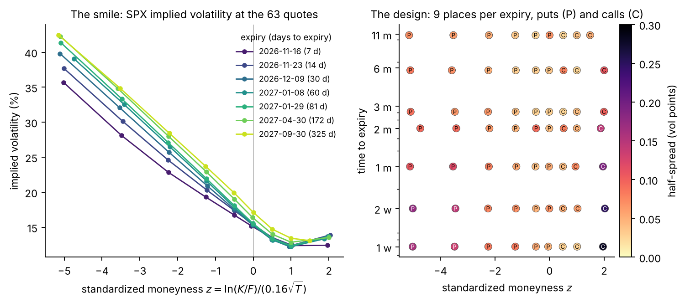

**Figure 4.** Left: the smile at the 63 quotes, one line per expiry. Right: the design in
$`(z, T)`$, coloured by each quote's half-spread in vol points (median 0.064, from 0.025
to 0.28). The widest are the calls at $`z \approx 2`$ in the first two weeks.

Using actual quotes adds no interpolation error. Because the design is fixed, one trained
network serves this snapshot; a new design needs its own simulations and network.

### 5.2 What each region pins

A local calculation shows how much each region of quotes contributes. At the SPX
posterior mean $`\hat\theta`$, with the Jacobian $`\mathcal{J} = \partial P/\partial\theta`$
by central differences and independent errors of one half-spread, the Fisher information
and the local posterior covariance are

```math
\mathcal{I} = \mathcal{J}^\top\,\mathrm{diag}(1/h^2)\,\mathcal{J},\qquad \mathrm{Cov}(\theta \mid y) \approx \mathcal{I}^{-1},\qquad \mathrm{Var}\big(g(\theta) \mid y\big) \approx \nabla g^\top\,\mathcal{I}^{-1}\,\nabla g ,
```

for any derived quantity $`g`$, such as a forward-starting variance. Removing the quotes of
a region $`R`$ gives $`\mathcal{I}_{-R}`$; the rise in posterior standard deviation is the
ratio of the square roots of the diagonals of $`\mathcal{I}_{-R}^{-1}`$ and
$`\mathcal{I}^{-1}`$, minus one. It does not depend on $`c`$, which scales every variance
alike.

| Region removed | $`v_0`$ | $`\kappa`$ | $`\bar{v}`$ | $`\xi`$ | $`\rho`$ | Short-window variance | Later-window variance |
| --- | ---: | ---: | ---: | ---: | ---: | ---: | ---: |
| Deep puts, $`z \le -2.25`$ (21 quotes) | +56% | +76% | +75% | +87% | +3% | +79% | +71% |
| Near puts, $`z`$ = −1.25 and −0.5 (14) | +21% | +9% | +20% | +8% | +17% | +21% | +25% |
| At the money, $`z = 0`$ (7) | +4% | +3% | +1% | +2% | +4% | +3% | +0% |
| Calls, $`z \gt 0`$ (21) | +124% | +30% | +53% | +77% | +791% | +122% | +76% |
| Expiries up to 1 month (27) | +144% | +70% | +23% | +92% | +10% | +106% | +11% |
| Expiries from 2 months (36) | +101% | +846% | +1502% | +107% | +157% | +39% | +1684% |

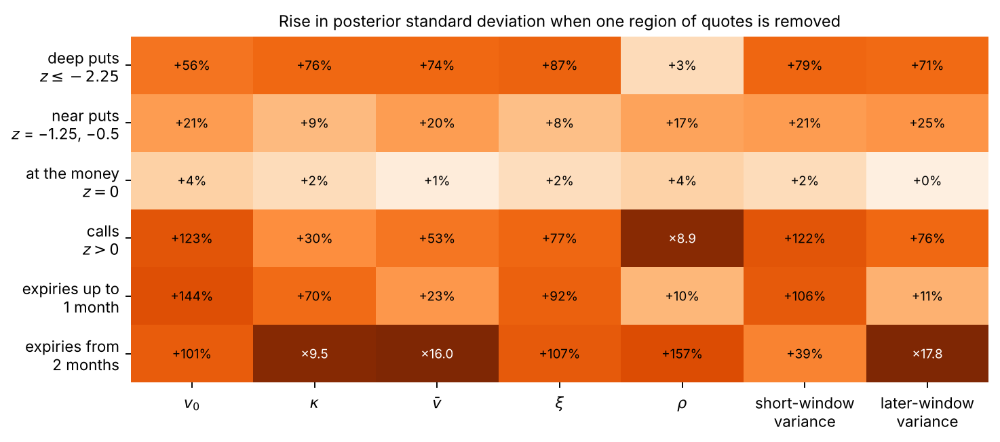

**Figure 5.** The table as a chart. Bars beyond the scale are labelled with the factor by
which the standard deviation grows.

- The calls pin $`\rho`$: without them its uncertainty grows ninefold.
- The expiries from 2 months pin the long-run level: without them $`\bar{v}`$ and the
  later-window variance become 16 and 18 times less certain, and $`\kappa`$ 9.5 times.
- The expiries up to 1 month pin today's variance and the short-window variance.
- The deep puts matter for every parameter except $`\rho`$, by 56% to 87%.
- The at-the-money point adds little once its neighbours are present.

So a design must reach deep puts and far calls, at short and at long maturities.

### 5.3 Coverage over density

Exact posteriors confirm this on simulated surfaces. A narrower design of 54 quotes, with
six expiries from 21 to 325 days (none shorter than three weeks), puts to about
$`z = -4`$ and calls to about $`z = +1`$, was compared with the 63-quote design on two simulated surfaces with
the same parameters. Under the 63 quotes the exact posterior's 90% intervals for the five
Heston parameters are 41% to 87% as wide, and $`\rho`$'s narrows the most on one of the two
(to 41%). The quotes, their half-spreads and the error draws differ between the two
designs, so this comparison describes two cases rather than proving a general ranking.

### 5.4 Data kept out of every fit

- **Carry anchors:** the parity pairs of 1.2, used only for forwards and discounts.
- **Held-out quotes:** a separate set of quotes, excluded from the selection, for scoring
  predictions out of sample.
- **Variance-swap strips:** at each expiry, all usable out-of-the-money quotes, for the
  check of 1.5.
- **The listed 2-year 90% put:** the listed expiry nearest 2 years and the strike nearest
  $`0.9\,F(T)`$, for a check of extrapolation in maturity.

## 6. How quotes differ from the model

### 6.1 The observation law

For the $`n = 63`$ quotes, in forward-unit prices,

```math
y_i = P_i(\theta) + c\,h_i\,Z_i,\qquad Z_i \sim \mathcal N(0, 1)\ \text{independent},\qquad c \sim U(0.5,\ 2) .
```

- **Why the half-spread.** The value at which a trade would happen lies between bid and
  ask, so each quote's own half-spread is the natural scale of its uncertainty. Reading it
  as one standard deviation is a convention.
- **Why a multiplier.** A single $`c`$ lets the data decide how large the errors are,
  relative to the half-spreads. It is inferred jointly with the model's parameters and is
  never an input to the network.
- **Price space.** Errors are added to prices, not implied volatilities, so a simulated
  price that falls below zero stays usable without inversion.

### 6.2 Likelihood

With $`R(\theta) = \sum_i \big((y_i - P_i(\theta))/h_i\big)^2`$, the sum of squared misses
in half-spreads,

```math
\log p(y \mid \theta, c) = -\frac{R(\theta)}{2c^2} - n\ln c - \sum_i \ln h_i - \frac n2 \ln 2\pi .
```

The term $`-n\ln c`$ is the normalizing constant of the Gaussian: it penalizes large
$`c`$, and without it the posterior would push $`c`$ up to explain any miss. At fixed
$`\theta`$, setting the derivative in $`c`$ to zero gives the conditional mode

```math
\hat c(\theta) = \sqrt{R(\theta)/n} ,
```

the root-mean-square miss in half-spreads, clipped to the prior's range.

### 6.3 How precisely the error scale can be learned

At the true $`\theta`$, $`R/c^2`$ is a sum of $`n`$ squared standard normals, $`\chi^2_n`$.
With $`p`$ parameters fitted, about $`p`$ of the $`n`$ directions in which the quotes move
are absorbed by the fit, and $`R/c^2 \approx \chi^2_m`$ with $`m = n - p`$. Then
$`\hat c = c\,\sqrt{\chi^2_m/m}`$, and since $`\mathrm{Var}(\chi^2_m/m) = 2/m`$, the delta
method gives

```math
\frac{\mathrm{sd}(\hat c)}{c} \approx \frac{1}{\sqrt{2m}} = \frac{1}{\sqrt{2 \times 58}} \approx 0.093 ,
```

so a 90% interval about $`2 \times 1.645 \times 0.093 \approx 0.31`$ times $`c`$ wide. The
exact posteriors of the two simulated cases, both generated with $`c = 1`$, have 90%
intervals for $`c`$ of width 0.31 and 0.28. The quotes determine $`c`$ well; step 7 shows
what a network needs in order to read it.

### 6.4 The fixed-scale case

With $`c`$ fixed, the likelihood is a least-squares criterion with weights
$`1/(c\,h_i)^2`$. Near the mode the posterior covariance is $`c^2\,(\mathcal{J}^\top\mathrm{diag}(1/h^2)\mathcal{J})^{-1}`$,
so the posterior widths of the physical parameters scale with $`c`$: fixing $`c`$ at 0.5
or 2 halves or doubles them, as long as the prior box does not bind. The error model sets
the width of every range that follows.

### 6.5 What the SPX quotes say

The exact posterior on the market puts $`c`$ at 1.9993 ± 0.0007, against an upper bound of
2: the quotes ask for errors larger than the prior allows.

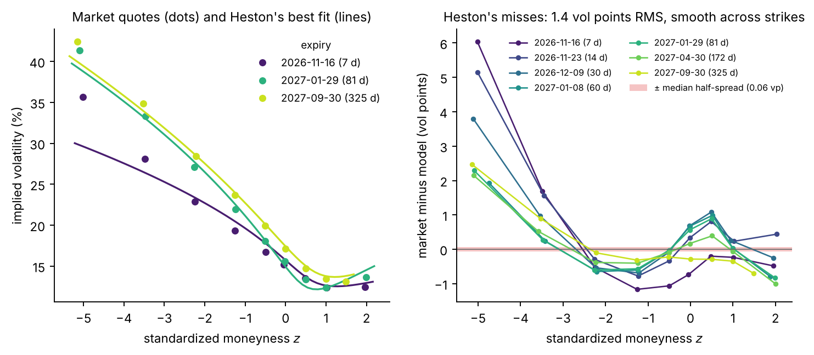

**Figure 6.** Left: market quotes (dots) and Heston at its exact posterior mean (lines), for
three expiries. At 7 days the model cannot produce the steep skew of the deep puts. Right:
market minus model in vol points, for all seven expiries; the red band, ± one median
half-spread, is barely visible.

| Measure | Value |
| --- | --- |
| Root-mean-square miss, 63 quotes | 1.38 vp |
| Largest miss (7-day put at $`z = -5`$) | 6.0 vp |
| Root-mean-square miss by expiry, 7 / 14 / 30 days | 2.2 / 1.8 / 1.4 vp |
| Root-mean-square miss by expiry, 60 to 325 days | 0.84–0.93 vp |
| Median half-spread | 0.064 vp |
| Root-mean-square miss in price, in half-spreads | 13.4 (the prior allows at most 2) |
| Correlation of neighbouring misses along strikes | 0.66 |
| Correlation of misses at adjacent expiries, same $`z`$ | 0.94 |

On SPX the model, not the quotes, is the main source of error, and the misses are smooth
across strikes and maturities. The posterior is then the uncertainty of Heston's
parameters given that Heston is the model, with errors capped at twice the half-spread: it
leaves out the model's own error. Widening the prior on $`c`$ would not repair this.
Independent errors would treat the 63 smooth misses as 63 independent pieces of evidence,
when they form a few smooth bumps, and the posterior would remain too narrow (6.6).

### 6.6 The smooth model-error extension

The natural extension adds a smooth error in implied volatility:

```math
y = P(\theta) + c\,h \odot Z + \tau\,\nu \odot U,\qquad Z \sim \mathcal N(0, I_n),\qquad U \sim \mathcal N(0, K_\ell)\ \text{independent},
```

with $`\nu`$ the quotes' vegas, $`\tau`$ the model error's size in volatility (inferred),
$`\odot`$ the elementwise product, and $`K_\ell`$ a squared-exponential correlation over
$`(z_i, \ln T_i)`$:

```math
(K_\ell)_{ij} = \exp\!\Big(-\frac{(z_i-z_j)^2}{2\ell_z^2} - \frac{(\ln T_i-\ln T_j)^2}{2\ell_T^2}\Big).
```

The law of 6.1 is the special case $`\tau = 0`$.

**Likelihood.** With $`r = y - P(\theta)`$,

```math
\Sigma(\tau, c) = c^2\,\mathrm{diag}(h^2) + \tau^2\,\mathrm{diag}(\nu)\,K_\ell\,\mathrm{diag}(\nu),\qquad
\log p(y \mid \theta, c, \tau) = -\tfrac12\,r^\top\Sigma^{-1}r - \tfrac12\log\det\Sigma - \tfrac n2\log 2\pi ,
```

computed with a Cholesky factor of $`\Sigma`$. The log-determinant plays the role of
$`-n\ln c`$: it stops $`\tau`$ from growing without bound. For rough Bergomi the Monte
Carlo price covariance at $`\theta`$ is added to $`\Sigma`$.

**Volatility units.** To first order,
$`y_i - P_i(\theta) \approx \nu_i\,(\sigma^{\text{market}}_i - \sigma^{\text{model}}_i)`$,
so dividing the residuals by $`\nu`$,

```math
\frac{r}{\nu} \sim \mathcal N\big(0,\ c^2\,\mathrm{diag}(h_{\text{vol}}^2) + \tau^2 K_\ell\big),\qquad h_{\text{vol}} = h/\nu :
```

independent quote noise in vol points plus a smooth curve of model error.

**How precisely the model-error size can be learned.** In volatility units, with
$`\Sigma = c^2 D + \tau^2 K`$, $`D = \mathrm{diag}(h_{\text{vol}}^2)`$, the Fisher information
for $`\tau^2`$ is $`\tfrac12\,\mathrm{tr}\big(\Sigma^{-1}K\,\Sigma^{-1}K\big)`$. If
$`D \approx d\,I`$ and $`K = \sum_k \lambda_k e_k e_k^\top`$,

```math
\mathcal{I}(\tau^2) = \frac12\sum_k \frac{\lambda_k^2}{(c^2 d + \tau^2\lambda_k)^2} \approx \frac{m_{\text{eff}}}{2\tau^4},\qquad m_{\text{eff}} = \text{number of } k \text{ with } \tau^2\lambda_k \gg c^2 d ,
```

so $`\mathrm{sd}(\tau)/\tau \approx 1/\sqrt{2\,m_{\text{eff}}}`$: only the directions in which
model error dominates quote noise inform $`\tau`$. On the 63 quotes, with their own
half-spreads, $`c = 1`$ and $`\theta`$ held fixed:

| Correlation lengths $`(\ell_z, \ell_T)`$ | $`\tau`$ | $`\mathrm{sd}(\tau)/\tau`$ | $`m_{\text{eff}}`$ |
| --- | ---: | ---: | ---: |
| (0.75, 1.15) | 1 vp | 0.108 | 43 |
| (0.75, 1.15) | 2.5 vp | 0.099 | 51 |
| (1.6, 2.0) | 1 vp | 0.151 | 22 |
| (1.6, 2.0) | 2.5 vp | 0.134 | 28 |

So $`\tau`$ is determined to about 10–15%, less sharply the smoother the error. Fitting
$`\theta`$ as well absorbs up to $`p`$ of these directions.

**Why independent errors make posteriors too narrow.** Estimate a quantity along a
direction $`a`$ of the quotes by least squares while the true residual covariance is
$`\tau^2 K`$. The true variance of the estimate is $`\tau^2\,a^\top K a/(a^\top a)^2`$; an
independent-error model claims $`\tau^2/(a^\top a)`$. Their ratio,

```math
\frac{a^\top K a}{a^\top a} ,
```

is large when $`a`$ is smooth across quotes. For a level shift, $`a = \mathbf{1}`$, it is
$`\mathbf{1}^\top K\mathbf{1}/n`$, the average number of strongly correlated neighbours. On
the 63 quotes the independent model understates that standard deviation by a factor of
2.9 with $`\ell = (0.75, 1.15)`$ and 4.7 with $`\ell = (1.6, 2.0)`$. Variance levels, and
with them variance and volatility swaps, load on such smooth directions.

**Settings.** $`\tau`$ log-uniform on 0.2 to 5 vp for both models; the correlation lengths
fixed per model before training by profile likelihood on the quotes, over
$`\ell_z \in`$ {0.75, 1, 1.5, 2} and $`\ell_T \in`$ {1, 1.5, 2}; $`c`$ as in 6.1.

**What it means for the network.** In the network's coordinates $`y/h`$ the noise
covariance becomes $`c^2 I + \tau^2\,\mathrm{diag}(\nu/h)\,K_\ell\,\mathrm{diag}(\nu/h)`$. At
$`\tau = 1`$ vp and a median half-spread of 0.064 vp, the model-error variance is hundreds
of times the quote noise in its leading directions, and those directions are smooth, like
the parameters' own. Reading $`\tau`$ is therefore the same kind of problem as reading
$`c`$, and needs the same input conditioning (step 7).

The extension is specified and its identifiability computed; posteriors and networks that
include it are among the next steps (10.3).

## 7. Computing the posterior: simulation-based inference

### 7.1 Why amortize

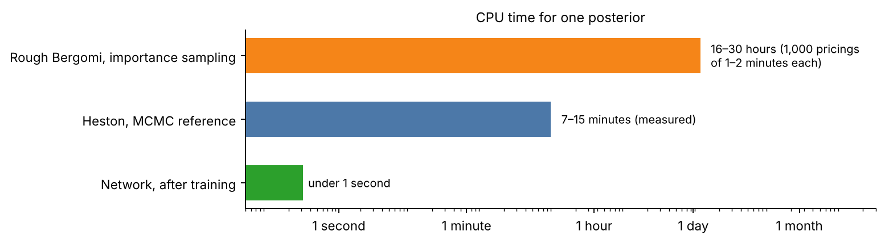

**Figure 7.** CPU time for one posterior, on a logarithmic scale. Heston's exact posterior by
MCMC: 7 to 15 minutes for the accepted run on each of three cases. Rough Bergomi by
importance sampling: about 1,000 pricings of the 63 quotes at 1 to 2 minutes each. The
trained network: under a second.

| | Heston | Rough Bergomi |
| --- | --- | --- |
| One likelihood (63 prices) | 3–6 ms (Fourier) | 1–2 CPU-minutes (Monte Carlo) |
| One reference posterior | 9–18 CPU-minutes by MCMC (8.1) | about 17–29 CPU-hours by importance sampling with 1,000 draws |
| 300 reference posteriors | 45–90 CPU-hours | about 5,000–9,000 CPU-hours |
| One network posterior | about 0.3 s | under a second, once trained |

Calibrated ranges must be tested on hundreds of simulated surfaces, and a desk needs them
every day, for every model and underlying. One exact posterior is affordable; hundreds are
affordable for Heston and not for rough Bergomi. A network trained once serves them all.

### 7.2 The amortization identity and the training objective

Draw $`\theta \sim p(\theta)`$ and $`y \sim p(y \mid \theta)`$. The pair is a draw from the
joint distribution, which factors both ways:

```math
p(\theta, y) = p(\theta)\,p(y \mid \theta) = p(y)\,p(\theta \mid y).
```

Read from the right, $`\theta`$ is a posterior draw given its own $`y`$. For any
conditional density $`q(\theta \mid y)`$,

```math
\mathbb{E}_{p(\theta, y)}\big[-\log q(\theta \mid y)\big] = \mathbb{E}_{p(y)}\Big[\mathrm{KL}\big(p(\cdot \mid y)\,\big\|\,q(\cdot \mid y)\big)\Big] + \mathbb{E}_{p(y)}\Big[\mathcal{H}\big(p(\cdot \mid y)\big)\Big],
```

where $`\mathcal{H}`$ is the entropy, which does not depend on $`q`$. Minimizing the
left-hand side over simulated pairs therefore drives $`q`$ to the posterior for almost
every $`y`$: neural posterior estimation.

**Flow matching** (BayesFlow 2.1) reaches the same target by regression. Pair a noise draw
$`\theta_0 \sim \mathcal N(0, I)`$ with a simulated $`\theta_1`$ and its $`y`$, and set
$`\theta_t = (1-t)\,\theta_0 + t\,\theta_1`$ for $`t \in [0, 1]`$. A network
$`v(\theta_t, t; y)`$ is trained to predict the direction $`\theta_1 - \theta_0`$:

```math
\min_v\ \mathbb{E}\Big[\big\|v(\theta_t, t; y) - (\theta_1 - \theta_0)\big\|^2\Big].
```

The minimizer is $`v^*(\theta, t; y) = \mathbb{E}[\theta_1 - \theta_0 \mid \theta_t = \theta, y]`$,
and integrating $`d\theta/dt = v^*(\theta, t; y)`$ from $`t = 0`$ to 1 carries
$`\mathcal N(0, I)`$ to $`p(\theta \mid y)`$. Sampling the posterior means solving this ODE
from many noise draws. In both cases the approximation error can differ from one $`y`$ to
another, which is why step 8 checks single observations as well as averages.

### 7.3 The simulation banks

| | Heston | Rough Bergomi |
| --- | --- | --- |
| Training rows | 300,000 parameter sets $`(\theta, c)`$ from the prior | 300,000, being generated |
| Other rows | 100 for validation during training; 512 for the checks of step 8 | 5,000 for validation and 7,000 for testing, to follow |
| Clean prices | Fourier with the Black control variate, accepted by the 0.01 $`h`$ gate | Hybrid-scheme Monte Carlo to the accuracy target of 4.2 |
| Errors | one draw of $`Z`$ per row, kept for every pass | the same |
| Cost | 300,612 checked pricings in 16 minutes on one workstation | 47–59 hours on 192 CPUs |
| Failures | none at the gate | recorded and never redrawn (7 of the first 2,764) |

The prices are computed once and stored; $`c\,h \odot Z`$ is added to give each row's
observation.

### 7.4 Reading the error scale: why the inputs must be whitened

**The geometry.** The network's input is $`x = y/h`$, elementwise. Under the law of 6.1,
$`x = s(\theta) + c\,Z`$, with $`s = P/h`$. Across the prior,

```math
\mathrm{Cov}(x) = \mathrm{Cov}_\theta\big(s(\theta)\big) + \mathbb{E}[c^2]\,I,\qquad \mathbb{E}[c^2] = \frac{2^3 - 0.5^3}{3 \times 1.5} = 1.75 .
```

One parameter vector moves all the prices together, so the first term is huge and nearly
of low rank: a few directions hold almost all of the price variance, while the noise has
variance 1.75 in every direction. The information about $`c`$ lives in the residual,
$`\hat c^2 \approx \sum_i (x_i - s_i(\theta))^2/n`$, that is, in the directions the
parameters cannot explain.

**A two-quote example.** Let $`x_1 = s + c\,z_1`$ and $`x_2 = s + c\,z_2`$, with a common
move $`s`$ of standard deviation 150. The only information about $`c`$ is in
$`x_1 - x_2 = c\,(z_1 - z_2)`$. Scaled to unit variance, each input is almost entirely
$`s`$, and the difference has standard deviation about 0.012. To read $`c`$, the network
must find the weights (1, −1) to about one part in a thousand, then square the result;
with 63 quotes it needs about 58 such cancellations.

**Why more data or training does not help.** For gradient descent on a linear first layer,
the curvature of the loss in the weights is the input covariance. The step size is capped
by its largest eigenvalue, so progress along the smallest is about one part in the
condition number per step. More data and longer training add steps but leave the
condition number unchanged; larger batches reduce gradient noise, not curvature; per-feature
scaling and Adam rescale coordinates one at a time, while the hard directions are
rotations. (The argument is exact only for plain gradient descent on a linear layer; it is
a guide.) It also explains why the physical parameters are learned easily: they live in
the large directions.

**Full (ZCA) whitening.** With $`\mu`$ and $`C`$ the mean and covariance of the noisy
training inputs, $`C = Q\,\mathrm{diag}(\lambda)\,Q^\top`$:

```math
W = Q\,\mathrm{diag}\Big(1/\sqrt{\max(\lambda_k,\ 10^{-8}\lambda_{\max})}\Big)\,Q^\top,\qquad u = W\,(x - \mu),\qquad \mathrm{Cov}(u) \approx I .
```

$`W`$ is invertible and keeps every coordinate, so it changes neither the information nor
the exact posterior, only how hard the network's task is. It rescales the noise-dominated
directions to unit variance, which in effect hands the network the residual. ZCA, the
symmetric choice of $`W`$, also keeps each whitened input close to its own quote. In
whitened coordinates the noise covariance is $`c^2\,W W^\top`$.

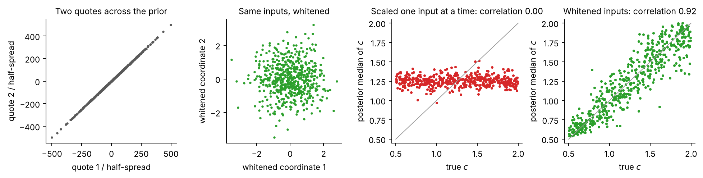

**Figure 8.** First two panels: two quotes across the prior lie almost on a line, because both
follow the parameters; after whitening they form a round cloud, in which the error
directions are as visible as the rest. Last two panels: a controlled comparison in which
only the input scaling differs. Scaled one input at a time, the network returns the prior
for $`c`$; whitened, it recovers $`c`$.

The controlled comparison used a 54-quote design, 10,000 training rows, the same network
(a spline coupling flow) and the same initial weights, and changed only the input scaling:

| 512 simulated observations | Each input scaled on its own | ZCA whitening |
| --- | ---: | ---: |
| Condition number of the input covariance | 2.2 million | 1 |
| Correlation of true $`c`$ with its posterior median | 0.00 | 0.92 |
| Error of the posterior median of $`c`$ (root mean square) | 0.44 | 0.17 |
| Median width of the 90% interval for $`c`$ | 1.34 (the prior's is 1.35) | 0.37 |

**Rules.**
- Fit $`\mu`$ and $`W`$ on noisy training inputs only (here the first 10,000 rows), in
  float64; never on validation, test or market observations.
- Store the transform with the network and apply exactly the same one at training,
  validation and use, the market included.
- Whiten the whole noisy vector, $`W(x - \mu)`$; never add noise after whitening clean
  prices, which would change the model.
- One transform per ordered design and model: a new design, or rough Bergomi, gets its
  own.

### 7.5 The trained network

- **Inputs:** the 63 values $`y_i/h_i`$, whitened as above. $`c`$ is never an input.
- **Targets:** $`(v_0, \kappa, \bar{v}, \xi, \rho, c)`$ in their own units, standardized.
  No transform keeps draws inside the prior box; draws that fall outside are kept and
  counted (8.2).
- **Network:** flow matching, with a velocity network of three hidden layers of 128
  units, a 32-dimensional embedding of $`t`$ and dropout 0.1; posterior draws by ODE
  integration with adaptive steps.
- **Training:** 300 passes over the 300,000 rows (90 million presentations) in batches of
  256, so 1,172 updates per pass and 351,600 in all; AdamW with weight decay 0.005 and
  gradient-norm clipping at 1.5; learning rate rising from $`5\times10^{-5}`$ to
  $`5\times10^{-4}`$ over the first 17,580 updates (5%), then decaying to zero along a
  cosine; seed 9011. The final pass is the network used. The pass with the lowest
  validation loss (259) was evaluated as well and is no better.
- **Cost:** 30 minutes of training on one workstation. The checks of step 8 drew 615
  posteriors in 164 seconds, about 0.3 s each.
- **Rough Bergomi:** the same recipe, with its own whitener fitted on its own bank, and
  seven targets $`(H, \eta, \rho, \xi_s, \xi_l, \lambda, c)`$.

## 8. Checking it

A network's posterior is an approximation, used as far as it passes checks. Each check
answers one question.

### 8.1 Reference posteriors

**Heston, exact, by MCMC.**
- *Target:* the uniform priors and the likelihood of 6.2 with Fourier prices, in PyMC.
- *Sampler:* DEMetropolisZ, which needs no gradients. Gradient-based samplers would need
  validated gradients of the Fourier likelihood
  ([MCMC policy](../mcmc-policy.md)).
- *Schedule:* 4 chains of 2,000 tuning steps and 2,000 draws; if the diagnostics fail,
  one declared extension to 6,000 and 12,000. All three cases used the extension.
- *Starts:* four fits to the data alone, dispersed; never the truth or the network.
- *Acceptance:* rank-normalized $`\hat R \le 1.01`$, and bulk and tail effective sample
  sizes of at least 400, for every parameter and for the products of 9.2; the price check
  of 4.1 at sampled draws.

| Case | Truth | Max $`\hat R`$ | Min bulk / tail ESS | CPU minutes (accepted run, total) |
| --- | --- | ---: | ---: | ---: |
| Broad, simulated | $`v_0`$ 0.136, $`\kappa`$ 3.08, $`\bar{v}`$ 0.083, $`\xi`$ 1.72, $`\rho`$ −0.78, $`c`$ 1 | 1.002 | 2,164 / 3,095 | 7.1 / 8.6 |
| Market-like, simulated | $`v_0`$ 0.027, $`\kappa`$ 4.34, $`\bar{v}`$ 0.056, $`\xi`$ 1.80, $`\rho`$ −0.67, $`c`$ 1 | 1.002 | 2,277 / 3,335 | 14.8 / 18.0 |
| SPX quotes | unknown | 1.002 | 2,041 / 2,361 | 15.0 / 18.4 |

**Rough Bergomi, by importance sampling with the network as proposal.** Draw
$`\theta_s \sim q(\theta \mid y)`$, $`s = 1, \dots, 1{,}000`$, and weight

```math
\tilde w_s = \frac{p(\theta_s)\,\hat L(y \mid \theta_s)}{q(\theta_s \mid y)},
```

with $`\hat L`$ the Gaussian likelihood of 6.2 evaluated with fixed-seed Monte Carlo prices,
their covariance added to the errors' (6.6). The fixed seed makes $`\hat L`$ a
deterministic function of $`\theta`$, so the weighted draws target the exact posterior of
that numerical model. Accepted when the effective sample size
$`(\sum_s \tilde w_s)^2/\sum_s \tilde w_s^2`$ is at least 200 and the Pareto-smoothed
$`\hat k`$ below 0.7; otherwise the network is reported as not checked on that case.

### 8.2 Population checks on simulated surfaces

512 surfaces simulated from the prior, each with its known parameters, and 512 posterior
draws from the network for each.

**Recovery.** How close the posterior median is to the truth.

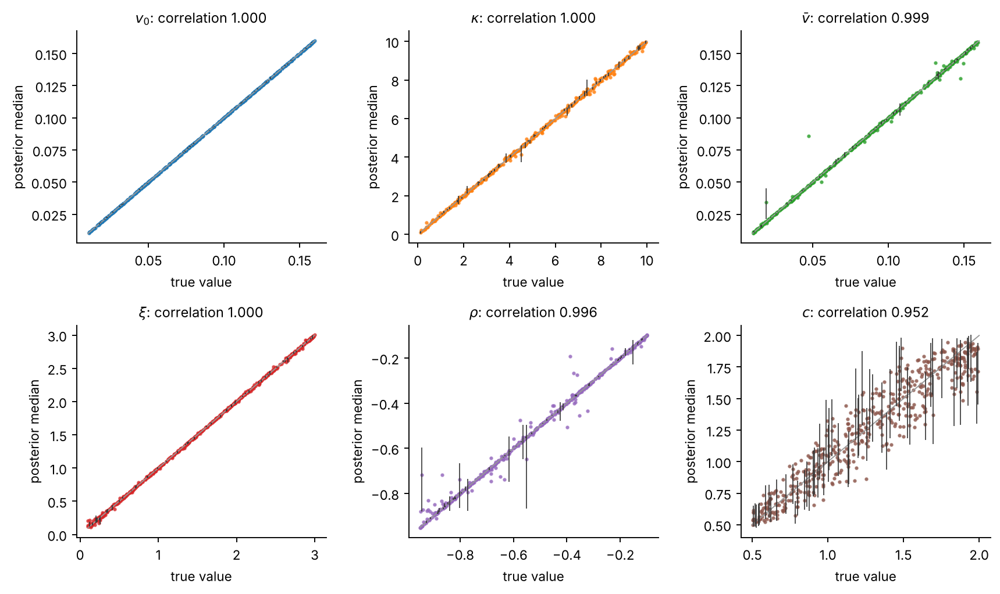

**Figure 9.** True value against posterior median, with 90% intervals on 60 of the surfaces.
The five Heston parameters are recovered almost exactly; $`c`$, read from the errors
alone, has wider intervals.

**Coverage.** A central interval at level $`\alpha`$ should contain the truth in a
fraction $`\alpha`$ of the surfaces. With 512 surfaces the binomial standard error at 90%
is $`\sqrt{0.9 \times 0.1/512} = 1.3\%`$.

**Rank test (simulation-based calibration).** If $`q(\cdot \mid y)`$ is the posterior, the
truth and the $`L`$ draws are $`L+1`$ exchangeable draws from the same distribution given
$`y`$, so the truth's rank among them is uniform. The test compares the empirical
distribution of the 512 fractional ranks with the uniform; the band is the
Dvoretzky–Kiefer–Wolfowitz bound at 5%, shared over the six targets,
$`\varepsilon = \sqrt{\ln(2 \times 6/0.05)/(2 \times 512)} = 0.073`$. A posterior that
returns the prior also passes, so this test is necessary, not sufficient.

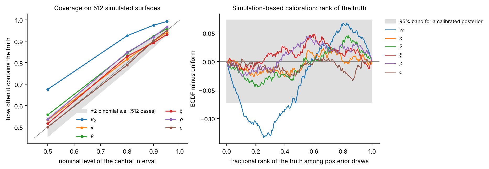

**Figure 10.** Left: coverage of central intervals against their nominal level; a calibrated
posterior lies on the diagonal, within the grey band. Right: the rank test; a calibrated
posterior stays inside the grey band.

| | $`v_0`$ | $`\kappa`$ | $`\bar{v}`$ | $`\xi`$ | $`\rho`$ | $`c`$ |
| --- | ---: | ---: | ---: | ---: | ---: | ---: |
| Coverage at 50% | 67.6% | 53.3% | 55.7% | 51.6% | 53.5% | 50.0% |
| Coverage at 80% | 92.6% | 81.6% | 84.4% | 83.0% | 84.8% | 78.9% |
| Coverage at 90% | 97.5% | 90.0% | 92.4% | 89.3% | 92.0% | 90.2% |
| Coverage at 95% | 99.2% | 94.1% | 95.9% | 93.2% | 96.7% | 94.9% |
| Rank test: distance (band 0.073) | 0.135 | 0.028 | 0.048 | 0.051 | 0.048 | 0.034 |
| Correlation of truth and median | 0.99999 | 0.9997 | 0.9987 | 0.9999 | 0.996 | 0.95 |
| Median 90% width, share of the prior's | 0.37% | 1.7% | 0.69% | 1.1% | 1.0% | 32% |

- Five of the six targets are calibrated.
- $`v_0`$'s intervals are too wide: the truth falls near the centre too often. A normal
  posterior widened by a factor $`k`$ covers $`P(|Z| \le 1.645\,k)`$ at nominal 90%;
  97.5% gives $`k \approx 1.36`$, and the 50% and 80% levels give 1.46 and 1.39. So the
  intervals for $`v_0`$ are about 1.4 times as wide as they should be.
- The error of the median of $`c`$ is 0.135 root mean square, close to the precision the
  quotes allow (6.3).
- 3.0% of all draws fall slightly outside the prior box; they are kept, not clipped.

### 8.3 Conditional checks against the references

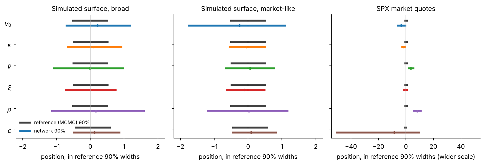

**Figure 11.** For each case and parameter, the 90% interval of the reference (grey) and of
the network (colour), centred on the reference median and measured in reference widths.
On the two simulated surfaces the network brackets the reference with wider intervals. On
the SPX quotes it is far away (note the wider scale).

The network draws 4,096 times on each case. Mean error is (network mean − reference mean)
divided by the reference standard deviation; width ratio is network 90% width over
reference 90% width.

| Case | | $`v_0`$ | $`\kappa`$ | $`\bar{v}`$ | $`\xi`$ | $`\rho`$ | $`c`$ | Short-window variance | Later-window variance |
| --- | --- | ---: | ---: | ---: | ---: | ---: | ---: | ---: | ---: |
| Broad | mean error | 0.75 | 0.30 | 0.06 | 0.01 | 0.58 | 0.40 | 0.78 | 0.11 |
| Broad | width ratio | 1.87 | 1.58 | 2.04 | 1.46 | 2.71 | 1.33 | 2.09 | 1.83 |
| Market-like | mean error | 0.96 | 0.12 | 0.17 | 0.33 | 0.04 | 0.33 | 0.87 | 0.14 |
| Market-like | width ratio | 2.86 | 1.05 | 1.43 | 1.11 | 2.34 | 1.27 | 2.74 | 1.89 |
| SPX | mean error | 11.2 | 5.8 | 12.0 | 1.8 | 26.9 | 37.2 | 9.2 | 12.4 |
| SPX | width ratio | 5.8 | 1.7 | 3.4 | 2.0 | 4.8 | 59 | 5.3 | 4.2 |

- *Simulated surfaces.* The network's means lie within one reference standard deviation,
  and its intervals are 1.05 to 2.9 times as wide, widest for $`v_0`$ and $`\rho`$: close
  and conservative, but not exact. For single surfaces we ask for means within a fraction
  of a reference standard deviation and widths within about 25%, so a single surface's
  results come from the reference.
- *SPX.* The network is far from the reference: 21% of its draws put $`c`$ above 2, and
  its physical means sit 2 to 27 reference standard deviations away. The market's misses,
  13 half-spreads root mean square, are larger than any error the prior allows, so the
  market lies outside what the network saw in training. Market results use the exact
  posterior.

### 8.4 What each kind of check answers

- *Population checks* (8.2) average over the prior: they say whether the network is
  calibrated on average.
- *Conditional checks* (8.3) test single observations: a network can be calibrated on
  average and still be wrong on a given day.
- *Model checks* test Heston against the market, which no amount of inference accuracy can
  settle:
  - the misses and $`c`$ (6.5), computed: the model misses by far more than the quotes'
    uncertainty;
  - prediction of the held-out quotes (5.4);
  - the model's variance-swap strikes against those of the listed strips (1.5);
  - the listed 2-year 90% put against the model's prediction (9.7).

Under the smooth model-error law of 6.6, the prediction for a held-out quote with price
$`P_*(\theta)`$, vega $`\nu_*`$ and half-spread $`h_*`$ includes the model error carried
over from the design. With $`k_* = \tau^2\,\nu_*\,\mathrm{diag}(\nu)\,K_\ell(\text{design}, *)`$
the covariance between the model error at the held-out point and at the design, Gaussian
conditioning gives, for each posterior draw,

```math
y_* \sim \mathcal N\Big(P_*(\theta) + k_*^\top\Sigma^{-1}r,\ \ \tau^2\nu_*^2 - k_*^\top\Sigma^{-1}k_* + (c\,h_*)^2\Big),\qquad r = y - P(\theta) .
```

Under the law of 6.1 the prediction is $`P_*(\theta) + c\,h_* Z_*`$, which will
under-cover wherever the misfit is real.

## 9. From the posterior to the products

### 9.1 Principle

A product's value is a function of the parameters,
$`P_j(\theta) = \mathbb{E}_\theta[\text{discounted payoff}]`$, and the posterior induces its
distribution (step 3). For each posterior draw, price each product. Path-dependent products
need simulation: every draw uses the same normals (common random numbers), so Monte Carlo
noise moves all draws together and the spread across draws is the parameters' (9.8). The
error scales $`c`$ and $`\tau`$ do not enter: they describe how listed options are
observed, not how the index moves.

### 9.2 Forward-starting variance: closed form

For each draw the strike is the closed form of 4.1 (Heston) or 4.2 (rough Bergomi). Two
windows are marked: a short one, from today to the 30 November 2026 expiry (21 days), and
a later one, from the 29 January to the 30 September 2027 expiries (81 to 325 days). Under
the exact SPX posterior of Heston:

| Window | Fair strike, as volatility | Posterior sd | 90% range | Reserve of a long position |
| --- | ---: | ---: | --- | ---: |
| 0 to 21 days | 17.73% | 0.027 vp | 17.69% to 17.78% | 0.035 vp |
| 81 to 325 days | 22.61% | 0.048 vp | 22.54% to 22.69% | 0.062 vp |

The reserve is the mean minus the 10% quantile of the strike, in vol points of strike. A
variance swap is usually sized by its vega notional, the amount paid per vol point of
realized volatility above the strike; per 100,000 of vega notional, these reserves are
about 3,500 and 6,200 before discounting.

The ranges are a few hundredths of a vol point wide, while at these maturities Heston
misses the quotes by 0.8 to 2.2 vol points (6.5). They are the uncertainty of Heston's
parameters given that Heston is right, with errors capped at twice the half-spread. Under
the smooth model-error law of 6.6 they would widen: the variance level loads on exactly
the smooth directions that law adds.

On the two simulated surfaces, the network's values for both windows lie within 0.9
reference standard deviations of the reference's, with 90% ranges 1.8 to 2.7 times as wide
(8.3).

### 9.3 Path simulation

- **Heston:** full-truncation Euler, with $`V^+ = \max(V, 0)`$ in the drift and the
  volatility,
  $`V_{t+\Delta} = V_t + \kappa(\bar{v} - V_t^+)\,\Delta + \xi\sqrt{V_t^+}\,\Delta W`$,
  four steps per business day ($`\Delta = 1/1008`$ year); $`I`$ and $`J`$ stored at every
  close (`calibration.products.heston_paths`).
- **Rough Bergomi:** the hybrid scheme of 4.2, 2,016 steps per year, $`I`$ and $`J`$ stored
  at every close (`calibration.products.rough_paths`).
- **Normals:** antithetic pairs; the normals for $`J^{\perp}`$, one per close, are drawn
  once and shared by all draws.
- **Horizon:** 1 year for the swaps, the forward start and the barrier put; 2 years for
  the check of 9.7, with the curve held flat beyond its last fitted point (stated).
- **Fit and products on one model:** Heston's fit uses Fourier prices and its products
  use Euler paths. On each day, the paths must reprice the design's options within
  0.05 vp of Fourier at the posterior median; otherwise the time step is halved.

### 9.4 Volatility swap

$`K_{\text{vol}}(T) = \mathbb{E}\big[\sqrt{I_T/T}\big]`$, estimated by the path mean of
$`\sqrt{I_T/T}`$ with antithetic pairs and one control variate
(`calibration.products.volatility_swap`): $`I_T/T`$ minus its exact mean for rough
Bergomi, whose discrete mean is exact; $`J_T`$ for Heston, whose Euler scheme shifts the
mean of $`I`$ but leaves $`J`$ with mean zero.

**Convexity.** Expanding $`\sqrt{x}`$ to second order around
$`m = K_{\text{var}} = \mathbb{E}[x]`$, with $`x = I_T/T`$:

```math
\sqrt{x} \approx \sqrt{m} + \frac{x - m}{2\sqrt m} - \frac{(x-m)^2}{8\,m^{3/2}}\qquad\Longrightarrow\qquad K_{\text{vol}} \approx \sqrt{K_{\text{var}}} - \frac{\mathrm{Var}(I_T/T)}{8\,K_{\text{var}}^{3/2}} .
```

The gap between the volatility and the variance strike is set by the variance of realized
variance, that is by the vol of vol. This is why the product depends on the wings and the
short maturities, which pin the vol of vol (5.2).

### 9.5 Forward-start call, 6 months to 1 year

**Reduction.** With $`S_t = F(t)\,X_t`$ and $`m = F(T_2)/F(T_1)`$,
$`S_{T_2} - m\,S_{T_1} = F(T_2)\,(X_{T_2} - X_{T_1})`$, so

```math
\text{Value} = D(T_2)\,F(T_2)\ \mathbb{E}\big[X_{T_1}\,(X_{T_2}/X_{T_1} - 1)^+\big].
```

**Conditional formula.** Given the path of $`W`$, $`X_{T_1}`$ depends on $`W^{\perp}`$ over
$`[0, T_1]`$ and $`X_{T_2}/X_{T_1}`$ on $`W^{\perp}`$ over $`[T_1, T_2]`$, so they are
conditionally independent. Each is conditionally lognormal (notation section), and
$`\mathbb{E}[X_{T_1} \mid W] = e^{\rho J_{T_1} - \frac12\rho^2 I_{T_1}}`$. Hence
(`calibration.products.forward_start_call_spot`)

```math
\mathbb{E}\big[\,\cdot \mid W\big] = e^{\rho J_{T_1} - \frac12\rho^2 I_{T_1}}\ \mathrm{BS}_{\text{call}}\Big(F' = e^{\rho(J_{T_2} - J_{T_1}) - \frac12\rho^2(I_{T_2} - I_{T_1})},\ 1,\ w = (1-\rho^2)(I_{T_2} - I_{T_1})\Big).
```

Controls: the difference of effective forwards
$`e^{\rho J_{T_2} - \frac12\rho^2 I_{T_2}} - e^{\rho J_{T_1} - \frac12\rho^2 I_{T_1}}`$, of
mean zero, and the control of 9.4.

**Why it matters.** Its value depends on the smile that will prevail at $`T_1`$, which no
listed option shows. Heston's future skew flattens through mean reversion, rough
Bergomi's persists: this is where the two models are expected to differ most. Reported in
forward units at $`T_2`$ and in index points.

### 9.6 Down-and-in put, 1 year, strike 100%, barrier 70%, daily closes

**Payoff** at $`T`$ = 1 year: $`(K - S_T)^+\,\mathbf{1}\{\min_i S_{t_i} \le B\}`$, with
$`K = S_0`$, $`B = 0.7\,S_0`$ and $`t_i`$ the 252 closes.

**Where it sits in the design.** At 1 year the forward is about 3.9% above spot, so the
barrier is near $`z = -2.5`$ and the strike near $`z = -0.24`$. At 325 days the design's
puts have strikes at 48%, 61% and 74% of spot, so the deep puts bracket the barrier
(Figure 4).

**The index path from the stored quantities.** Given $`W`$, $`J^{\perp}`$ has independent
Gaussian increments with variances $`\Delta I_i = I_{t_i} - I_{t_{i-1}}`$, so, exactly given
the variance path,

```math
\ln X_{t_i} = \rho\,J_{t_i} + \sqrt{1-\rho^2}\,J^{\perp}_{t_i} - \tfrac12\,I_{t_i},\qquad J^{\perp}_{t_i} = J^{\perp}_{t_{i-1}} + \sqrt{\Delta I_i}\ \zeta_i,\qquad \zeta_i \sim \mathcal N(0,1)\ \text{independent}.
```

Then $`S_{t_i} = F(t_i)\,X_{t_i}`$, with the forwards of 1.2. The barrier test is
$`X_{t_i} \le B/F(t_i)`$: in forward units the barrier falls as the forward rises.

**Estimator.** The path mean of $`D(T)\,(K - S_T)^+\,\mathbf{1}\{\text{hit}\}`$, with
antithetic pairs and the vanilla put $`(K - S_T)^+`$ as a control variate with its exact
value (Fourier for Heston; the conditional estimator of 4.2 on the same paths for rough
Bergomi). The identity down-and-in + down-and-out = vanilla is checked path by path.

**Tests of the new estimator** (to be added to `calibration.products`):
1. *Black–Scholes limit.* With $`\xi \to 0`$ and $`v_0 = \bar{v} = \sigma^2`$, compare with
   the closed-form continuously monitored down-and-in put at the shifted barrier
   $`B\,e^{-0.5826\,\sigma\sqrt{\Delta t}}`$, the Broadie–Glasserman–Kou correction for
   daily monitoring ($`0.5826 = -\zeta(1/2)/\sqrt{2\pi}`$, with $`\zeta`$ the Riemann zeta
   function). Pass within 3 standard errors plus 0.5% of the price.
2. *Monitoring frequency.* Halving it must move the price in the direction, and by about
   the size, the correction predicts.
3. *Determinism.* The same seed gives the same price.

**Why it matters.** It is the risk inside autocallable notes, and the issuing bank is long
it. It depends on the deep put wing out to 1 year and on how volatility rises when the
index falls ($`\rho`$ and the vol of vol). At Heston's SPX posterior mean, about 12% of the
simulated 1-year paths touch the barrier (Figure 1).

### 9.7 The listed 2-year 90% put (check)

The model price at the listed expiry nearest 2 years and the strike nearest
$`0.9\,F(T)`$: Fourier for Heston, the conditional estimator on 2-year paths for rough
Bergomi. Converted to implied volatility and compared with the market's, ± its
half-spread: extrapolation in maturity, checked against a listed price.

### 9.8 Monte Carlo accuracy

- **Paths:** per product and model, enough that the standard error at the posterior
  median is at most 2% of the product's posterior 90% range; 20,000 to 100,000 antithetic
  paths are expected for Heston and 10,000 to 50,000 for rough Bergomi.
- **Draws:** with $`S = 1{,}000`$ draws, the 90% quantile's error in probability is about
  $`\sqrt{0.9 \times 0.1/1000} \approx 0.01`$; reported by bootstrap over the draws.
- **Paths, for quantiles:** all draws rerun with an independent seed, and the differences
  reported.
- **Requirement:** both errors at most 2% of the 90% range; otherwise more paths or draws.

### 9.9 Summaries, prudent value and the book

Mark, prudent value and reserve as in 3.2. The example book:

| Position | Size | Why |
| --- | --- | --- |
| Down-and-in put, 1 year | long 1 | the issuer's side of autocallables |
| Forward-start call, 6 months to 1 year | long 1 | exposure to the future smile |
| Volatility swap, 1 year | short 1 | exposure to the vol of vol |

The put and the forward start are in index points per unit of index, the volatility swap
in vol points per unit of vega notional; the book fixes the swap's vega notional in
currency. Reported: the book's prudent value $`q_{0.10}(B^{(s)})`$, its reserve, the
diversification ratio $`R_{\text{book}}/\sum_j R_j`$ against the Regulation's fixed 0.5,
and the correlation matrix of the product values across draws.

### 9.10 Baselines

- **Point calibration** (2.2): least squares in implied volatility from 8 starts, and the
  maximum-likelihood version with $`c`$ estimated. A value with no range.
- **Delta method** (2.4), with product gradients by central differences under common
  random numbers.
- **Expiry-drop refits** (2.4): seven refits, one expiry left out each time.

## 10. What the results show, and what they do not

### 10.1 Results for Heston on SPX, 9 November 2026

- **Inference:** a network trained once on 300,000 simulated surfaces returns a posterior
  in about 0.3 s. On 512 simulated surfaces it is calibrated for five of six targets; its
  intervals for $`v_0`$ are about 1.4 times too wide (8.2).
- **Against exact posteriors:** on two simulated surfaces its means are within one
  reference standard deviation and its intervals 1.05 to 2.9 times as wide (8.3).
- **The error scale:** whitening the inputs is what lets the network read $`c`$; it then
  recovers $`c`$ close to the precision the quotes allow (6.3, 7.4, 8.2).
- **The design:** which region of quotes pins which parameter and product (5.2): calls
  pin $`\rho`$, expiries beyond 2 months pin the long-run level, the deep puts matter for
  everything else.
- **The market:** Heston misses the SPX smile by 1.38 vp root mean square, about 20 times
  the median half-spread, most at short maturities and deep strikes; $`c`$ goes to its
  bound (6.5). The market lies outside the network's training range, so market results
  use the exact posterior.
- **Products:** forward-starting variance strikes of 17.73% and 22.61%, with 90% ranges a
  few hundredths of a vol point wide (9.2).

### 10.2 What the ranges are not

- They are parameter uncertainty within one model, under a stated error model. Where the
  model misfits, as Heston does on SPX, they are too narrow; the smooth model-error term
  of 6.6 is the extension that addresses it. It covers misfit on quoted points, not
  dynamics the quotes cannot reveal, such as the future smile. The comparison of two
  models shows how far they disagree; neither range is a complete model-risk reserve.
- On real data the true value of a forward start or a barrier is never observed; the
  real-data checks are those of 8.4.
- Hedge ratios under the posterior are not shown.
- A posterior-based AVA is a proposal, not established practice.

**Known risks.**
1. *The smooth error can absorb parameter signal:* a flexible error and the parameters can
   trade off. The correlation lengths are fixed before training; wider posteriors are
   reported as they are.
2. *The error law is assumed:* Gaussian, with a squared-exponential correlation. $`\tau`$
   cannot tell structural model error from data problems.
3. *Rough Bergomi's simulated prices carry Monte Carlo error,* recorded per quote (4.2).
4. *Fourier accuracy at extreme parameters* (large $`\kappa`$ and $`\xi`$, short deep
   puts): the gate of 4.1 applies everywhere and rejected parameter sets are recorded.
5. *Event risk inside the shortest expiry:* a scheduled announcement before the 7-day
   expiry, such as an inflation release, adds a jump that neither model contains; the
   error terms absorb it.
6. *Raw data:* each close is fetched that evening and kept outside Git, recorded by
   SHA-256.

### 10.3 What remains

1. **Rough Bergomi:** finish the bank (4.2), train its network with the recipe of 7.5,
   check it (8.1 to 8.3), and compare the two models on the same quotes.
2. **Products and the book** under the exact SPX posterior: the forward start, the
   volatility swap, the down-and-in put with its new estimator and tests (9.6), and the
   book (9.9), with the baselines of 9.10.
3. **Calibration of the intervals for today's variance**, $`v_0`$ (8.2).
4. **The smooth model-error term** (6.6): exact posteriors first, then networks trained
   with $`\tau`$.
5. **Model checks on the market:** held-out quotes, variance swaps from the full strips
   and the listed 2-year put (8.4).
6. **Tutorial integration**, below.

### 10.4 Tutorial integration

- **Slot 4, Heston on SPX:** the desk's daily job and what the posterior adds; the SPX
  quotes and the design (steps 1 and 5); the error model and the misfit (step 6); the
  network, whitening and the checks against the exact posterior (steps 7 and 8); the
  products and the book under the exact posterior (step 9); the limits (step 10).
- **Slot 5, rough Bergomi on SPX:** why a second model (the short-maturity skew and
  Heston's misses); its curve, Monte Carlo pricing and accuracy target; the same
  inference and checks, with importance sampling as the reference; the products under
  both models side by side.
- **Slot 6, priors and misspecification:** the posterior as $`c`$ moves from 0.5 to 2
  (6.4), what the misfit does to it (6.5), and the smooth model-error term (6.6).

The notebooks describe quote errors as in step 6. New results enter `tutorial/assets/`
only through the lab's tools (`lab/studies/accept.py`, then `pixi run manifest` and
`pixi run claims`); before release, the tutorial's `pixi run test`, `test-notebooks` and
`check`, and the lab's `pixi run test` and `release-check`.

## Back to the goals, the audience and the practitioner

**Goals.**
1. *Marks and ranges* come from steps 3 and 9: one posterior per model, every product
   priced under every draw, and a range for the book. For Heston on SPX the
   forward-starting variance strikes are computed; the path-dependent products and the
   book follow the methods of 9.3 to 9.9.
2. *Fast and testable:* steps 7 and 8. The amortization identity makes it possible;
   whitening the inputs makes the error scale readable; the checks show five of six
   targets calibrated and close agreement with exact posteriors on simulated surfaces,
   while the market results use the exact posterior.
3. *The limits:* step 10, with the error model of step 6 as the choice that most affects
   them: on SPX, Heston's misfit is twenty times the quotes' half-spreads, and the ranges
   do not include it until the model-error term does.

**Audience.** Researchers in AI and statistics see a real inverse problem in which two
things, not the network's size, decide whether the posterior is right: the error model
(step 6) and the conditioning of the network's inputs (step 7), with a chain of checks that
separates approximation error from model error (step 8). Practitioners see calibration
ranges, book aggregation and a model comparison from one consistent calculation, mapped
onto the prudent-valuation rules, with a plain statement of what the ranges leave out.
Both should leave able to say, for their own model, whether they need this, what it costs,
and how to check it.

**Practitioner.** A desk and its product control would get, every day:
- a mark and a range for every product and for the book, from one consistent
  calculation, with tested coverage;
- a measure of how well each model fits that day's quotes ($`c`$, $`\tau`$ and the map of
  misses), which flags the days when a model stops describing the market;
- a comparison of two models on the same information.

In the terms of the rules, the posterior's range is an Article 9 input, the comparison of
models belongs to Article 11, and the joint draws measure the offset between products that
the Annex fixes at 50%. The desk would still have to choose the models, handle the model
risk beyond one model's parameters and the other AVA categories, such as close-out costs,
decide how to hedge, take the method through model validation, and have its regulator
accept a posterior as the basis of a prudent value.

## Evidence and figures

**Heston results** come from Alex's study,
[PR #85](https://github.com/fmuia/sbi4finance/pull/85), commit
[`1c276bb`](https://github.com/fmuia/sbi4finance/tree/1c276bb72c1a8d43d1055327934f359708ba1e3f/lab/evidence/pilot-results/2026-11-09/heston-spread-baseline/revised-grid),
under `lab/evidence/pilot-results/2026-11-09/heston-spread-baseline/revised-grid/`:

| What | File |
| --- | --- |
| The 63 quotes, forwards and discounts (steps 1, 5) | `cv-preparation/design.json` |
| Pricing replay over 98 points (step 4.1) | `cv-preparation/numerical-pilot/run.json` |
| Bank and training contract (steps 7.3, 7.5) | `recovery-bank-independent/300k-300/protocol.json` |
| Population and conditional checks (steps 8.2, 8.3) | `recovery-bank-independent/300k-300/evaluation/evaluation.json`, `recovery.npz` |
| Reference posteriors (steps 4.1, 8.1, 9.2) | `recovery-bank-independent/references/{synthetic-broad,synthetic-market-like,market}/` |
| 63 against 54 quotes (step 5.3) | `recovery-bank-independent/reference-width-comparison.json` |
| Controlled whitening comparison (step 7.4) | `../noise-scale/capacity-study/whitening-pilot/` |

**The network recipe** (ZCA whitening of $`y/h`$; flow matching with three 128-unit
layers and dropout 0.1) is that of Stefan's notebook,
`lab/notebooks/heston_6_parameter_bayesflow.ipynb` in
[PR #87](https://github.com/fmuia/sbi4finance/pull/87); the study scales it to 300,000 rows
and 300 passes.

**Rough Bergomi bank:** branch `feat/bergomi-actual63-production-20261111`, under
`lab/evidence/pilot-results/2026-11-11/bergomi-observation-refresh/` (`campaign-summary.json`,
and the timing audit in `joint-legacy-budget-300k/`); plan in
[PR #84](https://github.com/fmuia/sbi4finance/pull/84), production in
[PR #88](https://github.com/fmuia/sbi4finance/pull/88).

**Code.** In the tutorial runtime: the Heston characteristic function and pricer
(`tutorial/src/sbi4f_tutorial/heston_options/model.py`), the rough simulator
(`rough_options/simulator.py`) and its vanilla estimator (`shared/pricing.py`). On the
branch of PR #85: the Black control variate (`heston_options/control_variate.py`) and the
whitening transform (`shared/whitening.py`). In the lab: product pricing
(`lab/src/sbi4finance/calibration/products.py`).

**Figures.** [`figure-sources/extract_data.py`](figure-sources/extract_data.py) copies the numbers the
figures need from the files above into [`figure-sources/data.json`](figure-sources/data.json), with each
source's path and SHA-256. [`figure-sources/make_figures.py`](figure-sources/make_figures.py) draws every
figure in `images/` from that file and the tutorial's Heston pricer, and writes the derived
numbers it reports (the misfit, the information by region, the strip check, the precision
of $`\tau`$) to [`figure-sources/numbers.json`](figure-sources/numbers.json). To redraw:

```bash
PYTHONPATH=tutorial/src python lab/plans/option-application/figure-sources/make_figures.py
```

**Regulation and accounting:** Commission Delegated Regulation (EU) 2016/101, Articles 9,
10 and 11 and the Annex; CRR (Regulation (EU) No 575/2013), Article 34; IFRS 13. The
course's [practice sources](../../../course/practice-sources.md) record what practice is
documented.
