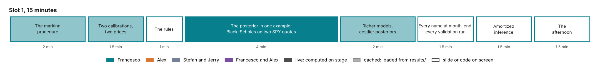

# Slot 1. Introduction: Bayes for volatility models

Francesco · 15 minutes · the first of the opening Beamer talks. Part of the [curriculum](00-overview.md).

Rebuilt on 11 November 2026 for the two-hour workshop of 14 November: Beamer talks for the introduction, amortized
Bayes and architectures, then the application notebooks, each run as model → simulate → train → infer → check. The talk
is [`slides/slot1/slot1.tex`](../slides/slot1/slot1.tex), compiled in the tutorial's Overleaf project
([`slides/slot1/README.md`](../slides/slot1/README.md)). The notebook [`slot1_intro.py`](../notebooks/slot1_intro.py)
remains a supporting demo; the deck's figures do not come from it.

The talk has one aim: that the audience sees why the methods of the tutorial may matter for their own models. It
states the problem on volatility models, says that these are an exercise and that the steps and the questions are
general, argues for Bayes while showing where the classical route gives the same answer, argues for simulation-based
inference and says what its checks have found so far, and ends on the team and the rest of the tutorial.

The deck keeps two kinds of evidence apart, and each slide says which one it shows. Slides 2, 3 and 6 to 9 are an
**illustration**: one running example on simulated quotes, with one exotic, a forward-start call, which shows a
mechanism. Slides 10 to 13 are **results**:
what the tutorial's Heston study on 63 SPX quotes had recorded on 11 November 2026, each with its status (holds,
holds with a caveat, flagged, pending).

## The slot in three sentences

**The question.** How sure is the price that a calibrated model gives to what the market does not quote, and how is
that uncertainty computed and checked?

**The answer.**

1. A calibration is one fit among many that match the quotes, so the price it gives an exotic has a range.
2. The posterior is that set of fits, weighted. Where the quotes determine the price, it returns the classical range.
   Where they do not, it states the assumption that sets the range, and one set of draws prices every product.
3. An exact posterior costs minutes for Heston and months for rough Bergomi. A network trained once on simulations
   returns it in 0.3 seconds, which makes it cheap enough to test, and the tests say where to trust it.

## What the audience leaves with

- The five steps every notebook follows (model, simulate, train, infer, check), and that only the first is specific to
  volatility models.
- Six questions the methods answer for any model that can be simulated, and the form each takes in the tutorial.
- What a posterior is: every parameter set, weighted by its fit and its prior.
- Where Bayes changes the answer (what the quotes leave open) and where it does not (quotes that determine the
  price, as the Bernstein–von Mises theorem predicts, and as the Heston notebook's own 63 quotes show).
- What an assumption does where the quotes are silent: an assumed value fits the quotes as well as any other and
  sets the price; a prior states the assumption and its width.
- What exact posteriors cost, the idea of amortized inference, and the tests that make a posterior trustworthy:
  coverage on simulated data, and agreement with exact posteriors.
- An honest account of where the tutorial's Heston network stands: fast, right on average for five of six
  parameters, wider than the exact posterior case by case, not used on the SPX quotes, where Heston itself misses.
- Who presents, and what each later part adds.

## Slide by slide

| Min | Slide | Key line (read by everyone); figure; optional facts | Evidence | Source |
| --- | --- | --- | --- | --- |
| 0:00–0:45 | The Problem | "A calibrated model prices what the market does not quote"; the desk diagram, from quotes to the book; facts: quoted, not quoted, the question | — | De Spiegeleer et al. 2018; Schoutens et al. 2004 |
| 0:45–2:05 | One Fit Among Many (two steps) | "Calibration returns the best fit, and a price for the exotic", then "Many fits match the quotes. They disagree on the exotic"; quotes at 6 months and 1 year with the fit, and the price the fit gives a forward-start call between those dates; then 120 other fits and their prices for it; facts: the example, the misfit, the forward start's prices | illustration | The running example |
| 2:05–2:55 | From a Price to a Range | "Each parameter set gives a price. Together they form a range"; the forward-start call under every parameter set, with the least-squares price, the mark, the 90% point and the reserve; facts: the product, mark and 90% point, the prudent value if sold | illustration | The running example; Reg. (EU) 2016/101 |
| 2:55–3:45 | An Exercise in Inference | "Volatility models are the exercise. The five steps are general"; the five steps and the simulators, with "your simulator"; facts: in finance, in science, what is needed | — | Cranmer et al. 2020 |
| 3:45–4:30 | Questions These Methods Answer | "The methods answer questions about uncertainty"; six questions, one per line, each with its form in today's examples | — | The programme |
| 4:30–5:40 | From a Fit to a Posterior | "Least squares keeps one fit. The posterior keeps them all, weighted"; the posterior in two planes, one left open by the quotes (mean reversion and vol of vol) and one pinned (long-run volatility and correlation), with the least-squares point and its region; facts: the error law, the prior, Bayes' rule | illustration | The running example |
| 5:40–6:50 | Where the Methods Agree | "Where the quotes determine the price, the two ranges agree"; the forward start's classical and posterior ranges as five, four, three, two and one expiries are quoted; facts: the classical range, the notebook's 63 quotes, quotes at 1 year only | illustration | The running example; the Heston notebook's exact posterior; the Bernstein–von Mises theorem |
| 6:50–7:50 | What the Quotes Leave Open | "What the quotes leave open is set by an assumption"; quotes at 1 year only: the best fit's price for the forward start against the value assumed for today's volatility, every point with the same misfit, and the posterior draws under the stated prior; facts: assume a value, fit it freely, state a prior | illustration | The running example |
| 7:50–8:35 | One Set of Draws | "One set of posterior draws prices every product, consistently"; two forward starts under the same draws, and a book; facts: a draw, a product, a book | illustration | The running example |
| 8:35–9:30 | The Cost of a Posterior | "One exact posterior costs minutes to months of computing"; CPU time on a logarithmic scale for Heston by MCMC (measured), rough Bergomi by importance sampling and by MCMC (estimated), and the trained network (measured); facts: 146,000 pricings, 512 posteriors for a coverage test, 140–250 CPU-years | result | The Heston notebook's run records; rough Bergomi derived from its pricing cost |
| 9:30–10:25 | Amortized Inference | "Simulate and train once. Then a posterior costs 0.3 seconds"; the pipeline; facts: what it needs, what is paid once, where it is valid | result | Cranmer et al. 2020; Radev et al. 2022; the Heston notebook |
| 10:25–11:20 | A Posterior That Can Be Tested | "A 90% range must contain the truth 90% of the time"; measured coverage of the Heston network's 90% intervals on 512 simulated surfaces, six parameters, with confidence intervals; facts: the test, five parameters on target, v₀ too wide | result | The Heston notebook's network; Talts et al. 2018 |
| 11:20–12:20 | What the Checks Find | "The checks decide where the network is trusted"; five checks with their status: speed and coverage hold, sharpness holds with a caveat, the market quotes raise a flag, rough Bergomi is pending | result | The Heston notebook and its run records |
| 12:20–13:05 | Summary | Three statements, and three questions for the audience's own model | — | — |
| 13:05–13:45 | The Team | The four presenters: photo, affiliation, background, parts | — | The tutorial's webpage |
| 13:45–14:20 | The Rest of the Tutorial | "Each part adds one building block"; the timeline, and one row per part: the time, the part over what it adds, the presenters | — | The tutorial's webpage |

Each main slide follows one reading order: the title and the key line are read by everyone, the figure is the
evidence, and a strip of at most three short label–value facts is optional; explanations go in the speaker notes
([`slides/slot1/README.md`](../slides/slot1/README.md)). The notes hold about 1,700 words, about 120 a minute.

Seven backup frames follow: the running example with its numbers; the example beside the notebook's SPX quotes;
least squares against the exact posterior on the notebook's 63 quotes; the checks behind slides 12 and 13, parameter
by parameter; the prudent-valuation rules and what a posterior adds to them; the methods that compute a posterior;
and the references.

## The running example

The example keeps the model, the prior, the error law and the "market-like" parameters of the tutorial's Heston
notebook (`lab/notebooks/heston_spx_calibration.py`) and changes one thing, the chain. The notebook's 63 SPX quotes
are so many and so tight that they pin every Heston parameter: its 90% intervals are at most about 1% of the prior's
range, and a figure of them shows nothing. The example's chain is thinner and quoted less tightly, as for a single
stock: 7 strikes on each of 1, 3 and 6 months and 1 and 2 years, with half-spreads of 0.3 volatility points at the
money and 1.5 at the lowest strike, about ten times those of the SPX quotes. Each price is observed once with the
notebook's error law, c × its own half-spread × a standard normal, with c = 1. The prior is the notebook's uniform
box, with c inferred under U(0.5, 2).

**The product is an exotic**, the option application's forward-start call: its strike is set at the money in
6 months, and it pays at 1 year. The same surface is read with fewer and fewer quoted expiries, and every reading
includes 1 year, when the product pays. Slides 2, 3, 6 and 9 use the 14 quotes at 6 months and 1 year, the product's
own two dates; slide 8 uses the 7 quotes at 1 year; slide 7 uses all five readings. Nothing is extrapolated in
maturity. With quotes at both dates, the options fix the distribution at each date; the forward start depends on how
the two dates are linked, which the quotes pin only through the model's parameters. That is the sense of "not
quoted" in this talk. A product beyond the last quoted expiry would show a larger range, but it would be an
extrapolation of the vanilla surface, not an exotic.

The classical route is least squares with the delta method, with the error scale estimated; the posterior is
computed by importance sampling followed by Metropolis moves, and was checked against independent chains.
[`slides/slot1/README.md`](../slides/slot1/README.md) gives the method, its checks and its limits.

The example is an illustration, labelled so on every slide that uses it and in the backup. The model is right by
construction, the quote errors are independent, and one surface is shown. It supports statements about a mechanism,
not about a market. A backup frame sets it beside the notebook: on the SPX quotes the open question is the model,
not the parameters, because Heston misses the quotes by 13 half-spreads.

## Why Bayes, and what the slot does not claim

**The classical route is given its due.** Slide 7 shows least squares with the delta method giving the same range as
the posterior while three expiries or more are quoted, which is what the Bernstein–von Mises theorem predicts when
the quotes determine the parameters. The slide says that a careful classical analysis is all one needs there, and that
the Heston notebook is in that regime: on its 63 simulated quotes the least-squares 90% intervals of this deck's
code match the notebook's exact posterior for all five parameters (widths within 2%, centres within 0.03 posterior
standard deviations). The tutorial has not measured the coverage of the two routes over many surfaces on its
current SPX design: the delta-method and expiry-drop baselines are remaining work of the option application (its
Section 10.3), and the deck does not cite the earlier study on the retired κ-fixed task.

**The argument is the assumption, not the shape.** Where the course measured it, on simulated thin chains, a
Gaussian at the mode with the same prior gave the same product ranges as the posterior (Lecture 16, Section 16.4).
The deck therefore argues from what the quotes leave open: with one expiry quoted, any assumed value of today's
volatility fits the quotes equally well and sets the forward start's price, and it leaves no trace in the fit; a
prior states the assumption and a width that can be discussed and tested (slide 8). Slide
6 shows a curved posterior beside the least-squares region as a picture of what the quotes leave open, not as a
claim that shape drives prices.

**One set of draws.** Slide 9 adds what a set of draws gives beyond a range for one product: every product priced
under the same parameter sets, and a book's range that accounts for how its products move together.

**The rules.** Prudent valuation asks for the point of a range of plausible values at which the bank is 90% confident
(Regulation (EU) 2016/101, Articles 9 and 11): the 90% point for a position it owes, the 10% point for one it owns.
Banks meet this today with consensus data and expert ranges ([practice sources](../../course/practice-sources.md)),
so the rules are not by themselves a reason for Bayes. The notes of slide 3 and a backup frame say what a posterior
adds: a range derived from the data, with its prior stated, that can be tested by coverage. That a posterior is an
accepted basis for a prudent value is a proposal.

**What a passed test says.** Slide 12 tests the network against the posterior of the stated model, on average over
the prior; a network that returned the prior would also pass, so slide 13 adds the comparison with exact posteriors,
case by case. A passed test covers data like the training data: on the SPX quotes of 9 November, Heston misses by far
more than any error the training allowed, the market lies outside what the network saw, and the market results use
the exact posterior. Whether the model describes the market is a separate check, which the later parts take up.

**Downstream uses.** The talk names marking and reserving products that are not quoted. It makes no claim about
hedging under parameter uncertainty or about value-at-risk.

## Numbers on screen, and their status

`export_figures.py` prints every number of the running example and of the recorded results; compare its report with
this table after any change. The recorded results are in
[`slides/slot1/recorded-results.json`](../slides/slot1/recorded-results.json), each with its source file, commit and
SHA-256. They are development results as recorded on 11 November 2026 (`scientific_acceptance` is false in their run
records), not studies of the claims ledger.

| Number | Source | Status |
| --- | --- | --- |
| 14 quotes at 6 months and 1 year; root-mean-square misfit 1.11 half-spreads for the best fit, 1.2 to 1.6 for the other fits (5% to 95%); the generating parameters miss by 1.19 | the running example | illustration |
| The forward-start call under the 120 fits drawn on slide 2: 4.17 to 5.18 per 100 of forward (best fit 4.77, generating parameters 4.66) | the running example | illustration |
| The forward-start call with quotes at its two dates: least squares 4.77, mark 4.70, 90% point 4.92, reserve 0.22 (5% of the mark), per 100 of forward; 4.66 under the generating parameters | the running example | illustration |
| The forward start's 90% range, delta method against posterior: 4.61–4.81 and 4.61–4.80 (five expiries), 4.56–4.82 and 4.56–4.81 (four), 4.51–4.94 and 4.51–4.90 (three), 4.31–5.23 and 4.39–5.00 (two: the product's dates); with 1 year only the fit sits on a bound of the box and has no range, the posterior gives about 2.9–4.9 | the running example | illustration |
| On the notebook's 63 simulated quotes, least squares and the exact posterior agree within 2% in the width of every 90% interval | this deck's least squares; the notebook's PyMC reference (`lab/evidence/pilot-results/2026-11-11/heston-actual63-notebook/`) | a check of the classical route, repeated by a test |
| Quotes at 1 year only, today's volatility assumed between 10% and 40%: the best fit's price for the forward start runs from 5.14 to 2.86, with a misfit of 0.80 half-spreads at every assumed value | the running example | illustration |
| 90% widths: the forward start struck in 6 months 0.61, the one struck in 9 months 0.53, the first minus the second 0.16 | the running example | illustration |
| One exact Heston posterior on the 63 SPX quotes: 14–27 CPU-minutes by MCMC, about 146,000 pricings of the quotes | the Heston notebook's PyMC references | recorded, measured |
| Rough Bergomi per exact posterior: 17–29 CPU-hours by importance sampling (1,000 pricings), 100–180 CPU-days by MCMC (146,000 pricings), at 60–105 CPU-seconds per pricing; the 512 posteriors of a coverage test, 140–250 CPU-years | option application, Section 7.1, and the Heston run's pricing count | estimated, not run |
| The Heston network: 300,000 simulated surfaces, as many pricings as two exact posteriors; training within an hour on a laptop CPU; 0.3 s per posterior (615 posteriors in 164 s) | the Heston notebook and its run record | recorded |
| Coverage of the network's 90% intervals on 512 simulated surfaces: 90.0, 92.4, 89.3, 92.0 and 90.2% for κ, v∞, σ_v, ρ and c; 97.5% for v₀ | the run record (`evaluation.json`) | recorded: holds for five of six parameters; the intervals for v₀ are too wide |
| Against the exact posterior on the notebook's two simulated surfaces: means within 0.96 exact standard deviations; 90% intervals 1.05 to 2.9 times as wide | the run record (`reference-comparison.json`) | recorded: a caveat |
| On the SPX quotes of 9 November: Heston misses by 13 half-spreads (13.4 root mean square; 1.38 volatility points against a median half-spread of 0.064); the network is outside its training range and the market results use the exact posterior | option application, Section 8.4; the run record | recorded: a flag |
| Rough Bergomi's network | — | pending: the simulation bank is being generated |

The deck cites no claim of the ledger: C7, C8 and C11 were measured on the earlier Heston task with κ fixed at 2,
which the option application has replaced. The application's results enter `tutorial/assets/` and the ledger only
through the lab's tools; until then the slides name the notebook and its run records.

## What may be said, and what may not

| Say | Do not say | Why |
| --- | --- | --- |
| "Many parameter sets are consistent with the quotes." | "Calibration is broken", or "least squares is wrong." | The best fit is a valid estimate; the point is that the quotes cannot tell it from its neighbours. |
| "This is an illustration on simulated quotes; the model is right by construction." | The example's numbers as results of the tutorial. | One simulated surface, independent errors, a chain thinner than SPX's. |
| "Where the quotes determine the price, the classical range and the posterior agree, as on the notebook's 63 quotes." | "Classical methods fail", or "Bayes gives better intervals." | Slide 7's upper rows; the backup table; the Bernstein–von Mises theorem. |
| "Where we measured, the prior made the difference, not the posterior's shape." | "Classical methods miss the posterior's shape." | Lecture 16, Section 16.4: a Gaussian with the same prior matches the posterior on thin chains. |
| "With one expiry, any value assumed for today's volatility fits the quotes equally well, and sets the price." | "Desks fix today's volatility", or any claim about what desks assume. | The slide shows a mechanism on simulated quotes; it documents no practice. |
| "The rules are met today, with consensus data and expert ranges; a posterior adds a range derived from the data, with its assumptions stated, that can be tested." | "Banks cannot meet the rules without Bayes." | Consensus services publish 10th and 90th percentiles; the regulation allows proxies and expert-based ranges. |
| "The reserve is the 90% point minus the mark, for a position the bank owes." | "The reserve is a VaR." | VaR is a quantile of P&L over a horizon. |
| "An exact Heston posterior takes 14 to 27 CPU-minutes: measured. For rough Bergomi, 100 to 180 CPU-days by the same chain: estimated, not run." | A rough-Bergomi cost as measured. | The rough-Bergomi costs are pricing counts times 60 to 105 CPU-seconds per pricing. |
| "A posterior in 0.3 seconds, after training." | "Milliseconds", or "instant on the market". | 0.27 s measured; on the SPX quotes the network was outside its training range. |
| "On simulated data the network's 90% intervals are on target for five of six parameters; for v₀ they are too wide." | "The network is calibrated." | 97.5% coverage for v₀; its rank test fails. |
| "Case by case the network is wider than the exact posterior, by 5% to almost three times." | "The network gives the posterior." | It is an approximation; the two simulated surfaces show how close. |
| "On the SPX quotes Heston misses by 13 half-spreads, so the network is not used there." | "The network failed on the market." | The flag concerns the model: the data are unlike anything the simulator produces. |
| "Rough Bergomi's results are not in yet." | Any rough-Bergomi accuracy number. | The bank was still being generated on 11 November. |
| "The same steps apply to any model that can be simulated." | That the tutorial shows results outside volatility models. | The examples are Heston and rough Bergomi. |

## Hard questions

1. **"With a flat prior this is just least squares."** At its peak, yes. The posterior keeps the other fits too; they
   matter where the quotes leave something open (slides 7 and 8).
2. **"A careful classical analysis gives the same range."** Where the quotes determine the price it does, and slide 7
   shows it, also for the notebook's own quotes. The delta method stops when the fit runs to a bound, and an assumed
   value then puts the price where the assumption says: from 5.14 to 2.86 as today's volatility goes from 10% to 40%
   (slide 8). A profile-likelihood range would still exist there, and it too would be set by the box.
3. **"So the prior is doing the work."** Where the quotes are silent, yes, and something must: the classical habits
   are assumptions of zero width, or none. Bayes states the width, and the width can be tested.
4. **"Your example is simulated, and the model is true."** Yes, and every slide that uses it says so. It keeps the
   notebook's model, prior, error law and parameters and thins the chain, so that the mechanism is visible. On the
   real SPX quotes the quotes are many and tight, the parameter ranges are too narrow to see, and the open question
   is the model: Heston misses by 13 half-spreads. A backup frame sets the two side by side.
5. **"The options at both dates are quoted. Why is the forward start uncertain at all?"** The options at 6 months fix
   the distribution at 6 months, and those at 1 year the distribution at 1 year. The forward start depends on how the
   two dates are linked. Within Heston that link is set by parameters, the vol of vol and the mean reversion among
   them, which 14 quotes pin only loosely (slide 6). Across models the link is freer still: that is model risk, which
   one model's posterior does not cover.
6. **"A range of 13% of the price is small."** It is the honest size for a product whose dates are quoted, on a thin
   chain, within one model. It is still a reserve of 5% of the mark that a single calibrated price hides, and
   slide 7 shows where it grows: when fewer expiries are quoted.
7. **"Banks already meet the rules."** They do. A posterior adds a range derived from the data, with a stated prior,
   that can be tested by coverage. That it is an accepted basis for a prudent value is a proposal.
8. **"Heston calibrates in a second; why a network?"** One exact Heston posterior is affordable (14 to 27
   CPU-minutes), and the Heston part computes it as the reference. A coverage test needs hundreds of posteriors, a
   book one per name per day, and rough Bergomi has no fast pricer: months per exact posterior by the same chain.
9. **"Why not train a network to price, and run a chain on it?"** That works too, and it is common for calibration
   (De Spiegeleer et al. 2018 speed the pricer up with machine learning). It amortizes the pricer: each posterior still costs a
   chain, and the pricer's error enters the likelihood. Amortizing the posterior makes hundreds of posteriors cheap,
   which is what the coverage test needs.
10. **"Why trust a network?"** Only as far as it passes its checks, and slide 13 lists them: coverage on simulated
   data (five of six parameters), agreement with exact posteriors (centred, but wider), and data like its training
   data (not the SPX quotes under Heston, so the exact posterior is used there).
11. **"Your network is up to three times too wide. Is that good enough?"** It is cautious, not wrong, and the check
    measures it. For a reserve it errs on the safe side; for a sharp answer on one data set the exact posterior, or
    importance sampling with the network as the proposal, is the remedy.
12. **"Does the range cover model risk?"** No. It is one model's parameter uncertainty under a stated error model.
    Two models on the same data show part of the rest.
13. **"Why not my model?"** The method does not depend on the model: a prior, a simulator and an error model are the
    first step, and the other four are the same.
14. **"Do you retrain every day?"** In the tutorial one network serves one snapshot's design (strikes, expiries,
    half-spreads); a new design needs its own simulations and network. A network that takes the design as an input
    is the way to daily use, and the tutorial does not show it.

## What is left out, and why

- **The ingredients on Black–Scholes and one SPY close** (likelihood, prior sweep, predictive check). They stay in
  the notebook `slot1_intro.py`; the talk spends its time on the argument.
- **The defence of the error law, and model error.** The application notebooks own the error model: the half-spread
  as the scale, c inferred, and the smooth model-error extension.
- **Hierarchies across names.**
- **The posterior's shape as an argument.** See "Why Bayes" above.
- **Hedging and value-at-risk.** Nothing in the repository supports a claim.

## Before the run-through

1. Compile in the Overleaf project with the real theme and check that no frame overflows; the deck has been compiled
   here only against a stand-in for the theme. If a figure slide overflows, lower `\figmax` at the top of `slot1.tex`.
2. Confirm the presenters' parts on slides 15 and 16 against the final programme.
3. If the Heston study's record changes before 14 November, or rough Bergomi's first results arrive, update slides 10
   to 13, `recorded-results.json` and this page together. Slide 13's last row is the one most likely to change.
4. Rehearse with a timer, twice.

## Sources

De Spiegeleer, Madan, Reyners and Schoutens (2018), SSRN 3191050; Schoutens, Simons and Tistaert (2004); Cranmer,
Brehmer and Louppe (2020); Radev et al. (2022); Talts et al. (2018); van der Vaart (1998), chapter 10; Kruse and
Nögel (2005) for the forward start; the course,
Lectures 6, 8, 14 and 16.4, and its [practice sources](../../course/practice-sources.md); the Heston SPX notebook,
`lab/notebooks/heston_spx_calibration.py`, with its run records, and the option application,
`lab/plans/option-application/` (results as of 11 November 2026).
