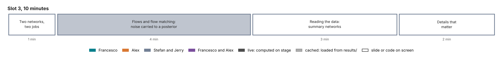

# Slot 3. Network architectures for amortized inference

Stefan and Jerry · 10 minutes. A proposal for Stefan and Jerry's review. Part of the [curriculum](00-overview.md).

## The slot in three sentences

**The question.** Which networks represent the posterior $q_\phi(\theta \mid y)$, and how do they read the data $y$?

**The answer.**

1. An inference network represents a conditional distribution: normalizing flows map noise to parameters through an invertible network, and flow matching learns a velocity field that carries noise to the posterior along an ordinary differential equation.
2. A summary network compresses large or structured data into a few numbers, and its architecture follows the data's structure: none for a fixed grid of quotes, a set network for a variable set of quotes, a time-series network for returns.
3. A handful of details decide whether a network works on financial data: bounded parameters mapped to the real line, standardized inputs, fresh noise in every batch, and the sampler's number of steps.

## Why this slot comes here

Slot 2 ends on the object to build, $q_\phi(\theta \mid y)$. Slot 3 says which networks build it and shows the exact configuration that slot 4 trains on Heston and slot 5 on rough Bergomi.

## Minute plan

| Min | Section | On screen | Live or cached | What is said |
| --- | --- | --- | --- | --- |
| 0–1 | 1. Two networks, two jobs | A diagram: data $y$ → summary network $h_\psi$ (optional) → inference network $q_\phi(\theta \mid h_\psi(y))$ → posterior draws | slide | One network represents the posterior; the other, when needed, reads the data. They are trained together on slot 2's loss. |
| 1–5 | 2. Flows and flow matching | Five snapshots of a cloud of standard-normal points carried by the trained Heston network to SPY's posterior in the $(\sigma_v, \rho)$ plane, at $\tau$ = 0, 0.25, 0.5, 0.75 and 1; the flow-matching loss in one line; a coupling layer in one diagram | cached (drawn from the slot-4 network) | A normalizing flow is an invertible map with an exact density. Flow matching learns a velocity field by regression and integrates it: in slots 4 and 5, 100 Euler steps, denser near the data end. It scales to many parameters and odd shapes, and the tutorial's networks use it. |
| 5–8 | 3. Reading the data | Three data shapes and their networks, in a table (below) | slide | The 63 prices on a fixed grid need no summary network: they enter as conditions, standardized. A real chain is a set of quotes of varying size, which a set network reads directly. A return series needs a time-series network. Learned summaries rediscover sufficient statistics where these exist. |
| 8–10 | 4. Details that matter | The twelve lines of `build_workflow` in `lab/src/sbi4finance/calibration/inference.py`, annotated | code | Each line answers a practical problem: bounds, scales, noise, sampling. Slot 4 trains this configuration. |

## Flow matching, in the form slots 4 and 5 use

For a simulated pair $(\theta, y)$, noise $z \sim \mathcal N(0, I)$ and a time $\tau \in [0, 1]$, the network $u_\phi$ is trained by

$$\mathcal L(\phi) = \mathbb E\,\big\| u_\phi\big((1 - \tau)\,z + \tau\,\theta,\ \tau,\ y\big) - (\theta - z) \big\|^2 .$$

Sampling integrates $dz/d\tau = u_\phi(z, \tau, y)$ from $\tau = 0$ to 1. Slots 4 and 5 use 100 Euler steps on the grid $\tau_i = 1 - (1 - i/100)^2$, which is dense near $\tau = 1$, and draw training times with a power law (`time_power_law_alpha`, −0.5 for the trained Heston network). The configuration stored with a network has 50 uniform steps; `inference.sample` sets the 100-step grid before sampling, so slots 4 and 5 sample through it.

## Data shapes and their networks

| Data | Shape | Network | Where in the tutorial |
| --- | --- | --- | --- |
| A smile on the design grid | A fixed vector of 63 prices, plus the forward-variance curve as context in slot 5 | No summary network: standardized quotes as conditions | Slots 4 and 5 |
| A real option chain | A set of (log-moneyness, maturity, price, noise) tuples, of varying size and order | A set network (DeepSet, set transformer), invariant to the order of the quotes | The extension that removes the design grid (Stage D) |
| Daily returns | A series of 1,000 values | A time-series network (convolutions, then a recurrent or attention layer) | Not in the tutorial |
| Any data, for misspecification tests | Whatever shape | A summary network trained with a distance term in its output space (Schmitt et al. 2024) | Slot 6 |

## The configuration, line by line

The workflow of `inference.build_workflow` has five decisions, each tied to a problem:

1. **Bounded parameters.** The adapter maps each parameter from its prior box to the real line (`constrain`), so draws never leave the box: $\rho$ stays in $(-0.95, -0.1)$.
2. **Scales.** Parameters and quotes are standardized with training statistics, because SPY's 63 prices range from about $1.5 \times 10^{-5}$ to $0.07$ of the forward.
3. **Noise.** Quote noise is drawn fresh in every batch, so the network sees new noise each epoch and cannot memorize it.
4. **Capacity.** Four dense layers of 256 inside the flow-matching velocity network.
5. **Sampler.** 100 Euler steps on the non-uniform grid above, set by `inference.sample`; fewer steps are faster and less accurate.

Slot 4 trains this configuration with `time_power_law_alpha=-0.5`, the value of the trained checkpoint (`checkpoints/heston/training.json`); `build_workflow`'s default is 0.5.

## Concepts slot 3 owns

Normalizing flows and flow matching; the choice of summary network by data shape; conditions and context variables; the practical details above. Slots 4 and 5 use them without re-deriving them.

## To build, by the freeze on Wed 4 Nov

1. The five-snapshot figure of the flow on SPY, from the slot-4 network, with intermediate states saved from a custom Euler loop.
2. The coupling-layer diagram and the data-shapes table as slides.

## Open choices for Stefan and Jerry

- Whether to mention diffusion and consistency models, and autoregressive samplers, which the proposal lists among the advanced concepts. One sentence each meets the proposal.
- Whether the set network for real chains is shown as a result or only named. It is not built yet.
