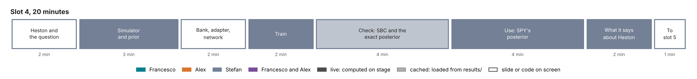
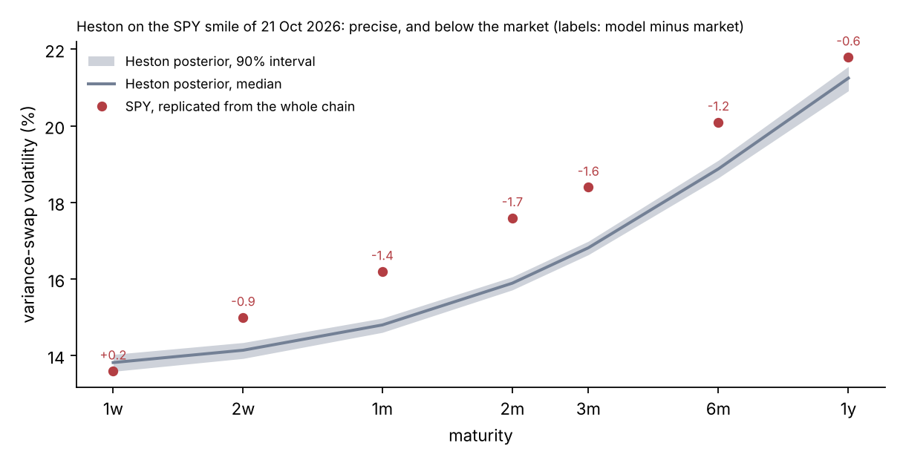

# Slot 4. A worked example in BayesFlow: Heston on the SPY smile

Stefan · 20 minutes. A proposal for Stefan's review. Part of the [curriculum](00-overview.md).

## The slot in three sentences

**The question.** What does the whole amortized workflow look like in code, on a smile model whose exact posterior can be computed to check every step?

**The answer.**

1. Heston is priced by a Fourier integral in 20 ms per smile, so the BayesFlow workflow can be built on it and its posterior compared with an exact Markov chain on the same smile.
2. The network passes simulation-based calibration on 2,000 held-out smiles, comes close to the exact posterior smile by smile, and gives SPY's posterior in about 1.5 seconds.
3. That posterior is precise and tells something about Heston itself: on SPY it needs a vol-of-vol of about 1.14, twice its Feller limit, and it prices variance swaps 0.6 to 1.7 volatility points below SPY's replicated strikes, which is why slot 5 moves to rough Bergomi.

## Why Heston, and why here

The earlier plan taught slot 4 on returns of VOO under geometric Brownian motion, then switched in slot 5 to an option smile under the pricing measure. That switch changed the data, the measure, the model and the question at once. With Heston in slot 4 the afternoon keeps one data set and one question from slot 1 to slot 6. Slot 5 then changes only the simulator, from a Fourier integral to Monte Carlo.

Heston fits the role of the model with an exact answer:

- every quant in the room has calibrated it;
- its likelihood is exact, so its posterior can be computed by MCMC in minutes and compared with the network's;
- it fits the SPY smile with a root-mean-square residual of about one noise unit (Lecture 11, Section 11.1), under a noise that is loose in the wings, so the example is real data, not a toy;
- its fit has visible defects, which motivate slot 5.

The returns notebook moves to the take-home track (overview, §6).

## The model and the task

The task is `lab/configs/tasks/calibration_heston_bank.json` (`hkde_calibration_v1`, jumps switched off).

| | |
| --- | --- |
| Data | The 63 prices of the design grid, read from SPY's quotes: 7 maturities (5, 10, 21, 42, 63, 126 and 252 business days) × 9 moneyness points, in forward units |
| Noise | Gaussian, the design's standard deviation per quote: a third of a volatility point at the money and a full point in the wings, at the reference volatility of 20% |
| Unknowns | $v_0 \in [0.01, 0.16]$, $\theta \in [0.01, 0.16]$, $\sigma_v \in [0.1, 1.5]$, $\rho \in [-0.95, -0.1]$, uniform; $\kappa = 2$ fixed |
| Pricer | The repository's Fourier pricer, about 20 ms per smile at one quadrature rung |
| Bank | 50,000 training, 5,000 validation and 5,000 test smiles, generated in 46 CPU-minutes (S1) |
| Network | `FlowMatching`, four dense layers of 256; parameters mapped to their bounds by the adapter; quotes standardized; fresh quote noise in every batch (`lab/src/sbi4finance/calibration/inference.py`) |
| Training | 500 epochs, 32 minutes on 4 cores (`checkpoints/heston/training.json`) |

## Minute plan

| Min | Step | On screen | Live or cached | What is said |
| --- | --- | --- | --- | --- |
| 0–2 | Heston and the question | The Heston equations in two lines; the four unknowns and their prior box; slot 1's question, now for Heston | slide | Heston adds a random variance correlated with the price. Four unknowns, a prior box a quant can judge, and the same 63 SPY quotes as slot 1. |
| 2–5 | Step 1: simulator and prior | `prior()` and `smile(v0, theta, vol_of_vol, rho)` wrapped by `bf.make_simulator`; 200 smiles drawn from the prior, plotted as implied volatilities, with SPY's smile over them | live, about 4 s | BayesFlow needs only functions that draw. The prior predictive check comes first: SPY's smile must lie inside the cloud the prior produces, or the network would extrapolate. Parameters inside the prior box reproduce SPY's smile to about one noise unit, so SPY lies within the prior's reach; the check itself is part of S8-H. |
| 5–7 | Step 2: bank, adapter, network | The bank's manifest (50,000 smiles in 46 CPU-minutes); the adapter and network code from `inference.py`, twelve lines | code | The bank is simulated once. The adapter maps each parameter to its bounds and standardizes the quotes; the network is slot 3's flow matching. |
| 7–9 | Step 3: train | `fit_offline` for about 15 epochs, with the loss falling on screen; then the 500-epoch checkpoint is loaded | live, about 1 minute, with the checkpoint as fallback | One epoch over 50,000 smiles takes about 4 seconds on 4 cores. The full network trained for 32 minutes. |
| 9–13 | Step 4: check | (a) SBC, coverage, contraction and recovery on 2,000 held-out smiles; (b) the network's posterior against the exact-likelihood reference on one test smile, with the agreement table over 50 smiles (the reference is importance sampling with the exact likelihood on 46 smiles and MCMC on 4) | cached draws, plots drawn live | SBC passes for all four parameters, and the 95% intervals cover 93.5% to 95.2% of truths. Smile by smile, the network meets the agreement criterion for all four parameters on 80% of the 50 smiles, so it is close but not exact. With importance sampling on the exact likelihood, the four smiles with chains agree with them. |
| 13–17 | Step 5: use on SPY | SPY's posterior from the network in one call, as pairs; the exact posterior beside it; 200 draws re-priced over SPY's quotes | live: network about 1.5 s, re-pricing about 4 s; exact chain cached | The network and the chain agree on SPY (⟨S8-H⟩). The posterior is tight: $\sigma_v$ = 1.14 ± 0.04, $\rho$ = −0.63 ± 0.02. The re-priced smiles cover the quotes. |
| 17–19 | What the posterior says about Heston | The figure below: the posterior's variance-swap curve against SPY's; the Feller ratio | live (closed form over the draws) | Heston fits SPY only with a vol-of-vol about twice its Feller limit: no posterior draw satisfies the Feller condition. Its variance-swap curve is tied to its smile parameters, and the posterior is confident about a curve that lies 0.6 to 1.7 points below SPY's replicated variance-swap strikes from two weeks to one year. Precise, and wrong for a product the smile does not pin down. |
| 19–20 | To slot 5 | The handoff table below | slide | Slot 5 keeps the data and the code, and changes the simulator. |

How to read the figure: the grey band is the 90% interval of the variance-swap volatility under the exact Heston posterior on SPY, and the line its median. The red dots are SPY's variance-swap volatilities replicated from the whole chain, with strikes down to δ = −8, which the 63 quotes do not reach. The labels are the median minus the market, in volatility points. The band is 0.3 to 0.6 points wide; the gaps from two weeks to six months are 0.9 to 1.7 points.

## Feasibility: the exact Heston posterior on SPY

Run on 23 October 2026 to check that slot 4 works on real data (`lab/checks/heston_spy_exact.py`; output and draws in [data/](../assets/data/heston-spy-exact.json)). The likelihood is the repository's Fourier likelihood at one quadrature rung, and the run took 531 CPU-seconds.

- **Multi-start.** Nelder–Mead from 8 points drawn over the prior box: 7 reach the same optimum. The eighth stops at the prior's upper bound $\sigma_v = 1.5$ with a log-likelihood 29 lower, so it is not a competing calibration.
- **Chains.** Four random-walk Metropolis chains of 4,000 steps, started at overdispersed points around the optimum, with the first 1,000 steps discarded. Split $\hat R$ is at most 1.007 and the bulk effective sample size is 670 to 1,210 per parameter.

| | Posterior mean ± sd | 90% interval | In volatility |
| --- | --- | --- | --- |
| $v_0$ | 0.0182 ± 0.0004 | 0.0175 to 0.0188 | 13.5% |
| $\theta$ | 0.0657 ± 0.0015 | 0.0631 to 0.0681 | 25.6% |
| $\sigma_v$ | 1.14 ± 0.04 | 1.07 to 1.21 | |
| $\rho$ | −0.632 ± 0.022 | −0.668 to −0.597 | |

The posterior lies well inside the prior box. Its mean equals the least-squares fit with $\kappa = 2$ of Lecture 11, Section 11.1. The Feller ratio $\sigma_v^2 / (2\kappa\theta)$ ranges from 3.8 to 6.3 over the draws (median 5.0): no draw satisfies the Feller condition. Equivalently, the vol-of-vol is about twice its Feller limit $\sqrt{2\kappa\theta} \approx 0.51$.

This run is not an accepted study. It is redone as study S8-H through `lab/studies/` before its numbers go on screen.

## The notebook, cell by cell

`tutorial/notebooks/slot4_heston_bayesflow.py`, new.

| Cell | Does | Budget | Fallback |
| --- | --- | --- | --- |
| Setup | Imports BayesFlow and the calibration library; loads the task and SPY's surface | 30 s before the slot | — |
| Simulator | `prior()`, `smile(...)` with the Fourier pricer; `bf.make_simulator` | < 1 s | — |
| Prior predictive | 200 prior smiles as implied volatilities, with SPY over them | about 4 s | cached figure |
| Bank | Reads the bank's manifest; shows sizes and generation cost | < 1 s | — |
| Workflow | `inference.build_workflow(task, time_power_law_alpha=-0.5)`, the trained checkpoint's configuration, shown in full | < 1 s | — |
| Train | 15 epochs on the bank with the loss plotted; then loads `checkpoints/heston/model.keras` | about 60 s | load the checkpoint directly |
| Diagnostics | SBC, coverage, contraction and recovery from the cached S2 draws (`heston/s2/draws.npz`) | < 5 s | cached figures (`heston/s2/*.png`) |
| Exact check | Network against exact chain on one S3 smile; the S3 agreement table | < 2 s | cached figure |
| SPY | Network posterior for SPY through `inference.sample` (which sets the 100-step sampler); pairs plot with the exact chain's draws | about 1.5 s after a warm-up call | cached draws |
| Re-pricing | 200 draws re-priced, as implied-volatility bands over SPY's quotes | about 4 s | cached figure |
| What it says | Variance-swap curve over the draws (closed form) against SPY's; Feller ratio | < 1 s | — |
| Handoff | The table below | — | — |

The network-loading cell runs once before the slot starts, because loading and compiling take several seconds.

## Numbers on screen, and their status

| Number | Source | Status |
| --- | --- | --- |
| Bank 60,000 smiles in 46 CPU-min; training 500 epochs, 32 min on 4 cores; Fourier likelihood 20 ms at one rung | C8 | verified |
| SBC 4 of 4 parameters on 2,000 smiles; 95% coverage 93.5–95.2%; contraction $v_0$ 0.99, $\theta$ 0.99, $\sigma_v$ 0.95, $\rho$ 0.93 | C7 | verified |
| Network alone within the criterion on 80% of 50 smiles; with importance sampling, 4 of 4 | C5 | not met for the network alone: shown as such |
| SPY: the exact posterior's numbers above; the Feller ratio; variance-swap gaps 0.9 to 1.7 points from two weeks to six months | feasibility run of 23 Oct | to redo as S8-H, then register |
| SPY: the network's posterior | ⟨S8-H⟩ | pending |

## What changes from the existing slot-4 notebook

The notebook `notebooks/tutorial_4_bayesflow_basics.py` (branch `feat/tutorial-slot4-bayesflow-basics`) teaches the same workflow on VOO returns. Three parts of it carry over to the new notebook:

1. the explanation of BayesFlow's objects (simulator, adapter, networks, workflow, diagnostics) and the code shown in full;
2. the reading of the four diagnostic plots;
3. the "check before you trust" structure, with the exact posterior as the final check.

The VOO notebook itself moves, edited, to the take-home track as `extras/returns_bayesflow_basics.py`.

## The handoff to slot 5

| | Slot 4 | Slot 5 |
| --- | --- | --- |
| Data | The SPY smile: 63 prices on the design grid | The same |
| Model | Heston: 4 parameters, $\kappa$ fixed | Rough Bergomi: $H$, $\eta$, $\rho$, and the forward-variance curve $\xi_0$ as an input |
| One smile priced by | A Fourier integral, 20 ms | Monte Carlo, 5 CPU-seconds |
| The bank | 60,000 smiles in 46 CPU-minutes, on a laptop | 112,000 smiles in about 370 CPU-hours, on a cluster |
| The network | Flow matching on the quotes | The same, with $\xi_0$ as an extra condition |
| The final check | The exact posterior by MCMC | No exact posterior: an audit of each smile with a Monte Carlo likelihood |
| What it shows on SPY | A fit with extreme parameters and variance swaps below SPY's | A skew that follows a power law, and variance swaps that match the market by construction |

## To build, by the freeze on Fri 30 Oct

1. `slot4_heston_bayesflow.py`, cell by cell as above.
2. Study S8-H: the Heston network's posterior and the exact chain on SPY, through `lab/studies/`, with an `ACCEPTED.json`; register its numbers in CLAIMS.md.
3. Move the VOO notebook to `extras/`.
4. Time the training cell on the presenter's laptop with the locked environment; set the number of live epochs to fit one minute.

## Course lectures behind slot 4

Lectures 10 and 11 (Heston, the Fourier pricer, the fit to SPY), 8 (posterior, Metropolis–Hastings), 9 (amortized inference) and 12 (the workflow on Heston: SBC, coverage, contraction, agreement).
