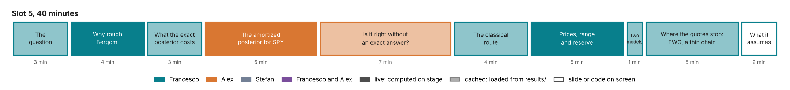

# Slot 5. Rough Bergomi on the SPY smile: from the posterior to a reserve

Francesco and Alex · 40 minutes. Part of the [curriculum](00-overview.md).

## The slot in three sentences

**The question.** Where the quotes stop, which price is marked for a product the smile does not quote, and how large is the reserve?

**The answer.**

1. Rough Bergomi's skew follows a power law in maturity, the shape of SPY's, and the model takes the forward-variance curve from the market, but it is priced only by Monte Carlo, so its exact posterior costs at least 16.9 CPU-hours per smile by random-walk Metropolis, or about 85 CPU-minutes by importance sampling from a Gauss–Newton proposal.
2. The amortized posterior from slot 4's code with a new simulator takes 1.4 seconds, and with no exact chain to compare against it is checked by simulation-based calibration, by a second method, and by an audit of each smile with the Monte Carlo likelihood.
3. Priced under the posterior, the forward-start option and the volatility swap carry a range, and the forward-start's 90% quantile against the least-squares mark is the reserve the rules ask for; the range is conditional on the prior, the noise model, the forward-variance curve and the model, which is where slot 6 starts.

**Title on screen.** Proposed: "Where the quotes stop: which price do you mark?" The decision is pending (D13, overview §10). The title would replace "The smile fits many calibrations. Which price do you mark?", which overstates the liquid case ([v2-plan](../../course/v2-plan.md), Section 9): on SPY's 63 quotes the posterior and the classical interval agree (Section 2.1). That title had itself replaced "Ten calibrations fit the smile", because the pilot found a single least-squares optimum on all 8 rough-Bergomi smiles it tested.

## Why this slot comes here

Slot 4 ends with Heston's posterior on SPY: precise, with a vol-of-vol about twice its Feller limit, and variance swaps below SPY's. Slot 5 keeps the smile and the code and changes the model to one built for index smiles. What it loses is slot 4's exact chain, so the checks change, and what it gains is the payoff of the afternoon: a price range and a reserve.

## What the slot must establish, in order

1. A bank needs a range and a 90% point for the products the smile does not quote.
2. Rough Bergomi is the model for this smile, and it is priced only by simulation.
3. The amortized posterior takes seconds, and it can be checked without an exact posterior.
4. It turns the smile into a price range and a reserve; the classical local interval approximates that well only where the problem is close to Gaussian.
5. Where the quotes stop, on a thin chain, the posterior and the classical baselines can part; EWG tests whether they do.
6. The answer is conditional, and its conditions are where slot 6 starts.

## Presenters

Francesco opens and closes: the problem, the model, the classical route, the products, the thin chain and the close (about 27 minutes). Alex takes the network and its checks (about 13 minutes), continuing his slot 2. Decision D13 can move the classical route to Alex.

## Minute plan

| Min | Who | Section | What is said | On screen | Live or cached | Numbers and status |
| --- | --- | --- | --- | --- | --- | --- |
| 0–3 | F | 1. The question | SPY on 21 October 2026, the 63 prices of slots 1 and 4, read from the chain onto the design grid. The products to mark are a forward-start call (one period of a cliquet) and a volatility swap. Neither is quoted. Least squares gives one parameter vector and one mark. The rules ask for the range and a 90% point: Art. 9 for the calibrated parameters, Art. 11 for the choice of model. | The SPY smile; Art. 9 and Art. 11 of Regulation (EU) 2016/101 | cached | S8, verified |
| 3–7 | F | 2. Why rough Bergomi | The at-the-money skew of SPY falls with maturity as a power law, exponent −0.32 from one week to one year (about −0.4 in the SPX literature). Slot 4's Heston fits the smile only with a vol-of-vol about twice its Feller limit, over-curves the short smiles, and prices variance swaps up to 1.7 points below SPY's replicated strikes; its skew tends to a constant as $T \to 0$. Rough Bergomi's skew goes like $T^{H-1/2}$ at short maturities, and the model takes the forward-variance curve $\xi_0$ from the market as an input, so its variance swaps match the market by construction. Its fit to SPY is ⟨S8⟩. Three parameters: the short skew sets $\rho\eta$; $H$ shapes the skew's term structure; $\eta$ is separated from $\rho$ by the long-dated at-the-money level against $\xi_0$. $\xi_0$ is read off the same smile and treated as known. | The SPY skew against maturity with the power-law fit; slot 4's variance-swap figure, one line | live (the fit takes seconds); slot 4's figure cached | C1, verified; slot 4's numbers after S8-H |
| 7–10 | F | 3. What the exact posterior costs | One likelihood evaluation is one Monte Carlo surface: 5.0 CPU-s with $2^{15}$ paths. Monte Carlo error inside the likelihood is handled by subtracting the Monte Carlo covariance of the prices from the quote-noise covariance, with each proposal priced on its own paths; that gives an unbiased estimate of the likelihood (Lecture 8, Section 8.9). The notebook has the detail. There are two exact routes. Random-walk Metropolis costs at least 16.9 CPU-h per smile. That is a lower bound for two reasons: it assumes the cheapest pricing cost, while the pilot bank's average is 11.9 CPU-s (41 CPU-h per chain), and a chain on a noisy Monte Carlo likelihood needs more evaluations than the exact Heston chains it is extrapolated from. Importance sampling from a Gauss–Newton proposal costs about 85 CPU-minutes on SPY's 63 quotes: 1,024 evaluations at 5.0 CPU-s, on a pricer with common random numbers (with a seed per proposal, as the unbiased likelihood needs, somewhat more). One posterior is affordable that way. A validation needs many: SBC on 2,000 smiles would cost about 2,800 CPU-h at 85 CPU-minutes a smile, and about 2 CPU-h with the network. Slot 4's check against an exact chain is not available here; the audit of section 5 uses the same importance sampling, with the network's draws as the proposal. | The ladder figure of slot 1, rough-Bergomi column highlighted; the routes to one rough-Bergomi posterior and their costs: random-walk Metropolis, importance sampling from a Gauss–Newton proposal, the network ([v2-plan](../../course/v2-plan.md), Section 2.4) | cached | C8, verified; the importance-sampling route is 1,024 proposals (`lab/checks/rough_spy_is.py`) at C8's 5.0 CPU-s; the SBC costs are from v2-plan, Section 2.4 |
| 10–16 | A | 4. The amortized posterior for SPY | The training bank holds 100,000 rough-Bergomi smiles (plus 12,000 for validation and test). Their parameters and forward-variance curves are drawn from the prior, they are priced by Monte Carlo on the cluster, and noise from the quote-noise model is added. It costs about 370 CPU-h at the pilot's rate, once (⟨S1⟩). The network is slot 4's, with $\xi_0$ as an extra condition. For SPY it gives 1,000 draws in 1.4 s. Reading the posterior: $\rho\eta$ is the tightest, $H$ comes from the term structure, $\eta$ and $\rho$ are each pinned but correlated. Re-pricing the draws gives the posterior predictive check on SPY. | Pairs plot over $H$, $\eta$, $\rho$ and $\rho\eta$; smiles re-priced from the draws, within the noise bands | live (one forward pass) | C8, verified; the SPY posterior ⟨S2⟩ ⟨S8⟩; valid only once the curve prior covers SPY's curve (gate G0) |
| 16–23 | A | 5. Is it right without an exact answer? | Three checks replace slot 4's exact chain. (a) Calibrated on average: SBC on held-out simulated smiles, ⟨S2⟩, against Heston's pass in slot 4. (b) A second, independent method: MCMC on a neural pricer, the deep-calibration network with a sampler. On Heston it matched the exact-likelihood reference on all 50 smiles (importance sampling on 46, MCMC on 4), so its agreement with the amortized posterior on rough smiles is evidence: ⟨S4⟩. (c) Right on this smile: the audit is slot 4's importance-sampling correction with a Monte Carlo likelihood. It draws 512 parameter values from a widened fit to the network's posterior, prices each on its own paths, and reweights them with the Monte Carlo estimate of the likelihood of section 3. The efficiency and the Pareto shape $\hat k$ decide, with the threshold 0.63 that suits 512 draws. If the smile passes, the corrected posterior is used; if not, it goes to the exact route. With a pilot pricing at a quarter of the paths before each proposal, it costs about 53 CPU-minutes per smile at 5.0 CPU-s a pricing, more where proposals need more paths (⟨S5⟩); the pilot's audit, with 256 draws on one seed, took 7. | SBC plots; the two routes' posteriors overlaid; the audit's weights and $\hat k$ for SPY | cached; a live audit with small $M$ is optional | ⟨S2⟩, ⟨S4⟩, ⟨S5⟩; the pilot, with the likelihood that counted the Monte Carlo variance twice, flagged 13 of 40 smiles (32.5%) at 0.58 and 9 of 40 at 0.7 |
| 23–27 | F | 6. The classical route on the same smiles | A multi-start least squares found one optimum on each of the 8 pilot smiles, so it gives no range there (⟨S6⟩ on the full set). The Gauss–Newton interval does give one. On 200 Heston smiles its 90% intervals cover the truth 87–92% of the time, as the posterior's do (87–90%); it fails on 11 smiles, where the information matrix is singular. That is the honest baseline: where the objective is close to a quadratic, the local interval approximates the posterior well. On rough Bergomi: ⟨S6⟩. The posterior adds three things: the shape where the objective is not quadratic (near $\rho = -1$, at small $H$), a coverage statement tested on thousands of smiles, and prices for any product from the same draws without the product's gradient. Deep calibration (a neural pricer with least squares) gives a point. | The objective over two parameters, with the optimum, the Gauss–Newton region and the posterior draws; the coverage table | cached | C11, verified; C4 and the rough coverage are pilot values (8 smiles) until ⟨S6⟩ |
| 27–32 | F | 7. From posterior to prices: the range and the reserve | Each draw prices each path-dependent product by Monte Carlo with common random numbers, so the spread of prices comes from the parameters, not from the simulation. The variance swap has zero range by construction: it is the integral of $\xi_0$, which fixes it under continuous monitoring. That is a consistency check of the curve input; it cannot reveal an error in the path simulation. With daily monitoring the strike rises, by 0.4% to 0.9% of the strike for three parameter sets on a flat 20% curve (Lecture 13, Section 13.12), so a real swap does depend on $(H, \eta, \rho)$. The volatility swap's range is ⟨S7⟩% of its price. The forward-start call's reserve, the 90% quantile minus the least-squares mark, is ⟨S7⟩% of its price. The study reports which parameter the reserve owes most to (⟨S7⟩; in the pilot, $\eta$ alone gives a single-parameter $R^2$ of 0.94 to 0.97 for the forward-start). | Three price histograms with the least-squares mark and the 90% quantile; a slider for the confidence level | live (slider over the cached S7 draws) | C3 (pilot) until ⟨S7⟩; the daily-monitoring excess is Lecture 13, Section 13.12 (to register as C15) |
| 32–33 | F | 8. Heston against rough Bergomi on SPY | Slot 4's Heston posterior and this posterior, on the same SPY smile, price the forward-start differently: ⟨S7-SPY⟩%. Under Heston the variance swap carries a range and sits below the market; under rough Bergomi it is fixed by the curve. On the 3 pilot smiles the comparison went both ways, so it is judged smile by smile; on one of them Heston misses the quotes badly ($\chi^2$ of 1,347 on 63 quotes), its posterior collapses to a point, and its audit flags it ($\hat k$ = 154). The posterior's range is the parameter part of model risk; the choice of model is the other part. | Two price distributions for the forward-start on SPY, one per model | cached | ⟨S7-SPY⟩; C9 (pilot, 3 smiles) |
| 33–38 | F | 9. Where the quotes stop: a thin chain | On SPY's smile the posterior and the classical answer agree (section 6). They can part where the quotes stop. EWG (iShares MSCI Germany) on 22 October 2026 is a real thin chain: four usable expiries to six months, median half-spreads of 1.2 to 2.0 volatility points near the money, 4 to 7 times SPY's design noise there, and no dividend before June 2027. The thin network (S2-T) is trained on EWG's layout: 27 quotes to 126 trading days, with EWG's own half-spreads as noise. It infers the forward-variance curve instead of taking it as given. The posterior is computed at EWG's 61 cleaned quotes, by importance sampling from the network's draws. Three classical baselines are fitted to the same quotes: Gauss–Newton with the curve flat beyond the last quote, the same fit with a power law there, and the fit with $H$ fixed at 0.10. Holding the curve flat and fixing $H$ are choices of zero width. Five of the six products mature by the last quote; the forward start from six months to one year depends on the curve beyond it. What each method gives on EWG: ⟨S11⟩. How often each method's one-sided 90% bounds are breached on 1,000 simulated chains with EWG's layout: ⟨S10⟩. A correct method breaches each side 10% of the time. The truth of the forward start beyond the quotes is priced under three laws for the unquoted level: the prior's, which the posterior assumes; flat, which the flat fit assumes; and the prior with its last increment doubled, which neither assumes. With the network as proposal, S10's 1,000 audited chains cost an estimated 180 CPU-h. | EWG's chain against the other candidates and SPY's design noise ([`v2-thin-candidates.png`](../../course/images/v2-thin-candidates.png)); each method's bounds for the six products on EWG; the breach-rate table | cached | v2-plan, Sections 1 and 3 (`lab/checks/thin_chains/`); ⟨S11⟩ and ⟨S10⟩ pending ([CLUSTER-RUNS.md](../../lab/plans/CLUSTER-RUNS.md), R7 and R8); the 180 CPU-h is v2-plan's estimate, Section 2.4 |
| 38–40 | F | 10. What the answer assumes, and what it takes | The answer is conditional on four things: the model, the prior, the quote-noise model, and $\xi_0$, read off the same smile and treated as exact. Each is a lever, and slot 6 pulls them. In practice the chain is: the model, the prior, the noise model, a simulated training bank on a cluster, the network, the validation, the audit of each smile, the products, the report. Everything shown is in the repository. | Checklist slide; contacts (overview, §7) | slide | — |

**Core and optional.** Four items are optional: the Monte Carlo noise sentence in section 3, the deep-calibration sentence in section 6, the live audit in section 5, and the daily-monitoring sentence in section 7. Section 8 is one slide (one minute), the cut that was kept for a slot that runs long. With two minutes from section 7 and one from the close, that gives section 9 five minutes on EWG.

## The notebook

`tutorial/notebooks/slot5_calibration.py`, revised.

| Cell | Does | Budget | Fallback |
| --- | --- | --- | --- |
| Setup | Imports; loads SPY's surface, the task, the rough network (warm-up call before the slot) | 10 s before the slot | — |
| Skew | SPY's at-the-money skew against maturity and its power-law fit | < 1 s | cached figure |
| Costs | The ladder figure; the routes to one posterior | — | cached |
| Posterior | The network's draws for SPY, pairs plot | 1.4 s | cached draws |
| Re-pricing | A Monte Carlo re-pricing of 64 draws at reduced paths, as bands over SPY's quotes | about 1 minute in the background; cached for the slide | cached figure |
| Checks | SBC, the two-route overlay, SPY's audit | < 5 s from cached results | cached figures |
| Classical | The objective, the optimum, the Gauss–Newton region, the draws; coverage table | < 2 s | cached |
| Products | Histograms and reserve from the cached S7 draws, with a confidence-level slider | < 0.5 s per move | cached |
| Across models | The two models' forward-start distributions on SPY | < 1 s | cached |
| EWG | EWG's chain against the candidates; each method's bounds on EWG (S11); the breach rates (S10) | < 2 s from cached results | cached figures; ⟨S10⟩ and ⟨S11⟩ until the runs |

**Edits to today's notebook:**

- Use the new title, and claim 1 as the design document's revised claim 1.
- Notebook section 2 (Heston) moves to slot 4. Section 3 (rough Bergomi) becomes sections 2 and 3 of the table above.
- Notebook section 4: remove the ridge language, including "η and ρ separately only through the curvature in the wings".
- Notebook section 5: the exact Heston check moves to slot 4; add the neural-pricer route as the second method.
- Notebook section 6: replace "Where the objective has a valley the ellipse cannot follow it" with the honest-baseline text above.
- Notebook section 7: "the control of the pipeline" becomes "a consistency check of the curve input".
- Notebook section 8: "the posterior range is its lower bound, not its measure" becomes the per-smile text above, on SPY.
- Make SPY the primary smile throughout, with the synthetic smiles for the checks.
- Add an EWG section after the comparison across models: the thin chain, the posterior and the three baselines (S11), and the breach rates (S10).

## Gates

The rough-Bergomi results arrive between 26 October and 6 November. Each gate has a date and a fallback, so the story never depends on a result that has not come in.

| Gate | Study | Date | If it passes | If it fails |
| --- | --- | --- | --- | --- |
| G0 | The curve prior covers SPY's forward-variance curve | Before the full bank is generated (now) | The network's SPY posterior is an interpolation | The pilot's curve prior bounds each level's log deviation at 0.2, and SPY's curve needs 0.36 (design document, S8). Without the change, the SPY posterior is an extrapolation, the audit is the only check that applies, and section 4 must say so |
| G1 | S1: the full bank and its quality | Wed 28 Oct | Proceed | Train on the shards that exist and state the bank's size |
| G2 | S2: SBC of the rough network on the full bank | Fri 30 Oct | Section 5(a) says SBC passes for rough Bergomi | Section 5(a) names the parameters that fail, the audit becomes the per-smile correction, and no slide claims that the network alone is calibrated. The pilot failed for both ρ and ρη on 1,600 training smiles; the full bank's 100,000 is the first remedy, a larger network the second |
| G3 | S5: the audit on held-out smiles, with the corrected likelihood | Tue 3 Nov | The headline is the audited route: 1.4 s for the network plus minutes for the audit | If the share flagged at $\hat k > 0.58$ is above the agreed threshold (proposed: one in three), sections 4–8 run on Heston, with slot 4's exact posterior, and rough Bergomi is the case that needs the method, with its numbers labelled pending. The pilot network flagged 13 of 40 (32.5%), just below the threshold, with the likelihood that counted the Monte Carlo variance twice, so the full network has to do clearly better |
| G4 | S8: the posterior predictive check on SPY | Wed 4 Nov | SPY carries sections 4–8 | If SPY's smile falls outside the posterior predictive bands, show that as the result: the real smile lies outside the model, which hands over to slot 6. Sections 5–7 then run on a synthetic smile fitted to SPY |
| G2-T | S2-T, then S11 and S10: the thin network's SBC on EWG's layout, EWG's posterior, and breach rates on simulated EWG-like chains | Wed 28 Oct | Section 9 shows EWG's ranges and the breach rates | Section 9 shows what has come in and labels the rest pending. If the thin network fails SBC at s = 1, section 9 shows the audited posterior only, and no slide calls the network alone calibrated. If Gauss–Newton covers at its nominal rate on EWG-like chains, section 9 says so, and the case for Bayes rests on the long end and on pooling (slot 6's optional slides). If rough Bergomi fails EWG's predictive check, section 9 shows it: model error then exceeds every within-model range |

Freeze **Fri 6 Nov**. Full timed run-through **Mon 9 Nov**.

## What may be said, and what may not

| Say | Do not say | Why |
| --- | --- | --- |
| "The short skew pins ρη, H comes from the skew's term structure, and η is separated from ρ by the long-dated at-the-money level against $\xi_0$." | "η alone is unidentified; the posterior is a long ρ–η ridge." | Pilot S2: the contractions of η and ρ are 0.95 and 0.94, and the within-smile correlation of η and ρ has median 0.34. |
| "Least squares found one optimum on each of the 8 pilot smiles, so a multi-start gives no range there." | "The multi-start lands on several optima along the ridge." | C4 (pilot, 8 smiles). The two-optima example is HKDE, in slot 1. |
| "The Gauss–Newton interval is the right baseline; on Heston it covers as well as the posterior." | "Classical calibration gives no uncertainty." | C11. |
| "On SPY's 63 quotes the posterior and the classical interval agree, as theory predicts." | "The posterior differs from Gauss–Newton on SPY's grid." | v2-plan, Section 2.1: in a quick check (`lab/checks/rough_spy_is.py`), the delta-method reserves are 0.93 to 1.16 times the posterior's. |
| "Heston fits this smile with a root-mean-square residual of about one noise unit, under a noise that is loose in the wings, but only with a vol-of-vol about twice its Feller limit, over-curved short smiles and variance swaps below SPY's." | "Heston cannot fit SPY's skew", or "five times the Feller limit". | Lecture 11, Section 11.1 (with κ = 2: RMS 1.03, 58 of 63 quotes within two noise units); slot 4's exact posterior: $\sigma_v^2$ is about five times $2\kappa\theta$, so $\sigma_v$ is about twice $\sqrt{2\kappa\theta}$. |
| "An unbiased estimate of the likelihood, when each proposal is priced on its own paths and its Monte Carlo covariance is small enough." | "An unbiased likelihood", without the conditions. | Lecture 8, Section 8.9: quotes priced on shared paths have correlated errors, so the estimate subtracts their full covariance; the code refuses it when the largest eigenvalue, in units of the quote noise, exceeds 0.5. |
| "The quote noise is the design's: a third of a volatility point at the money and a full point in the wings, both at the reference volatility of 20%, and wider than SPY's bid–ask on 21 October." | "The noise is SPY's bid–ask." | Design document, S8 and Appendix I: the real half-spreads lie below the design noise at all 63 points. |
| "The variance swap's zero range is a consistency check of the curve input: it is the integral of $\xi_0$." | "The zero range shows the method works." | It holds by construction, and the swap is not simulated. |
| "1.4 s for the network; with the audit, about 53 CPU-minutes on SPY's 63 quotes and about 4 on EWG's." | "Milliseconds", or "seconds per smile" without the audit. | C8; the audit prices 512 proposals, each after a pilot at a quarter of the paths, at 5.0 CPU-s a pricing on SPY and about 0.4 CPU-s on EWG (`lab/checks/thin_chains/timing.json`); ⟨S5⟩ measures it. |
| "Exact: at least 16.9 CPU-hours by random-walk Metropolis, or about 85 CPU-minutes by importance sampling from a Gauss–Newton proposal on SPY's 63 quotes." | The exact cost without the importance-sampling figure. | v2-plan, Section 2.4: 1,024 evaluations at 5.0 CPU-s (S9, `lab/checks/rough_spy_is.py`). The case for the network is many posteriors, not one. |
| "SBC passes for Heston; for rough Bergomi, ⟨S2⟩." | "SBC passes", for rough Bergomi, before gate G2. | The pilot fails for ρ and ρη. |
| "The range is conditional on the quote-noise model; double the noise and the range widens." | "The posterior is the market's uncertainty." | The width scales with the assumed noise (slot 6). |
| "The SPY skew exponent is −0.32; the literature's is about −0.4." | "SPY has H = 0.18." | Under rough Bergomi with a large η, the exponent plus one half understates H (S8's note). |
| "The gap across models is judged smile by smile." | "The range within the model is a lower bound on model risk." | C9 (pilot). |
| "The posterior is conditional on $\xi_0$, read off the same smile and treated as exact." | Nothing about $\xi_0$. | The separation of η from ρ runs through $\xi_0$, so the answer depends on it. |
| "SPY's curve lay outside the pilot's curve prior; the full bank's prior covers it." (Only after G0.) | "The network has seen smiles like SPY's." (Before G0.) | Design document, S8. |
| "Rough volatility fits index smiles well." | "Banks use rough Bergomi in production." | Not documented ([practice-sources.md](../../course/practice-sources.md)); Risk.net (2021) names hedge funds and non-bank market-makers as the main adopters. |

## Hard questions, with short answers

1. **"Why not Gauss–Newton and the delta method?"** On Heston it works as well as the posterior (C11), and it is the baseline the slot shows. It fails where the objective is not quadratic: near ρ = −1, at small H, and at the edge of the prior box, where no interval exists. On rough Bergomi it needs the Jacobian of a Monte Carlo pricer and, for each product, that product's gradient. The posterior prices every product from the same draws, with coverage tested on thousands of smiles.
2. **"Isn't the width just your noise assumption?"** Largely, yes. The posterior is the set of calibrations consistent with the quotes at the assumed precision, which is what "plausible" means in Art. 9. On 21 October the assumed noise is wider than SPY's bid–ask at every quote, so the range is on the conservative side. Slot 6 changes the noise model.
3. **"$\xi_0$ comes from the same smile. Is that double counting?"** $\xi_0$ is stripped from the smile by replicating variance swaps, and the posterior is conditional on it. Treating it as exact makes η's range too narrow by whatever $\xi_0$'s uncertainty adds. Propagating that uncertainty is an open decision for SPY. On EWG the thin network infers the curve with the other parameters (section 9).
4. **"Deep calibration already calibrates in milliseconds."** It returns a point. MCMC on the neural pricer returns a posterior: on Heston it matches the exact-likelihood reference on all 50 smiles, and the amortized network meets the same criterion against it on 84% (C6). Both are simulation-based. The amortized posterior needs no chain per smile; the neural pricer is more flexible when the quote set or the noise model changes.
5. **"Rough Bergomi fails joint SPX–VIX calibration. Why this model?"** It is not the last word. The method needs only a simulator. The comparison with Heston shows how much the choice of model matters on this smile, and slot 6 tests misspecification.
6. **"Does a network trained on simulations work on a real smile?"** Only if the real smile and its inputs look like what the prior can produce. Whether SPY's smile statistics lie inside the prior is checked by S8 (⟨S8⟩). Its forward-variance curve lay outside the pilot's curve prior, which is why the full bank's prior is widened (gate G0). Two more guards check each smile: the posterior predictive check, and the audit, which uses this smile's own likelihood and its real curve.
7. **"How does it scale to a book?"** One network serves one model and one design grid, and each underlying's chain is mapped to the grid. The network costs about 3.6 CPU-s per smile, and the audit about 53 CPU-minutes on a 63-quote smile. For 500 smiles in one valuation run that is about 30 CPU-minutes for the network and about 440 CPU-hours for the audits, run in parallel. The exact routes cost at least 8,500 CPU-hours by random-walk Metropolis, or about 710 CPU-hours (85 CPU-minutes a smile) by importance sampling from a Gauss–Newton proposal. The audited network costs about two thirds of importance sampling from a Gauss–Newton proposal; the large saving is in validation, which needs no audit. Variable quote sets need a set network (slot 3).
8. **"What does training cost, and when does it pay?"** About 370 CPU-hours for the full bank at the pilot's pricing cost, plus training, once (⟨S1⟩). Against random-walk Metropolis it pays for itself after about 9 smiles at the bank's average pricing cost, or about 22 against the 16.9 CPU-hour lower bound. Against importance sampling at about 85 CPU-minutes a smile, it pays after about 260 smiles, plus training, so when many posteriors are needed: SBC on 2,000 smiles would cost about 2,800 CPU-hours that way, and about 2 CPU-hours with the network. Retraining is needed when the prior or the design grid changes, not at each valuation.
9. **"What about hedge ratios?"** Deltas and vegas can be computed under each draw in the same way. They are not in the tutorial; the design document has a section on them.
10. **"Isn't the coverage on simulated EWG-like chains guaranteed by your own prior?"** For the posterior, when the truths follow the prior, yes: that arm is correct by construction. S10 therefore also prices the forward start beyond the quotes with the unquoted level flat, and with the prior's last increment doubled. S10-E draws 300 truths from EWG's posterior instead of the prior (⟨S10-E⟩).

## Take-home exercises

1. Change the quote-noise model and watch the reserve.
2. Drop the two shortest maturities and watch $H$.
3. Calibrate Heston to a rough-Bergomi smile (slot 6 uses it).

## Course lectures behind slot 5

Lectures 5, 10 and 13 (the smile, Heston, rough Bergomi), 6 (products and rules), 7 (the classical route), 8 (posterior and reserve), 14 (cost), 9 and 12 (amortized inference and its checks), 15 (SPY) and 16 (EWG).
