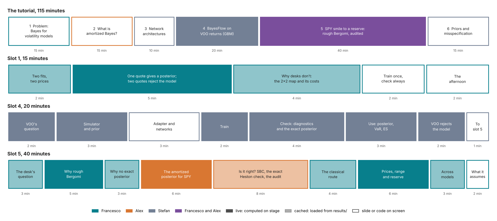
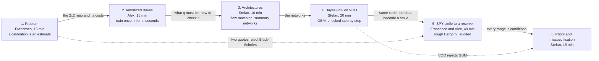

# Tutorial curriculum: ICAIF '26, Milan, 14–15 November 2026

Draft for the organizers' review, 23 October 2026. Owner: Francesco Muia.

This file fixes what the tutorial teaches, in what order and why. Where it differs from [PLAN.md](PLAN.md) §4 (slot 5), §9 (slot 4), §10 (the intro) and §13 (the other slots), this file replaces them. §13 predates the agenda: it gave flow matching and summary networks to slot 2 and simulation-based calibration to slot 3, and the agenda now makes slot 3 the architectures slot.

How to read it:

- §1 states the message and the message under it.
- §2 shows the six slots and what each hands to the next.
- §3, §4 and §5 give slots 1, 4 and 5 minute by minute.
- §6 says what slots 2, 3 and 6 must cover for the others to work.
- §7 and §8 are presenter material for slots 1 and 5: what may be said, what must not, and the hard questions.
- §9 places the consultancy message, §10 lists the gaps against the accepted proposal, and §11 lists the decisions due.

A number written ⟨Sn⟩ comes from study Sn of the [design document](../docs/design/calibration-design-document.md#planned-feasibility-study) and is not on screen until [CLAIMS.md](CLAIMS.md) marks it verified.

## 1. The message

**In one sentence.** A calibrated volatility model is an estimate. Bayes turns its uncertainty into the range a desk must report. Amortized inference makes that range affordable every morning, even for a model priced only by simulation. A chain of checks says when to trust it.

The message has three beats. Each is carried by named slots.

| Beat | Set up in | Delivered in |
| --- | --- | --- |
| The range matters, and the rules ask for it. | Slot 1 | Slot 5, as a reserve |
| Amortization makes the range affordable: pay once in training, then seconds per data set. | Slot 1, as a cost problem | Slots 2–4 teach it; slot 5 measures it |
| Trust comes from checks, not from the network: an exact answer on a sibling model, simulation-based calibration (SBC), an audit of each real data set, and a test of the model itself. | Slot 2 | Slot 4 on GBM, slot 5 on Heston and rough Bergomi, slot 6 on priors and misspecification |

The audience should leave able to say three things about their own model: whether they need this, what it costs, and how they would check it.

**The message under the message.** Doing this on a real desk is a chain of choices:

1. the model;
2. the prior;
3. the quote-noise model;
4. a simulated training bank on a cluster;
5. the network;
6. the validation;
7. the audit of each data set;
8. the pricing of products;
9. the report to the model validator.

The tutorial shows the whole chain built on a real SPY smile. The chain is documented to the standard a validator asks for, and its failures are shown and handled. The audience should conclude that the team can do this for their models. §9 says where that is made explicit (twice) and where it is only shown.

## 2. The six slots

How to read the figure:

- The top row is the tutorial: 115 minutes of talks in six slots, with widths proportional to minutes.
- The three rows below are the minute maps of slots 1, 4 and 5, from §3, §4 and §5.
- Colour is the presenter.
- A solid block is computed on stage. A light block is loaded from `results/`. A white block is a slide or code on screen.

The figure is drawn by `scripts/curriculum/storyboard.py`.

| Slot | Presenter | Min | The question it answers | Example and data | What it hands to the next slot |
| --- | --- | --- | --- | --- | --- |
| 1 | Francesco | 15 | Why do volatility models need Bayes, and why do desks not use it? | Black–Scholes on two real SPY quotes (live); the HKDE two-optima study (cached) | The 2×2 map (likelihood cheap or only by simulation, one posterior or thousands) and its measured costs |
| 2 | Alex | 15 | How can a network return a posterior, and when does it pay? | The train-once, infer-many pipeline; the break-even number of data sets | The object to build, $q_\phi(\theta \mid y)$, and the checks it must pass |
| 3 | Stefan | 10 | Which networks, for which data? | Flow matching; summary networks for series, sets and fixed grids | Flow matching and a summary network, as slot 4 uses them |
| 4 | Stefan | 20 | What is the whole workflow in code, when every step can be checked? | GBM on 1,000 daily VOO returns, against the exact posterior | The same code with a new simulator; VOO's rejection of constant volatility |
| 5 | Francesco, Alex | 40 | Does it work for a model desks use, on real data, up to the number a regulator asks for? | Rough Bergomi on the SPY smile of 21 October 2026; Heston as the exact check | A range that is conditional on the prior, the noise model, the forward-variance curve and the model |
| 6 | Stefan | 15 | What happens when the prior or the model is wrong, and how is it detected? | The crash-day prior example; Heston calibrated to a rough smile; VOO under GBM | The close |

The argument runs as one chain. Solid arrows are the main handoffs; dashed arrows are the threads that skip a slot.

Five rules keep the flow sharp:

1. Each concept has one owner slot. The other slots refer back to it in one sentence. §6 lists the owners.
2. Each slot opens with the previous slot's handoff and closes with its own.
3. Slots 4 and 5 follow the same code path: simulator, adapter, network, training, checks, use. Slot 5 changes the simulator, the data and the checks, and nothing else.
4. A number goes on screen only from CLAIMS.md, and only from a final run. A final result that misses its criterion is shown as missed ("not met"), never hidden. A pilot value is never quoted as a result; until the final run exists the slide shows ⟨Sn⟩.
5. Every live cell has a cached fallback that loads from `results/` if the computation fails or runs past its time budget. A cell that loads a network is run once before the slot starts, because loading and compiling take 5.9 s.

## 3. Slot 1: the problem (Francesco, 15 minutes)

**Title.** Bayes for volatility models: the range behind every calibrated number.

**What the slot must establish, in order:**

1. A calibration is an estimate, and the numbers computed from it inherit its uncertainty.
2. The posterior is that uncertainty, and pricing each posterior draw carries it into any number.
3. For the models desks use, the posterior is too expensive to compute every day.
4. Amortization removes the cost, and checks earn the trust.

**Recommendation for decision D1: option E, "one quote, then the smile", opened by the HKDE study.** The reasons:

- The agenda names volatility models, and option E is about volatility.
- It uses option quotes, which are slot 5's data, so slot 5 starts where slot 1 stops.
- Every posterior in it is in closed form and runs live in seconds.
- It plants both ideas the afternoon needs: propagation of the posterior, and a posterior inside a wrong model.

Option D (betas across stocks, branch `feat/tutorial-slot1-intro`) is strong and has survived two adversarial reviews. It teaches cross-sectional shrinkage, which no later slot uses, and it is about betas, not volatility. It moves to `extras/` as take-home material.

| Min | Section | What is said | On screen | Live or cached | Numbers and status |
| --- | --- | --- | --- | --- | --- |
| 0–2 | 1. Two calibrations, two prices | One synthetic smile with known parameters, thirty least-squares starts, two optima with almost the same fit. They give a one-year variance-swap volatility strike 83% above and 16% below the true one. Which one does the desk mark? The rules ask for the range of plausible calibrations and a point in it at 90% confidence. A risk desk has the same problem with a value-at-risk computed from returns. | The HKDE figure, SHOP-like panel; the words of Regulation (EU) 2016/101, Art. 11 | cached | To register as C12, with both optima's fit in noise units: optimum A ≈ +83%, optimum B ≈ −16%, posterior 90% interval −18% to +67% (HKDE study, 9 Oct) |
| 2–7 | 2. Bayes in one example | Under Black–Scholes one volatility σ prices every option. One at-the-money one-month SPY quote gives a posterior for σ. The quote's noise is the design's: a third of a volatility point at the money, wider than SPY's bid–ask on that day. The posterior's standard deviation is that third of a point: the price noise divided by the vega. Price the one-month put at the lowest grid strike (about 89% of the forward) under each posterior draw: a 90% range. The market's price for that put is about a hundred times the range. Add the put's quote: no single σ fits both quotes. That misfit is the smile. | Posterior of σ; the put's price range against its quote; the two likelihoods side by side; a slider that widens the noise | live, seconds | Computed from `spy/surface.json` (S8, verified). With the quotes of 21 Oct: σ = 12.8% ± 0.3 points; the put's 90% range 0.05–0.14 bp of the forward against its quote of 14.1 bp (implied volatility 24.4%); the best single σ misses the put by 9.5 noise standard deviations, and only five times the noise brings the miss under two |
| 7–11 | 3. Why desks do not do this | The 2×2 map has two questions. Can the likelihood be computed cheaply, or only by simulation? Is one posterior needed, or thousands (every smile, every morning)? Costs measured on one 4-core machine fill the cells. Five hundred rough-Bergomi smiles would take at least 8,500 CPU-hours exact: 350 cores for a full day, or about 2,000 for a four-hour morning. | The 2×2 table with costs | cached | C8, verified: Heston likelihood 20 ms, exact posterior ≈ 4 CPU-min; rough Bergomi likelihood 5.0 CPU-s, exact posterior at least 17 CPU-h. From returns: SVJ particle MCMC 5–29 CPU-min per series (SVJ study, 10 Oct; to register as C13) |
| 11–13 | 4. Train once, check always | Amortized inference moves the cost into training. Many pairs of parameters and data are simulated once and a network is trained on them. Each new data set then costs one pass: 1.4 s for 1,000 posterior draws for rough Bergomi. The network is an approximation, so the afternoon spends as much time checking it as building it. | The train-once, infer-many diagram (the top of the proposal's Figure 1) | slide | C8, verified: 1.4 s on the clock (3.6 CPU-s), after a one-off 5.9 s to load the network |
| 13–15 | 5. The afternoon | Six slots, each one question. Two running examples: VOO returns under GBM (slot 4: risk, the real-world measure P) and the SPY smile under rough Bergomi (slot 5: pricing, the pricing measure Q). Everything shown is in the repository, with a ledger of where each number comes from. | Six-slot slide; the names of the organizers, one line each | slide | — |

**Said aloud during section 2.** Three sentences, because the afternoon depends on them:

- The posterior is every parameter value consistent with the data at its precision.
- Propagation is mechanical: price each draw.
- The posterior is conditional on the model, and a wrong model gives a confident, wrong range. That is slot 6's subject.

**What is left out, and why.**

- The proposal's Figure 1 (Heston from a year of returns: today's variance sharp, the drift and the leverage barely learned) is left out for time. Its source is not in `tutorial_final/`. If the source is committed, its point can return in slot 5 as one sentence: the leverage ρ that a year of returns barely sees, the smile pins (Heston S2 contraction for ρ: 0.93, verified).
- The difference between P and Q gets one sentence here. Slots 4 and 5 each state their measure.

**To build before the freeze (Wed 4 Nov):**

1. Switch `notebooks/intro_one_quote.py` from the simulated rough smile to the SPY quotes. `surface.json` holds `prices_forward_units` and `noise_sd`. Rename the notebook `slot1_intro.py`, as PLAN.md §12 lays out. Its text changes with the data: on SPY the posterior from both quotes does not sit between the two likelihoods. It stays at the at-the-money value, whose quote has the larger vega, and misses the put by 9.5 noise standard deviations.
2. Register C12 (the HKDE study) and C13 (the SVJ particle-MCMC cost) in CLAIMS.md, with their source files.
3. Draw the 2×2 slide from `costs/costs.json`.

**Course lectures behind slot 1:** 1 and 8 (the desk, the products, the rules), 4 and 5 (Black–Scholes, implied volatility), 10 (posterior and propagation), 11 (cost).

## 4. Slot 4: a first amortized posterior in BayesFlow (Stefan, 20 minutes)

Proposed for Stefan's review.

The notebook exists: `notebooks/tutorial_4_bayesflow_basics.py` on branch `feat/tutorial-slot4-bayesflow-basics` (14 Oct), 1,279 lines. It was written when slot 5 was SVJ from returns. Its structure is right. It needs a 20-minute core path, the edits listed below for the new slot 5, and a move into `tutorial_final/`.

**What the slot must establish:**

1. The BayesFlow workflow consists of a few objects: simulator, adapter, networks, workflow, diagnostics.
2. Trust is earned by checks, and here every check can be compared with the exact posterior.
3. Identification can be read off the posterior: volatility is pinned and the drift is not.
4. A correct inference inside a wrong model is still wrong. VOO shows it.

| Min | Step | On screen | Live or cached | Message |
| --- | --- | --- | --- | --- |
| 0–2 | The question | VOO's last 1,000 daily log returns; "the volatility, how sure, the 10-day 99% value-at-risk" | live | The risk desk's version of slot 1's question |
| 2–5 | Step 1: simulator and prior | `prior()`, `observation()`, `bf.make_simulator`; return paths drawn from the prior | live | The prior is stated in units a risk manager can judge |
| 5–8 | Steps 2–3: adapter and networks | Two sufficient statistics, the mean $\bar y$ and $\log \hat s$; flow matching | code | Slot 3's networks, used |
| 8–10 | Step 4: train | `fit_online`, about a minute on 4 cores; the pretrained checkpoint loads if time is short | live, with fallback | Training is the one-off cost |
| 10–14 | Step 5: check | The four default diagnostics; the exact grid posterior over the network's for one series; the maximum-likelihood estimate ± 1.645 standard errors beside the network's 90% interval | live | Volatility is pinned (contraction close to 1). The drift is not (contraction about 0.4): four years of returns say little about the expected return. The checks, not the network, earn the trust. |
| 14–17 | Step 6: use | VOO's posterior in one pass; 100 series at once; 10-day 99% VaR and 97.5% expected shortfall, plug-in against predictive | live | At 10 days the plug-in and the predictive agree. Bayes does not change this number, and the slot says so. Optional, to be added: the same comparison at one and five years. Over a horizon of $h$ years the predictive variance of the log return gains the term $s_1^2 h^2$, where $s_1$ is the drift's posterior standard deviation, and this term grows faster than the $\sigma^2 h$ of the shocks |
| 17–19 | Back to VOO | VOO's 20-day realized volatility against the model's constant; the clustered VaR breaches | live | The inference is right and the model is wrong. No network repairs a wrong model. Slot 6 shows how to detect it; slot 5 uses a model whose volatility moves. |
| 19–20 | Handoff | The comparison table below | slide | Same code; the data become a smile |

**Edits to the existing notebook.** This list updates PLAN.md §9.

1. Replace the closing table with this one:

   | | Slot 4 | Slot 5 |
   | --- | --- | --- |
   | Data | 1,000 daily returns of VOO | 63 option quotes: the SPY smile of 21 October 2026 |
   | Measure | P, the real world: forecast risk | Q, pricing: value the products the smile does not quote |
   | Model | Constant volatility (GBM) | Rough Bergomi; Heston as the check |
   | Unknowns | Drift, volatility | $H$, $\eta$, $\rho$, given the forward-variance curve $\xi_0$ |
   | What the network sees | Two sufficient statistics, or learned ones | The 63 quotes and $\xi_0$ |
   | Training | About a minute, on a laptop | A bank of 100,000 smiles priced by Monte Carlo, on a cluster, once |
   | Is it right? | Compare with the exact posterior | SBC; the exact Heston posterior; an audit of each smile against the Monte Carlo likelihood |
   | The number at the end | VaR and expected shortfall | A price range and a reserve |

2. Remove the references to the SVJ slot 5. The prior is no longer "the same as slot 5's prior for these two quantities". The cost line "about 35 CPU-minutes per name" becomes slot 5's: at least 17 CPU-hours per smile exact, 1.4 s for the network.
3. Add the maximum-likelihood interval beside the network's.
4. Part B, the learned summary network, becomes a one-minute result with its training as take-home. The result: the network rediscovers $\log \hat s$ unaided, and a learned summary must be accurate to a fraction of the posterior's width. Report its $R^2$ and its error share as a range over three seeds. Keep its checkpoint: slot 6's misspecification test on VOO needs a learned summary (§6).
5. End the VOO section with one sentence: the smile is the other rejection of this model, and it is slot 5's data.
6. Fold the panels that derive the training loss and flow matching. Slot 2 and slot 3 own those derivations.
7. Move the notebook to `tutorial_final/notebooks/slot4_bayesflow_basics.py` and resolve paths from `tutorial_final/`. Freeze **Fri 30 Oct**.

**Course lectures behind slot 4:** 3 (volatility is measurable, the drift is not), 10 (the posterior), 12 (amortized inference), 13 (SBC, coverage, contraction).

## 5. Slot 5: from the SPY smile to a reserve (Francesco and Alex, 40 minutes)

**Title.** The smile fits many calibrations. Which price do you mark?

The title replaces "Ten calibrations fit the smile". The pilot found a single least-squares optimum on all 8 rough-Bergomi smiles it tested. "Ten calibrations" would invite the reply that there is only one. The many calibrations of the new title are posterior draws around that optimum that fit the quotes about as well, given their assumed noise.

**What the slot must establish, in order:**

1. The desk needs a range and a 90% point for the products the smile does not quote.
2. The model a desk would use for an index smile is priced only by simulation, so its exact posterior is out of reach.
3. The amortized posterior takes seconds and is checked three ways.
4. It turns the smile into a price range and a reserve. The classical local interval approximates that range well only where the problem is close to Gaussian.
5. The answer is conditional, and its conditions are where slot 6 starts.

**Presenter split.** Francesco opens and closes: the problem, the model, the classical route, the products and the close. Alex takes the network and its checks, which continue his slot 2. Alex speaks for about 14 minutes and Francesco for about 26. Decision D13 can move the classical route to Alex.

| Min | Who | Section | What is said | On screen | Live or cached | Numbers and status |
| --- | --- | --- | --- | --- | --- | --- |
| 0–3 | F | 1. The desk's question | SPY on 21 October 2026: 63 quotes on the design grid, 7 maturities from one week to one year, 9 strikes. The desk marks a forward-start call (one period of a cliquet) and a volatility swap. Neither is quoted. Least squares gives one parameter vector and one mark. The rule asks for the range and a 90% point. Slot 1 showed two optima on a Heston-with-jumps smile. Here the question is asked for the model a desk would use on an index smile. | The SPY smile; Art. 11 | cached | S8, verified |
| 3–8 | F | 2. Why rough Bergomi | Slot 1's second quote, now for the whole smile: one σ cannot fit it. The at-the-money skew of SPY falls with maturity as a power law, exponent −0.32 from one week to one year (about −0.4 in the SPX literature). Heston fits this one smile within the noise, but only with an extreme vol-of-vol of 1.37, which breaks the Feller condition by a factor of five and over-curves the short smiles. Its variance-swap curve, tied to its smile parameters, sits 0.8 to 1.4 volatility points below SPY's. Its skew tends to a constant as $T \to 0$. Rough Bergomi's skew goes like $T^{H-1/2}$, and the model takes the forward-variance curve $\xi_0$ from the market as an input. It has three parameters. The short skew sets $\rho\eta$. $H$ shapes the skew's term structure. $\eta$ is separated from $\rho$ by the long-dated at-the-money level measured against $\xi_0$. $\xi_0$ is read off the same smile and treated as known. | The SPY skew against maturity with the power-law fit; Heston's best fit beside it, with its parameters and its variance-swap curve against SPY's | live (the fit takes seconds), Heston cached | C1, verified (−0.32); the Heston fit is Lecture 6, Section 6.10 (to register as C14) |
| 8–11 | F | 3. Why the exact posterior is out of reach | One likelihood evaluation is one Monte Carlo surface: 5.0 CPU-s with $2^{15}$ paths. Monte Carlo error inside the likelihood is handled by an unbiased estimate; the notebook has the detail. An exact chain costs at least 17 CPU-h per smile. That is a lower bound for two reasons: it assumes the cheapest pricing cost, while the pilot bank's average is 11.9 CPU-s (41 CPU-h per chain), and a chain on a noisy Monte Carlo likelihood needs more evaluations than the Heston chains it is extrapolated from. Heston costs 20 ms per likelihood and about 4 CPU-min per exact posterior, which is why Heston is the check and not the example. | Bar chart of costs, log scale: Heston likelihood, rough likelihood, Heston exact, rough exact, network, audit | cached | C8, verified; the audit, about 425 CPU-s, is a pilot value until ⟨S5⟩ |
| 11–17 | A | 4. The amortized posterior for SPY | The training bank holds 100,000 rough-Bergomi smiles. Their parameters and forward-variance curves are drawn from the prior, they are priced by Monte Carlo on the cluster, and noise from the quote-noise model is added. It costs ⟨S1⟩ CPU-h, once. The network reads the 63 quotes and $\xi_0$ and returns draws by flow matching (slot 3). For SPY it gives 1,000 draws in 1.4 s. Reading the posterior: $\rho\eta$ is the tightest, $H$ comes from the term structure, $\eta$ and $\rho$ are each pinned but correlated. Re-pricing the draws gives the posterior predictive check on SPY. | Pairs plot over $H$, $\eta$, $\rho$ and $\rho\eta$; smiles re-priced from the draws, within the noise bands | live (one forward pass) | C8, verified (1.4 s); the SPY posterior ⟨S2⟩ ⟨S8⟩; valid only once the curve prior covers SPY's curve (gate G0) |
| 17–25 | A | 5. Is it right? | There are three questions and a check for each. (a) Is it right on average over the prior? SBC on held-out simulated smiles. Heston passes for all four parameters on 2,000 smiles, with 95% coverage between 93.5% and 95.2%. Rough Bergomi: ⟨S2⟩. (b) Is it right where the exact answer exists? On 50 Heston smiles the network alone meets the agreement criterion for all four parameters on 80% of smiles, so the criterion is not met. With the importance-sampling correction, all 4 smiles checked agree with exact MCMC. The network is a good proposal, not the final word. (c) Is it right on this smile? The audit draws 256 parameter values from a widened fit to the network's posterior and reweights them with the Monte Carlo likelihood. The efficiency and the Pareto shape $\hat k$ decide, with the threshold 0.58 that suits 256 draws. If the smile passes, the corrected posterior is used. If it fails, the smile goes to the exact route. | SBC plots, Heston and rough; network against exact posterior on one Heston smile; the audit's weights and $\hat k$ | cached; the audit is cached for SPY, and a live run with small $M$ is optional | C7, Heston verified; C5 (not met for the network alone: say so); the share of smiles flagged ⟨S5⟩ (the pilot, before the likelihood correction, flagged 33% at 0.58 and 23% at 0.7); SPY's audit ⟨S5⟩ |
| 25–29 | F | 6. The classical route on the same smiles | A multi-start least squares found one optimum on each of the 8 pilot smiles, so it gives no range there (⟨S6⟩ on the full set). The Gauss–Newton interval does give one. On 200 Heston smiles its 90% intervals cover the truth 87–92% of the time, as the posterior's do (87–90%). It fails on 11 smiles, where the information matrix is singular. That is the honest baseline: where the objective is close to a quadratic, the local interval approximates the posterior well. On rough Bergomi: ⟨S6⟩. The posterior adds three things: the shape where the objective is not quadratic (near $\rho = -1$, at small $H$), a coverage statement tested on thousands of smiles, and prices for any product from the same draws without the product's gradient. Deep calibration (a neural pricer with least squares) gives a point. MCMC on the neural pricer gives a posterior that matches the exact Heston posterior on all 50 smiles; the amortized network meets the same criterion against it on 84%. | The objective over two parameters, with the optimum, the Gauss–Newton region and the posterior draws; the coverage table | cached | C11, verified; C4 and the rough coverage are pilot values (8 smiles) until ⟨S6⟩; C6 (not met for the network alone) |
| 29–35 | F | 7. From posterior to prices: the range and the reserve | Each draw prices each path-dependent product by Monte Carlo with common random numbers, so the spread of prices comes from the parameters, not from the simulation. The variance swap has zero range by construction: it is priced as the integral of $\xi_0$, which fixes it under continuous monitoring. That is a consistency check of the curve input; it cannot reveal an error in the path simulation. With daily monitoring the strike rises by about 0.4% to 0.9%, so a real swap does depend on $(H, \eta, \rho)$. The volatility swap's range is ⟨S7⟩% of its price. The forward-start call's reserve, the 90% quantile minus the least-squares mark, is ⟨S7⟩% of its price. The study reports which parameter the reserve owes most to (⟨S7⟩; in the pilot, $\eta$ alone gives a single-parameter $R^2$ of 0.94 to 0.97 for the forward-start). Under Heston the variance swap does carry a range, up to 2.6%, because Heston's forward variance depends on its parameters. | Three price histograms with the least-squares mark and the 90% quantile; a slider for the confidence level | live (slider over the cached S7 draws) | C3 (pilot) until ⟨S7⟩; C10, verified; the daily-monitoring excess is Lecture 8, Section 8.3 (to register as C15) |
| 35–38 | F | 8. Within one model, and across models | Heston and rough Bergomi calibrated to the same smile price the forward-start differently: ⟨S7⟩%. The comparison is judged smile by smile, and a smile Heston cannot fit is reported as such: on one of the 3 pilot smiles Heston misses the quotes badly ($\chi^2$ of 1,347 on 63 quotes), its posterior collapses to a point, and its audit flags it ($\hat k$ = 154). The posterior's range is the parameter part of model risk. The choice of model is the other part. | Two price distributions per smile | cached | C9 (pilot, 3 smiles) until ⟨S7⟩ |
| 38–40 | F | 9. What the answer assumes, and what it takes on a desk | The answer is conditional on four things: the model, the prior, the quote-noise model, and $\xi_0$, read off the same smile and treated as exact. Each is a lever, and slot 6 pulls the first two. On a desk the chain is the nine steps of §1. Everything shown is in the repository. | Checklist slide; contacts (§9) | slide | — |

**Core and optional.** Three items are optional: the Monte Carlo noise sentence in section 3, the deep-calibration paragraph in section 6, and the live audit in section 5. If the slot runs long, section 8 becomes one slide (one minute) folded into section 9.

**Take-home exercises.** The three exercises of PLAN.md §4 are unchanged:

1. Change the quote-noise model and watch the reserve. It is a reweighting, with no retraining.
2. Drop the two shortest maturities and watch $H$.
3. Calibrate Heston to a rough-Bergomi smile. That misspecification leads into slot 6.

**Edits to `notebooks/slot5_calibration.py`:**

- Use the new title.
- The introduction: claim 1 becomes the design document's revised claim 1.
- Notebook section 4 (the amortized posterior): remove the ridge language, including "η and ρ separately only through the curvature in the wings".
- The notebook's sections are numbered differently from the table above (its section 2 is Heston, its section 3 rough Bergomi). Renumber them to the table's nine sections.
- Notebook section 6: replace "Where the objective has a valley the ellipse cannot follow it" with the honest-baseline text above.
- Notebook section 7: "the control of the pipeline" becomes "a consistency check of the curve input".
- Notebook section 8: "the posterior range is its lower bound, not its measure" becomes the per-smile text above.
- Add section 3 (cost) and section 9 (the close).
- Make SPY the primary smile throughout. Keep the synthetic smiles for the checks.

**Gates.** The rough-Bergomi results arrive between 26 October and 6 November. Each gate has a date and a fallback, so the story never depends on a result that has not come in.

| Gate | Study | Date | If it passes | If it fails |
| --- | --- | --- | --- | --- |
| G0 | The curve prior covers SPY's forward-variance curve | Before the full bank is generated (now) | The network's SPY posterior is an interpolation, and sections 4–7 can use it | The pilot's curve prior bounds each level's log deviation at 0.2, and SPY's curve needs 0.36 (design document, S8). Without the change, the network's SPY posterior is an extrapolation, the audit is the only check that applies, and section 4 must say so |
| G1 | S1: the full bank and its quality | Wed 28 Oct | Proceed | Train on the shards that exist and state the bank's size |
| G2 | S2: SBC of the rough network on the full bank | Fri 30 Oct | Section 5(a) says SBC passes for rough Bergomi | Section 5(a) names the parameters that fail, the audit becomes the per-smile correction, and the slide makes no claim that the network alone is calibrated. The pilot failed for both ρ and ρη on 1,600 training smiles; the full bank's 100,000 is the first remedy, and a larger network the second |
| G3 | S5: the audit on held-out smiles, with the corrected likelihood | Tue 3 Nov | The headline is the audited route: 1.4 s for the network plus minutes for the audit | If the share flagged at $\hat k > 0.58$ is above the agreed threshold (proposed: one in three), sections 4–8 run on Heston, where every number is final, and rough Bergomi is the case that needs the method, with its numbers labelled pending. The pilot network, before the likelihood correction, flagged 33%: exactly at the threshold, so the full network has to do better than the pilot |
| G4 | S8: the posterior predictive check on SPY | Wed 4 Nov | SPY carries sections 4–7 | If SPY's smile falls outside the posterior predictive bands, show that as the result: the real smile lies outside the model, which hands over to slot 6. Sections 5–7 then run on a synthetic smile fitted to SPY |

Freeze **Fri 6 Nov**. Full timed run-through **Mon 9 Nov**.

**Course lectures behind slot 5:** 5 to 7 (the smile, Heston, rough Bergomi), 8 (products and rules), 9 (the classical route), 10 (posterior and reserve), 11 (cost), 12 (amortized inference), 13 (validation), 14 (the study).

## 6. What slots 2, 3 and 6 must cover

Slots 1, 4 and 5 rely on concepts the other slots introduce. Each concept has one owner.

| Concept | Owner | Used in |
| --- | --- | --- |
| Calibration as estimation; the posterior; propagation by pricing each draw | 1 | 4, 5 |
| The 2×2 map and its costs | 1 | 2, 5 |
| The rules: Art. 11, IFRS 13, PRA SS1/23, SR 26-2 | 1 | 5 |
| Amortization; why the trained network is the posterior (the expected Kullback–Leibler argument) | 2 | 4 (folded panel), 5 |
| The break-even number of data sets: the training cost divided by the cost of one exact posterior | 2 | 5 |
| SBC, coverage and contraction, as concepts | 2 | 4 (the plots), 5 (on smiles) |
| The amortization gap, and correcting one data set by importance sampling | 2 | 5 (the audit) |
| Flow matching: the velocity field, the loss, the Euler sampler | 3 | 4, 5 |
| Summary networks matched to the data: series, sets, fixed grids; sufficient against learned statistics; conditioning variables | 3 | 4 (Part B), 5 (the 63 quotes, with $\xi_0$ as a condition) |
| BayesFlow's objects: simulator, adapter, networks, workflow, diagnostics | 4 | 5 |
| The prior predictive check | 4 | 5, 6 |
| The posterior predictive check, and a misspecification seen in it | 4 (VOO) | 5 (SPY), 6 |
| Detecting misspecification; sensitivity to the prior | 6 | — |

**Slot 2 (Alex, 15 minutes).**

- *Must cover:* the idea and the economics of amortization, ending on slot 1's 2×2 map. It should give the break-even arithmetic on one cost basis. At the pilot's average pricing cost of 11.9 CPU-s per surface, the full bank of 112,000 surfaces (training, validation and test) costs about 370 CPU-h, plus the training of the network (⟨S1⟩, ⟨S2⟩). At the same pricing cost an exact posterior costs about 41 CPU-h, so the bank pays for itself after about 9 smiles; against the 17 CPU-h lower bound, after about 22. It must also cover the amortized workflow from the prior predictive check to SBC, the posterior predictive check and the per-data-set correction.
- *The proposal's component (i):* a short history from ABC to neural posterior estimation, and the contrast with the finance alternatives: likelihood expansions (Aït-Sahalia), indirect inference and the method of moments, particle MCMC.
- *Key figure:* the top of the proposal's Figure 1.
- *Should not:* explain option pricing. Slot 1 does that.

**Slot 3 (Stefan, 10 minutes).**

- *Must cover:* flow matching, which slots 4 and 5 both use. Slot 5 samples with 100 Euler steps on a non-uniform time grid.
- *Must also cover:* how the summary network follows the structure of the data. A return series calls for convolutional or recurrent summaries (`TimeSeriesNetwork`). An exchangeable set calls for DeepSet or a set transformer. Slot 5's fixed grid of 63 quotes needs only a dense network on the vector, with $\xi_0$ passed as a condition. A set-based network for variable quote sets is the Stage D extension.
- *Optional:* coupling flows against flow matching; diffusion models.

**Slot 6 (Stefan, 15 minutes).** It takes four examples that earlier slots prepare.

1. *Misspecification in returns:* VOO under GBM, slot 4's ending, for detection in summary space (Schmitt et al. 2024). The two sufficient statistics cannot see it: on them VOO looks like a typical GBM series, because they ignore the order of the returns. Detection needs a learned summary network trained with the misspecification criterion, which slot 4's Part B checkpoint can start from.
2. *Misspecification in smiles:* Heston calibrated to a rough-Bergomi smile, slot 5's exercise 3, and the across-model gap of slot 5's section 8. The pilot smile that Heston cannot fit, where the audit's $\hat k$ is 154, shows the audit acting as a misspecification flag.
3. *Priors:* the crash-day example (branch `feat/tutorial-slot6-crash-risk`, #42), where the prior decides much of the answer; slot 4's exercise with a wide drift prior; and, in slot 5's setting, the prior on $H$ and the quote-noise model, both of which change by reweighting without retraining.
4. *The forward-variance curve:* a misstated $\xi_0$, and what $\eta$ does with it. This connects to the design document's open decision on propagating $\xi_0$.

Slot 6 closes the tutorial.

## 7. What may be said in slots 1 and 5

Each row pairs a sentence that is supported with the tempting one that is not.

| Say | Do not say | Why |
| --- | --- | --- |
| "The short skew pins ρη, H comes from the skew's term structure, and η is separated from ρ by the long-dated at-the-money level against $\xi_0$." | "η alone is unidentified; the posterior is a long ρ–η ridge." | Pilot S2: the contractions of η and ρ are 0.95 and 0.94, and the within-smile correlation of η and ρ has median 0.34. |
| "Least squares found one optimum on each of the 8 pilot smiles, so a multi-start gives no range there." | "The multi-start lands on several optima along the ridge." | C4 (pilot, 8 smiles): no smile had two optima. The two-optima example is HKDE, a different model, in slot 1. |
| "The Gauss–Newton interval is the right baseline; on Heston it covers as well as the posterior." | "Classical calibration gives no uncertainty." | C11. |
| "Heston fits this smile within the noise, but only with an extreme vol-of-vol, over-curved short smiles and a variance-swap curve below the market's." | "Heston cannot fit SPY's skew." | Lecture 6, Section 6.10: RMS residual 0.84 noise units, 62 of 63 quotes within two; fitted skew exponent −0.41 over the grid. |
| "The quote noise is the design's: a third of a volatility point at the money and a full point in the wings, both at the reference volatility of 20%, and wider than SPY's bid–ask on 21 October." | "The noise is SPY's bid–ask." | Design document, S8 and Appendix I: the real half-spreads lie below the design noise at all 63 points, so the floor binds everywhere. |
| "The variance swap's zero range is a consistency check of the curve input: it is the integral of $\xi_0$." | "The zero range shows the method works." | It holds by construction, and the swap is not simulated, so it cannot reveal a path-simulation error. |
| "SPY's curve lay outside the pilot's curve prior; the full bank's prior covers it." (Only after gate G0.) | "The network has seen smiles like SPY's." (Before G0.) | Design document, S8: the curve needs a log deviation of 0.36 against the prior's bound of 0.2. |
| "1.4 s for the network, minutes with the audit, at least 17 CPU-hours exact." | "Milliseconds", or "seconds per smile" without the audit. | C8; the audit is about 425 CPU-s (pilot). The proposal's "milliseconds" is not what was measured. |
| "At least 17 CPU-hours." | "17 CPU-hours." | It assumes the cheapest pricing cost (the bank's average gives 41) and the evaluation count of a chain on an exact likelihood; a chain on a noisy Monte Carlo likelihood needs more. |
| "SBC passes for Heston; for rough Bergomi, ⟨S2⟩." | "SBC passes", for rough Bergomi, before gate G2. | The pilot fails for ρ and ρη. |
| "The network alone meets the agreement criterion against the exact Heston posterior on 80% of smiles, so it does not meet it; with the correction, all four smiles checked agree." | "The network matches the exact posterior." | C5: not met for the network alone. |
| "The range is conditional on the quote-noise model; double the noise and the range widens." | "The posterior is the market's uncertainty." | The width scales with the assumed noise (exercise 1). |
| "The SPY skew exponent is −0.32; the literature's is about −0.4." | "SPY has H = 0.18." | Under rough Bergomi with a large η, the exponent plus one half understates H (S8's note). |
| "The gap across models is judged smile by smile: on some smiles larger than the range within the model, on others smaller." | "The range within the model is a lower bound on model risk." | C9 (pilot). |
| "The posterior is conditional on $\xi_0$, read off the same smile and treated as exact." | Nothing about $\xi_0$. | The separation of η from ρ runs through $\xi_0$, and a validator will ask. |

## 8. Hard questions, with short answers

These are for slots 1 and 5. Each answer cites its evidence.

1. **"Why not Gauss–Newton and the delta method?"** On Heston it works as well as the posterior (C11), and it is the baseline the slot shows. It fails where the objective is not quadratic: near ρ = −1, at small H, and at the edge of the prior box, where no interval exists. On rough Bergomi it needs the Jacobian of a Monte Carlo pricer and, for each product, that product's gradient. The posterior prices every product from the same draws, with coverage tested on thousands of smiles.
2. **"Isn't the width just your noise assumption?"** Largely, yes. The posterior is the set of calibrations consistent with the quotes at the assumed precision, which is what "plausible" means in Art. 11. On 21 October the assumed noise is wider than SPY's bid–ask at every quote, so the range is on the conservative side. Exercise 1 changes the noise model without retraining.
3. **"$\xi_0$ comes from the same smile. Is that double counting?"** $\xi_0$ is stripped from the smile by replicating the variance swap, and the posterior is conditional on it. Treating it as exact makes η's range too narrow by whatever $\xi_0$'s uncertainty adds. Propagating that uncertainty is the next step (an open decision in the design document).
4. **"Deep calibration already calibrates in milliseconds."** It returns a point. MCMC on the neural pricer returns a posterior: on Heston it matches the exact posterior on all 50 smiles, and the amortized network meets the same criterion against it on 84% (C6). Both are simulation-based. The amortized posterior needs no chain per smile. The neural pricer is more flexible when the quote set or the noise model changes.
5. **"Rough Bergomi fails joint SPX–VIX calibration. Why this model?"** It is not the last word. The method needs only a simulator. The across-model comparison shows how much the choice of model matters on each smile, and slot 6 tests misspecification.
6. **"Does a network trained on simulations work on a real smile?"** Only if the real smile and its inputs look like what the prior can produce. SPY's smile statistics lie inside the prior. Its forward-variance curve lay outside the pilot's curve prior, which is why the full bank's prior is widened (gate G0). Two more guards check each smile: the posterior predictive check, and the audit, which uses this smile's own likelihood and its real curve.
7. **"How does it scale to a book?"** One network serves one model and one design grid, and each underlying's chain is mapped to the grid. The network costs about 3.6 CPU-s per smile. The audit costs about 425 CPU-s per smile (pilot), so 500 smiles take about 30 CPU-minutes for the network and about 59 CPU-hours for the audits, run in parallel, against at least 8,500 CPU-hours exact. Variable quote sets need the set-based summary network (Stage D).
8. **"What does training cost, and when does it pay?"** About 370 CPU-hours for the full bank at the pilot's pricing cost, plus training, once (⟨S1⟩). It pays for itself after about 9 smiles at the bank's average pricing cost, or about 22 against the 17 CPU-hour lower bound. Retraining is needed when the prior or the design grid changes, not every day.
9. **"What about hedge ratios?"** Deltas and vegas can be computed under each draw in the same way. They are not in the tutorial; the design document has a section on them.
10. **"With a flat prior, one quote is just least squares."** Yes, deliberately. The example shows propagation and the rejection of the model, not the prior. Priors are slot 6's subject.
11. **"The proposal promised VaR from returns."** That is slot 4, on VOO.

## 9. Where the consultancy message lands

The message is shown in every slot and said in only two places.

**Shown:**

- *Real data end to end.* The SPY chain of 21 October 2026 and the VOO returns.
- *Documentation to a validator's standard.* The design document and the fourteen-lecture course in `docs/course/`, the long version of slots 1 and 5, are take-home material.
- *A ledger of claims.* Every number on screen is traced to a study and a file (CLAIMS.md).
- *Failures shown and handled.* The pilot's SBC failure, the audit's flag rate, and the places where the classical route is as good.
- *Infrastructure.* A bank of 100,000 Monte-Carlo-priced surfaces built on a cluster, and trained networks shipped as checkpoints.
- *The people.* BayesFlow's lead developer and core contributors, and hedge-fund experience on the team. Slot 1 spends fifteen seconds on this.

**Said, twice:**

1. *The last slide of slot 5 (Francesco).* "What it takes on a desk": the nine steps of §1, then one line and contacts. "A model only simulation can price, or a validator asking for these ranges? Talk to the authors: ⟨contacts⟩."
2. *The participant README.* A short section, "Working with the authors".

There is no sales slide anywhere else, and none in slot 1.

## 10. Gaps against the accepted proposal

The audience has read the proposal. Each promise this curriculum does not keep needs a handling, decided before the freeze.

| The proposal promises | This curriculum | Proposed handling |
| --- | --- | --- |
| Calibration from return series (its Figure 1), with joint calibration to returns and options named as the follow-on edition | The advanced example calibrates to an option smile | Once the source of the proposal's Figure 1 is committed (§3), slot 1's last slide says why in one sentence: the leverage that a year of returns barely sees, the smile pins. The SVJ-from-returns lesson goes home as a notebook |
| Five model families: Heston, jump diffusion, GARCH, rough, multifractal | GBM, Heston, rough Bergomi; HKDE as one slide | Name the take-home notebooks (the SVJ lesson, the multifractal notebook) on slot 1's last slide. GARCH has no notebook: say so, or drop it from the slide |
| Two notebooks worked through live and one taken home, in "student" and "solved" versions, runnable on Colab | Three live notebooks (slots 1, 4 and 5) | Decision D10: either count slot 1 as slides with a live cell, or say three. The student versions and the hosted option are decision D9 of PLAN.md |
| "Attendees calibrate real market data and sign off on the diagnostics" | Presenters do it on VOO and SPY | Decision D12: the exercises after slots 4 and 5 are where attendees do it |
| Autoregressive samplers, as an advanced concept | Not in any slot | Slot 3 may mention them; otherwise drop them from the slides |
| Learning from series of different lengths and with missing values | Not in any slot | Slot 3 may mention it; otherwise drop it from the slides |
| LLM-based verification agents, used hands-on | Not in any slot | Decision D11: a two-minute demonstration in slot 4's check step, where an agent paired on the live notebook runs the diagnostics and drafts the sign-off, with a recorded fallback; or drop it and say so |
| "Full posterior distributions in milliseconds" | 1.4 s for 1,000 draws | Say seconds, never milliseconds |
| Half a day, 3.5 hours, hands-on | 1 hour 55 minutes of talks | Decision D12: the rest is breaks, questions and exercises; decide whether the exercises run after slot 4 and after slot 5 |
| Mis-specification diagnostics (learning outcome 2) | Slot 6 | Kept |
| Propagation into volatility forecasts and VaR (learning outcome 4) | Slot 4 (VaR and expected shortfall under constant volatility, where Bayes does not change the 10-day number), slot 5 (prices and reserves) | Partly kept: there is no volatility forecast that moves. The SVJ notebook covers it at home |
| Figure 1 (Heston from returns) | Not shown; its source is not in `tutorial_final/` | Commit its source if any slot shows it |

## 11. Decisions

| # | Decision | Recommendation | By |
| --- | --- | --- | --- |
| G0 | Widen the curve prior of the rough bank so that it covers SPY's forward-variance curve | Yes, before the full bank is generated | Now |
| D1 | Slot 1 option | E, opened by the HKDE study (§3); option D to `extras/` | Fri 23 Oct |
| D2 | Slot owners and durations | As in the agenda of §2 | Fri 23 Oct |
| D10 | Presentation format | Marimo notebooks for slots 1, 4 and 5, with a cached fallback in every live cell | Fri 30 Oct |
| D11 | The LLM verification agent promised in the proposal | Two-minute demonstration in slot 4, or drop it and say so | Fri 30 Oct |
| D12 | Hands-on time beyond the talks | Exercises after slots 4 and 5 | Fri 30 Oct |
| D13 | Slot 5's title and presenter split | "The smile fits many calibrations. Which price do you mark?"; Alex takes sections 4–5 | Fri 30 Oct |
| D14 | Threshold for gate G3 | One smile in three flagged | Fri 30 Oct |

Freezes: slot 4 **Fri 30 Oct**, slot 1 **Wed 4 Nov**, slot 5 **Fri 6 Nov**. Full timed run-through **Mon 9 Nov**.

## Sources

- [PLAN.md](PLAN.md): the decision, the studies, the timeline.
- [CLAIMS.md](CLAIMS.md): the status of every number cited here.
- [The design document](../docs/design/calibration-design-document.md) and [the course](../docs/course/README.md).
- The proposal: *Amortized Bayesian Calibration of Volatility Models*, ICAIF '26 tutorial proposal.
- Branches: `feat/tutorial-slot1-intro` (option D), `feat/tutorial-slot4-bayesflow-basics` (slot 4), `feat/tutorial-slot6-crash-risk` (slot 6's seed).
