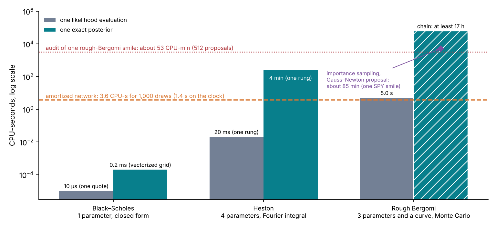
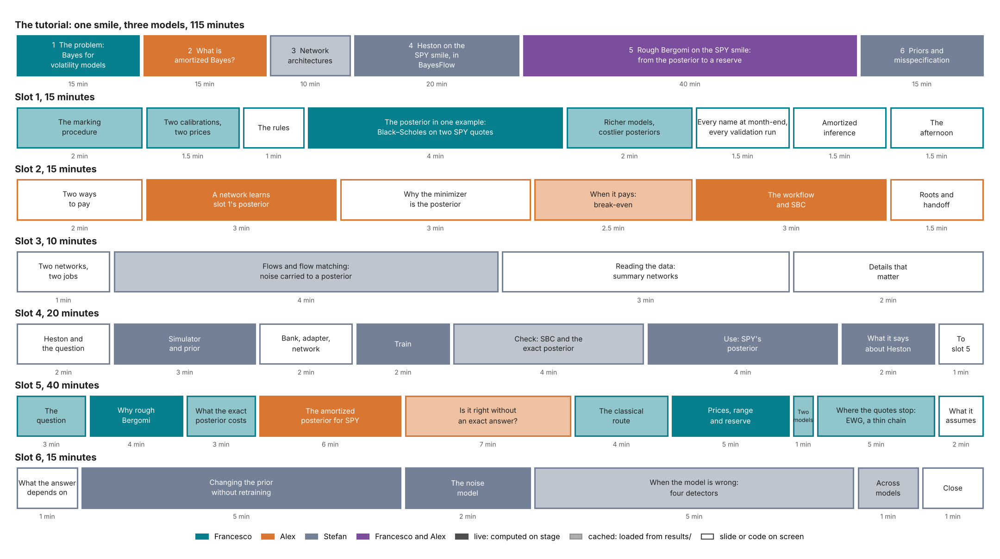
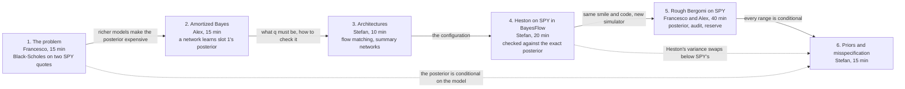

# The ICAIF '26 tutorial: curriculum

Draft for the organizers' review. 23 October 2026, revision 2. Owner: Francesco Muia.

This folder fixes what the tutorial teaches, in what order and why: this summary, and one file per slot.

| File | Slot | Presenter | Minutes |
| --- | --- | --- | --- |
| [01-slot1-the-problem.md](01-slot1-the-problem.md) | 1. The problem: Bayes for volatility models | Francesco | 15 |
| [02-slot2-amortized-bayes.md](02-slot2-amortized-bayes.md) | 2. What is amortized Bayes? | Alex | 15 |
| [03-slot3-architectures.md](03-slot3-architectures.md) | 3. Network architectures | Stefan | 10 |
| [04-slot4-heston-in-bayesflow.md](04-slot4-heston-in-bayesflow.md) | 4. A worked example in BayesFlow: Heston on the SPY smile | Stefan | 20 |
| [05-slot5-rough-bergomi-to-a-reserve.md](05-slot5-rough-bergomi-to-a-reserve.md) | 5. Rough Bergomi on the SPY smile: from the posterior to a reserve | Francesco, Alex | 40 |
| [06-slot6-priors-and-misspecification.md](06-slot6-priors-and-misspecification.md) | 6. Changing priors and dealing with misspecified models | Stefan | 15 |

The folder replaces `CURRICULUM.md` (revision 1, same day) and, where they differ, §4, §9, §10 and §13 of [PLAN.md](../PLAN.md). A number written ⟨Sn⟩ comes from study Sn of the [design document](../../docs/design/calibration-design-document.md#planned-feasibility-study) and is not on screen until [CLAIMS.md](../CLAIMS.md) records the final run.

## Executive summary

**What the tutorial teaches.** A calibrated volatility model is an estimate, and the prices it gives for products nobody quotes inherit its uncertainty. The posterior is that uncertainty, and pricing under each posterior draw turns it into the range a desk must report. Amortized inference makes the posterior affordable for every smile, every morning, even for a model priced only by simulation, and a chain of checks says when to trust it.

**The arc: one smile, three models.** The whole afternoon works on one data set, the SPY option smile of 21 October 2026 (63 prices read from the closing quotes onto a fixed grid of 7 maturities × 9 moneyness points), and one question: which price to mark for a product the smile does not quote, and with what range. Three models of increasing realism carry it, each more expensive to invert:

1. **Black–Scholes** in slot 1: one parameter, a posterior on a grid in a fraction of a millisecond, and a model the smile rejects.
2. **Heston** in slot 4: four parameters, an exact likelihood by Fourier integral, so the network can be checked against the exact posterior. It fits SPY, but only with extreme parameters.
3. **Rough Bergomi** in slot 5: three parameters and the market's forward-variance curve, priced only by Monte Carlo, so the exact posterior costs at least 17 CPU-hours and the network is checked by an audit of each smile.

Slots 2 and 3 explain the machine between them. Slot 6 changes the prior and the noise model, and tests the model.

**What changed from revision 1, and why.**

- **Slot 4 moves from returns to the smile.** It was GBM on VOO returns, under the real-world measure P, followed in slot 5 by option quotes under the pricing measure Q. That switch changed the data, the measure, the model and the question at once. Slot 4 is now Heston on the SPY smile, so slot 5 changes only the simulator. The exact Heston check moves from slot 5 to slot 4.
- **The returns material goes home.** The VOO notebook, the SVJ lesson and the crash-day prior example become a take-home track (§6). This widens the gap against the proposal, which calibrates from returns (§8).
- **Slot 1 is rewritten slide by slide**, with one line of argument: what a desk does, an example of the problem, what the rules ask for, the posterior in one live example, why richer models make it expensive, and the way around.
- **Slots 2, 3 and 6 have proposals**, each built on the same smile, for Alex's and Stefan's review.

**A feasibility run supports the new slot 4.** The exact Heston posterior on SPY ($\kappa$ = 2 fixed, the bank's prior box) was computed on 23 October in 531 CPU-seconds. Seven of eight optimizer starts spread over the prior box reach the same optimum, and four chains from overdispersed starts agree ($\hat R \le 1.007$). The posterior is tight: $\sigma_v$ = 1.14 ± 0.04 and $\rho$ = −0.63 ± 0.02. No draw satisfies the Feller condition: the vol-of-vol is about twice its Feller limit. The posterior prices variance swaps 0.6 to 1.7 volatility points below SPY's replicated strikes from two weeks to one year, with 90% bands 0.3 to 0.6 points wide. This gives slot 4 a real-data ending and slot 5 its reason to change model. Details are in the slot 4 file; the run is redone as study S8-H before its numbers go on screen.

**What has to happen now.**

1. **Gate G0, before the full rough bank is generated:** widen the curve prior to cover SPY's forward-variance curve (slot 5, Gates).
2. **D1 and D16** (§10): confirm option E for slot 1 and the all-smile arc.
3. **Build lists** are at the end of each slot file. Freezes: slot 4 by **Fri 30 Oct**; slots 1, 2 and 3 by **Wed 4 Nov**; slots 5 and 6 by **Fri 6 Nov**. Full timed run-through **Mon 9 Nov**.

## 1. The message

**In one sentence.** A calibrated volatility model is an estimate; Bayes turns its uncertainty into the range a desk must report; amortized inference makes that range affordable every morning, even for a model priced only by simulation; and a chain of checks says when to trust it.

The message has three beats, each carried by named slots.

| Beat | Set up in | Delivered in |
| --- | --- | --- |
| The range matters, and the rules ask for it. | Slot 1 | Slot 5, as a reserve |
| Amortization makes the range affordable: pay once in training, then seconds per smile. | Slot 1, as a cost problem | Slots 2 and 3 explain it; slot 4 builds it; slot 5 measures it |
| Trust comes from checks, not from the network. | Slot 2, as a workflow | Slot 4 against an exact posterior; slot 5 by audit; slot 6 on priors and misspecification |

The audience should leave able to say three things about their own model: whether they need this, what it costs, and how they would check it.

**The message under the message.** Doing this on a real desk is a chain of choices: the model, the prior, the quote-noise model, a simulated bank on a cluster, the network, the validation, the audit of each smile, the pricing of products, the report to the validator. The afternoon shows the whole chain built on a real smile, documented to the standard a validator asks for, with its failures shown and handled. The audience should conclude that the team can do this for their models. §7 says where that is made explicit (twice) and where it is only shown.

## 2. The arc: one smile, three models

How to read the figure: for each model, the grey bar is the cost of one likelihood evaluation (pricing the quotes once) and the green bar the cost of one exact posterior, in CPU-seconds on a log scale, on one 4-core machine. The hatched bar is a lower bound. Heston's bars are at one rung of its quadrature ladder; a checked evaluation costs at least twice as much. The dashed orange line is the amortized network's cost for 1,000 draws, and the dotted red line the cost of auditing one rough-Bergomi smile (a pilot value). Sources: `costs/costs.json` (C8); the Black–Scholes bars were timed once with `sbi4finance.calibration.surface` on 23 October and are illustrative, not a study result.

| | Black–Scholes | Heston | Rough Bergomi |
| --- | --- | --- | --- |
| Slot | 1 | 4 | 5 |
| Parameters | σ | $v_0$, $\theta$, $\sigma_v$, $\rho$ ($\kappa$ fixed) | $H$, $\eta$, $\rho$, with the curve $\xi_0$ as an input |
| One likelihood evaluation | about 10 µs per price | 20 ms per smile at one quadrature rung | 5.0 CPU-s per smile |
| One exact posterior | 0.2 ms (vectorized grid) | about 4 CPU-min at one rung, twice that with the accuracy checks | at least 17 CPU-h |
| What it does on SPY | Cannot fit two quotes | A root-mean-square residual of about one noise unit (the noise is loose in the wings), with a vol-of-vol about twice its Feller limit and variance swaps below SPY's | Its skew follows a power law in maturity, the shape of SPY's; its variance swaps match the market by construction; its fit to SPY is ⟨S8⟩ |
| The check of the network | — (slot 2's toy, against the grid) | The exact posterior by MCMC | SBC, a second method, and an audit of each smile |

## 3. The six slots

How to read the figure: the top row is the tutorial, 115 minutes of talks in six slots, with widths proportional to minutes. The rows below are the minute maps of the six slots, from their files. Colour is the presenter. A solid block is computed on stage, a light block is loaded from `results/`, and a white block is a slide or code on screen. The figure is drawn by `scripts/curriculum/storyboard.py`.

| Slot | The question it answers | Example | What it hands to the next slot |
| --- | --- | --- | --- |
| 1 | Why does a calibrated volatility model need a posterior, and why do desks not compute one? | Black–Scholes on two SPY quotes (live); the HKDE two-optima study (cached) | The cost of the posterior under richer models, and the idea of amortization |
| 2 | How can a network trained on simulations return the posterior, and when does that pay? | A network learns slot 1's posterior (live); the break-even for Heston and rough Bergomi | The object to build, $q_\phi(\theta \mid y)$, and the workflow that checks it |
| 3 | Which networks represent the posterior, and how do they read the data? | Flow matching carrying noise to SPY's Heston posterior; data shapes and their networks | The exact network configuration of slots 4 and 5 |
| 4 | What does the workflow look like in code, when every step can be checked? | Heston on the SPY smile, against the exact posterior | The same code, a new simulator; Heston's defects on SPY |
| 5 | Which price does a desk mark, and how large a reserve? | Rough Bergomi on the SPY smile, audited; Heston against rough | A range conditional on the prior, the noise model, the curve and the model |
| 6 | What does the answer depend on, and how is a wrong model found out? | The prior on $H$; the Feller condition; the noise multiplier; four detectors | The close |

The argument runs as one chain. Solid arrows are the main handoffs; dashed arrows are threads that skip a slot.

## 4. Rules for every slot

1. **One owner per concept.** The other slots refer back in one sentence (§5).
2. **Handoffs.** Each slot opens with the previous slot's handoff and closes with its own.
3. **One code path.** Slots 4 and 5 follow the same steps: simulator, adapter, network, training, checks, use. Slot 5 changes the simulator and the checks, and nothing else.
4. **Numbers.** A number goes on screen only from CLAIMS.md, and only from a final run. A final result that misses its criterion is shown as missed ("not met"). A pilot value is never quoted as a result; until the final run exists the slide shows ⟨Sn⟩.
5. **Live cells.** Every live cell has a cached fallback that loads from `results/` if the computation fails or runs past its time budget. A cell that loads a network runs once before the slot starts.
6. **Wording.** Seconds, never milliseconds, for the network; "at least 17 CPU-hours" for the exact rough posterior; "the design's noise", never "SPY's bid–ask". Slot 5's file lists the rest.

## 5. Who owns which concept

| Concept | Owner | Used in |
| --- | --- | --- |
| Calibration as estimation; the posterior; propagation by pricing each draw; conditionality on the model | 1 | 2, 4, 5, 6 |
| The rules: Regulation (EU) 2016/101 Art. 9 and Art. 11, IFRS 13, PRA SS1/23 | 1 | 5 |
| The cost ladder and the 2×2 table | 1 | 2, 5 |
| The amortization identity; the economics and the break-even | 2 | 4, 5 |
| The amortized workflow; SBC, coverage and contraction as concepts | 2 | 4, 5 |
| The amortization gap and its correction by importance sampling | 2 | 4 (exact likelihood), 5 (Monte Carlo likelihood) |
| Normalizing flows and flow matching; the sampler | 3 | 4, 5 |
| Summary networks by data shape; conditions and context variables | 3 | 5 ($\xi_0$ as a condition), 6 (summary-space detection) |
| BayesFlow's objects in code: simulator, adapter, networks, workflow, diagnostics | 4 | 5, 6 |
| The prior predictive check and the posterior predictive check on a smile | 4 | 5, 6 |
| Products under the posterior; the reserve; the classical baseline | 5 | 6 |
| Changing the prior and the noise model; detecting misspecification; across-model reporting | 6 | — |

## 6. The take-home track

The proposal calibrates from returns and propagates into value-at-risk. The afternoon no longer does, so the repository carries that material as take-home notebooks. Each is drafted on a branch or in the archive and moves into `extras/`, which does not exist yet:

| Notebook | What it teaches | Source |
| --- | --- | --- |
| `extras/returns_bayesflow_basics.py` | BayesFlow on 1,000 VOO returns under GBM: the same workflow as slot 4, with VaR and expected shortfall | Branch `feat/tutorial-slot4-bayesflow-basics`, edited |
| `extras/svj_from_returns.py` | Stochastic volatility with jumps from returns, with a particle-filter audit | The SVJ lesson (#38), branch `feat/tutorial-slot5-svj-advanced` |
| `extras/multifractal_returns.py` | The multifractal model of asset returns | `notebooks/01_mmar_univariate.py` in the archive |
| `extras/crash_day_priors.py` | How much the prior decides the probability of a 7% loss day | Branch `feat/tutorial-slot6-crash-risk` (#42) |
| `extras/betas_across_stocks.py` | Cross-sectional shrinkage of betas | Branch `feat/tutorial-slot1-intro` (option D) |

Slot 1's last slide names the track in one line.

## 7. Where the consultancy message lands

The message is shown in every slot and said in only two places.

**Shown:**

- real data end to end: the SPY chain of 21 October 2026;
- documentation to a validator's standard: the design document and the fourteen-lecture course in `docs/course/`, take-home;
- a ledger of claims: every number on screen traced to a study and a file;
- failures shown and handled: the Heston network alone short of the exact-likelihood reference on one smile in five, the rough pilot's SBC failure, the audit's flag rate, the places where the classical route is as good;
- infrastructure: a bank of 112,000 Monte-Carlo-priced smiles generated on a cluster (gate G1), and trained networks shipped as checkpoints (Heston's now, rough Bergomi's after gate G2);
- the people: BayesFlow's lead developer and core developers, and hedge-fund experience on the team; slot 1 spends twenty seconds on this.

**Said, twice:**

1. The last slide of slot 5 (Francesco): "What it takes on a desk", the chain of §1, then one line and contacts: "A model only simulation can price, or a validator asking for these ranges? Talk to the authors: ⟨contacts⟩."
2. The participant README: a short section, "Working with the authors".

## 8. Gaps against the accepted proposal

The audience has read the proposal. Each promise the curriculum does not keep needs a handling, decided before the freeze.

| The proposal promises | The curriculum | Proposed handling |
| --- | --- | --- |
| Calibration from return series (its Figure 1, "simulated pairs (parameters, return series)"), with joint returns-and-options calibration named as the follow-on edition | Every slot works on an option smile | Decision D16. Slot 1 says in one line why the afternoon uses options and that returns go home; the take-home track (§6) carries returns |
| Propagation into volatility forecasts and value-at-risk (learning outcome 4) | Propagation into product prices and a reserve | Partly kept; VaR and volatility forecasts are in the take-home track |
| Five model families: Heston, jump diffusion, GARCH, rough, multifractal | Black–Scholes, Heston, rough Bergomi; Heston with jumps as one slide | Name the take-home notebooks on slot 1's last slide, the SVJ and multifractal notebooks included; GARCH has no notebook: say so, or drop it from the slide |
| Two notebooks live and one taken home, in student and solved versions, runnable on Colab | Live notebooks in slots 1, 2, 4, 5 and 6 | Decision D10 for the number; decision D17 for the student and solved versions; decision D9 of PLAN.md for the hosted option |
| Half a day, 3.5 hours: principles (1 h with a break), a worked example hands-on (1.5 h with a break), advanced concepts and a second example (1 h with a 15-minute Q&A) | 115 minutes of talks; about 95 minutes of the 3.5 hours unassigned | Decision D12: assign the time to breaks, the Q&A and exercises after slots 4 and 5 |
| A close with "a broader view of the field and recent developments" | Slot 6's last minute | Slot 6's close names recent developments in one slide, or the Q&A opens with them |
| "Trained checkpoints for every example" | Heston's network exists; the rough network and slot 6's networks are pending | Ship each by its slot's freeze, or say which examples train at home |
| Four organizers teaching | Jerry Huang has no slot | Decision D18: a role for Jerry, for example the hands-on support, slot 6's networks or the SBC study, as PLAN.md §14 proposed |
| "Attendees calibrate real market data and sign off on the diagnostics" | Presenters do it on SPY | Decision D12: exercises after slots 4 and 5 |
| LLM-based verification agents, used hands-on | Not in any slot | Decision D11: a two-minute demonstration in slot 4's check step, or drop it and say so |
| "Special emphasis" on learning from series of different scales, dimensions, lengths and degrees of missingness; autoregressive samplers | Not in any slot; the smile is a fixed grid | The largest content gap after returns. Slot 3 can show the set network for real chains as the answer for quotes; time series stay in the take-home track. Say so rather than imply coverage |
| "Full posterior distributions in milliseconds" | 1.4 s for 1,000 draws | Say seconds |
| Mis-specification diagnostics (learning outcome 2) | Slot 6 | Kept |
| Read identifiability off the posterior (learning outcome 3) | Slots 4 and 5 | Kept |

## 9. Gates and dates

| Date | What | Owner |
| --- | --- | --- |
| Now | G0: widen the rough bank's curve prior to cover SPY's curve | Alex (bank generation) |
| Wed 28 Oct | G1: the full rough bank and its quality (S1) | Alex |
| Fri 30 Oct | G2: SBC of the rough network on the full bank (S2); freeze of slot 4; S8-H (Heston on SPY) accepted | Alex; Stefan |
| Tue 3 Nov | G3: the audit on held-out smiles, with the corrected likelihood (S5) | Alex |
| Wed 4 Nov | G4: the posterior predictive check on SPY (S8); freezes of slots 1, 2 and 3 | Francesco; Alex; Stefan |
| Fri 6 Nov | Freezes of slots 5 and 6 | Francesco, Alex, Stefan |
| Mon 9 Nov | Full timed run-through | All |
| Wed 11 Nov | Release tag; participant README | Francesco |

## 10. Decisions

| # | Decision | Recommendation | By |
| --- | --- | --- | --- |
| G0 | Widen the curve prior of the rough bank to cover SPY's forward-variance curve | Yes, before the full bank is generated | Now |
| D1 | Slot 1 option | E, as in the slot 1 file; option D to the take-home track | Fri 23 Oct |
| D16 | The arc: every slot on the SPY smile, Heston in slot 4, returns as a take-home track | Yes | Fri 23 Oct |
| D2 | Slot owners and durations | As in the agenda above | Fri 23 Oct |
| D10 | Presentation format | Marimo notebooks for slots 1, 2, 4, 5 and 6, slides for slot 3, a cached fallback in every live cell | Fri 30 Oct |
| D11 | The LLM verification agent promised in the proposal | A two-minute demonstration in slot 4, or drop it and say so | Fri 30 Oct |
| D12 | Hands-on time beyond the talks | Exercises after slots 4 and 5 | Fri 30 Oct |
| D13 | Slot 5's title and presenter split | "The smile fits many calibrations. Which price do you mark?"; Alex takes sections 4 and 5 | Fri 30 Oct |
| D14 | Threshold for gate G3 | One smile in three flagged | Fri 30 Oct |
| D15 | Slot 6's sensitivity-aware network and summary-space detector | Build the first; the second if time allows | Fri 30 Oct |
| D17 | Student and solved versions of the notebooks | Solved versions on stage; student versions with the exercises blanked, generated from the solved ones | Fri 30 Oct |
| D18 | Jerry Huang's role | To agree with Jerry | Fri 30 Oct |

## 11. Sources

- [PLAN.md](../PLAN.md): the decision, the studies, the timeline. [CLAIMS.md](../CLAIMS.md): the status of every number.
- [The design document](../../docs/design/calibration-design-document.md) and [the course](../../docs/course/README.md): the long version of slots 1, 4 and 5.
- The proposal: *Amortized Bayesian Calibration of Volatility Models*, ICAIF '26 tutorial proposal.
- The feasibility run of 23 October: `scripts/curriculum/heston_spy_exact.py` and [data/heston-spy-exact.json](data/heston-spy-exact.json).
- Branches with earlier slot drafts: `feat/tutorial-slot1-intro`, `feat/tutorial-slot4-bayesflow-basics`, `feat/tutorial-slot6-crash-risk`.
