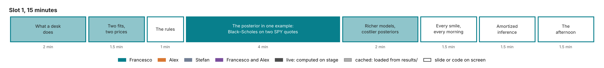

# Slot 1. The problem: Bayes for volatility models

Francesco · 15 minutes · first slot of the afternoon. Part of the [curriculum](00-overview.md).

## The slot in three sentences

**The question.** Why does a calibrated volatility model need a posterior, and why do desks not compute one?

**The answer.**

1. A calibration is an estimate from noisy quotes, so the prices it gives for products nobody quotes are uncertain, and the rules ask banks to report that range.
2. The posterior is that uncertainty: pricing a product under every posterior draw turns it into the range.
3. For the models desks use, one posterior costs minutes to hours, which is too slow for every smile every morning; amortized inference removes that cost, and the rest of the afternoon shows how and how to check it.

## What the audience leaves with

- The posterior is every parameter value consistent with the quotes at their precision, and propagation is pricing under each value.
- The posterior is conditional on the model. A model that cannot produce the data gives a precise and wrong range.
- The three models of the afternoon form a ladder: Black–Scholes (closed form), Heston (exact likelihood, slot 4) and rough Bergomi (Monte Carlo only, slot 5). Each step up fits the smile better and makes the posterior more expensive.

## Slide by slide

Each slide states its title as it appears on screen, what is on screen, what is said, and how it leads to the next slide. The words "said" are a script to adapt, not to read.

### Slide 1. Bayes for volatility models (20 seconds)

- **On screen.** The tutorial's title and the four organizers, one line each: hedge-fund research, BayesFlow's lead developer, BayesFlow's core developers, Bayesian consulting.
- **Said.** The afternoon answers one question that every derivatives desk faces every morning. It answers it on one real option smile, with three models of increasing realism.

### Slide 2. What a desk does every morning (1.5 minutes)

- **On screen.** Left: the SPY smile of 21 October 2026, implied volatility against strike for the 7 maturities from one week to one year (`results/calibration/spy/surface.png`). Right: three boxes joined by arrows: "63 quotes" → "a model, fitted" → "prices of products nobody quotes: a forward-start option, a volatility swap".
- **Said.** These are 63 SPY option quotes at the close of 21 October. Each morning a desk fits a model to quotes like these. It then uses the fitted model to price products that are not quoted, such as an option whose strike is set in one year's time. The quotes are noisy, so the fit is uncertain. The question of the afternoon is how uncertain the price of the unquoted product is.
- **Leads to.** An example where the uncertainty is large.

### Slide 3. Two calibrations, two prices (1.5 minutes)

- **On screen.** The SHOP-like panel of the HKDE study of 9 October (`docs/design/images/01-hkde-option-prices.png`), with the variance-swap column highlighted.
- **Said.** This is Heston's model with jumps, fitted to a synthetic smile whose true parameters are known. Thirty starts of the optimizer end at two parameter sets that fit the quotes almost equally well. One gives a one-year variance-swap volatility 83% above the true one, the other 16% below. The blue shape is the posterior: all parameter values consistent with the quotes, and the prices they give. Its 90% interval runs from −18% to +67%.
- **Leads to.** What the rules say about such a range.

### Slide 4. The rules ask for the range (1 minute)

- **On screen.** Three quotations, one line each:
  - Regulation (EU) 2016/101, Art. 11: "a range of plausible valuations", and a point in it at 90% confidence. The difference from the fair value is a valuation adjustment deducted from capital.
  - IFRS 13 §93(h): the sensitivity of a Level 3 fair value to reasonably possible alternative inputs.
  - PRA SS1/23: model uncertainty is "the inherent uncertainty in the parameter estimates and results of statistical models".
- **Said.** Supervisors already ask for this range. Least squares returns one parameter vector and one price. The rules ask for a distribution of prices and a point in it.
- **Leads to.** How to compute that distribution, in the simplest model there is.

### Slides 5 to 7. The posterior in one example (4 minutes, live)

The notebook `slot1_intro.py` runs three cells, each in under a second.

**Cell 1: one quote gives a posterior.**

- **On screen.** The likelihood of σ for the at-the-money one-month SPY quote, with a flat prior from 5% to 60%. The posterior: σ = 12.8% ± 0.3 volatility points.
- **Said.** Black–Scholes has one parameter, the volatility σ. The quote is known to about a third of a volatility point, the noise the tutorial assumes at the money. Only volatilities between about 12.3% and 13.3% are consistent with it. That curve is the posterior.

**Cell 2: the posterior prices another option.**

- **On screen.** The one-month put struck at 89% of the forward, priced under every posterior draw: a 90% range of 0.05 to 0.14 basis points of the forward.
- **Said.** To price another option, price it under every volatility the posterior allows. The spread of those prices is the range the rules ask for. Nothing more is needed than a pricer and the posterior.

**Cell 3: the market disagrees.**

- **On screen.** The market's price for the same put: 14.1 basis points, an implied volatility of 24.4%. Then both quotes as data: the two likelihoods do not overlap. The best single σ fits the at-the-money quote and misses the put by 9.5 noise standard deviations. A slider multiplies the noise: only five times the assumed noise brings the miss under two standard deviations.
- **Said.** The market prices the put about a hundred times higher than the range. One volatility cannot fit both quotes. That misfit is the smile. The posterior was precise, and it was wrong, because it is conditional on the model. A posterior says which parameters fit only inside a model that can produce the data.
- **Leads to.** Models that can produce a smile.

### Slide 8. Richer models, costlier posteriors (2 minutes)

- **On screen.** The ladder figure ([images/ladder.png](images/ladder.png)): for each model, the cost of one likelihood evaluation and of one exact posterior, on a log scale.
- **Said.** Heston adds a random variance that moves against the price. It has four parameters here, and a smile is priced by a Fourier integral in 20 milliseconds, so its exact posterior takes about 4 CPU-minutes. Rough Bergomi reproduces the shape of the SPY skew across maturities, but its prices exist only by Monte Carlo: 5 CPU-seconds per smile, and at least 17 CPU-hours per exact posterior.
- **Leads to.** What those costs mean for a desk.

### Slide 9. Every smile, every morning (1.5 minutes)

- **On screen.** A 2×2 table.

  | | One posterior | 500 smiles every morning |
  | --- | --- | --- |
  | Cheap likelihood (Black–Scholes, Heston) | Milliseconds to minutes | Heston: about 35 CPU-hours a day |
  | Likelihood only by simulation (rough Bergomi) | At least 17 CPU-hours | At least 8,500 CPU-hours a day: 350 cores for 24 hours |

- **Said.** For one smile, Heston's posterior is affordable. For a book of 500 smiles every morning it costs about 35 CPU-hours a day, and rough Bergomi's is out of reach. This is why desks stop at least squares.
- **Leads to.** The way around the cost.

### Slide 10. Amortized inference: pay once, then seconds (1.5 minutes)

- **On screen.** A pipeline: prior → simulator → many (parameters, smile) pairs → a network trained once → a new smile → posterior draws. Below it, the three checks of the afternoon: an exact answer on a sibling model (Heston, slot 4), simulation-based calibration on simulated smiles, and an audit of each real smile (slot 5).
- **Said.** Amortized inference moves the cost into training. Parameters are drawn from the prior, smiles are simulated from them, and a network learns to return the posterior from a smile. A new smile then costs one pass through the network: 1.4 seconds for 1,000 posterior draws for rough Bergomi. The network is an approximation, so the afternoon spends as much time checking it as building it.
- **Leads to.** The plan of the afternoon.

### Slide 11. The afternoon (1.5 minutes)

- **On screen.** The six slots, each with its question, and the model ladder beside them.

  | Slot | Question |
  | --- | --- |
  | 2 | How does a network learn a posterior, and when does it pay? |
  | 3 | Which networks, for which data? |
  | 4 | Heston on the SPY smile in BayesFlow, checked against the exact posterior |
  | 5 | Rough Bergomi on the SPY smile, from the posterior to a reserve |
  | 6 | What changes when the prior or the model is wrong? |

  A footer: everything shown is in the repository, with a ledger of where each number comes from; returns and value-at-risk notebooks go home.
- **Said.** One smile, three models, one question. The same approach applies to a value-at-risk computed from returns, and the take-home notebooks do that.

## The live notebook

`tutorial_final/notebooks/slot1_intro.py`, built from today's `intro_one_quote.py`.

| Cell | Computes | Budget | Fallback |
| --- | --- | --- | --- |
| Load | SPY prices and noise on the design grid from `spy/surface.json`; the one-month at-the-money quote and the one-month put at δ = −2 | < 1 s | none needed |
| 1 | Grid posterior of σ from the at-the-money quote (4,001 points, flat prior on 5% to 60%) | < 0.1 s | none needed |
| 2 | The put's price under each posterior quantile; the 90% range | < 0.1 s | none needed |
| 3 | Both likelihoods; the joint posterior; standardized misses; a slider for the noise multiplier from 1 to 10 | < 0.1 s per move | none needed |

The notebook's text changes with the data. On SPY the posterior from both quotes does not sit between the two likelihoods. It stays at the at-the-money value, whose quote has the larger vega, and misses the put.

## Numbers on screen, and their status

| Number | Source | Status |
| --- | --- | --- |
| 63 quotes, 7 maturities, 9 strikes, SPY on 21 Oct 2026 | `spy/surface.json` (S8) | verified |
| HKDE: +83%, −16%, posterior 90% interval −18% to +67% | HKDE study, 9 Oct; `docs/design/images/01-hkde-option-prices.png` | to register as C12, with the two optima's fit in noise units |
| σ = 12.8% ± 0.3; put range 0.05–0.14 bp; quote 14.1 bp (24.4%); miss 9.5 sd; five times the noise | computed live from `spy/surface.json` | verified by construction (live) |
| Heston 20 ms and about 4 CPU-min; rough Bergomi 5.0 CPU-s and at least 17 CPU-h; network 1.4 s (3.6 CPU-s) | `costs/costs.json` (C8) | verified |
| 500 smiles: Heston about 35 CPU-h; rough at least 8,500 CPU-h | arithmetic on C8 | verified |

## What may be said, and what may not

| Say | Do not say | Why |
| --- | --- | --- |
| "The quote is known to a third of a volatility point, the noise the tutorial assumes." | "The quote's bid–ask is a third of a point." | The noise is the design's floor, wider than SPY's spreads on that day (design document, S8). |
| "Two parameter sets fit almost equally well." | "Least squares is broken." | Both fit within the noise; the point is that the quotes cannot tell them apart. |
| "At least 17 CPU-hours." | "17 CPU-hours." | A lower bound (design document, S9). |
| "1.4 seconds for 1,000 draws." | "Milliseconds." | Not what was measured. |
| "Rough Bergomi reproduces the shape of the SPY skew across maturities." | "Heston cannot fit SPY." | Heston fits SPY within the noise, with extreme parameters (slot 4). |

## Hard questions

1. **"With a flat prior, one quote is just least squares."** Yes. The example is chosen to show propagation and the conditionality on the model, not the prior. Priors are slot 6's subject.
2. **"Two optima? Use a better optimizer, or regularize."** Both optima fit the quotes within their noise, so no optimizer can choose between them from these quotes. A penalty picks one by the penalty, not by the data.
3. **"Black–Scholes is a straw man."** It is the one-parameter case where the posterior can be drawn on one axis. Slots 4 and 5 use the models desks use.
4. **"Heston calibrates in a second; why would I need a network?"** For one smile, the exact Heston posterior is affordable, and slot 4 computes it. Validation needs thousands of posteriors, and so does a book of underlyings every morning (slot 2). Rough Bergomi has no fast pricer at all (slot 5).

## What is left out, and why

- **Option D, betas across stocks** (branch `feat/tutorial-slot1-intro`). Strong, reviewed, and about betas rather than volatility; no later slot uses cross-sectional shrinkage. It goes to the take-home track.
- **The proposal's Figure 1, Heston from a year of returns.** Its source is not in `tutorial_final/`, and the afternoon no longer uses returns. It can return as one sentence on slide 11 if its source is committed.
- **Returns and value-at-risk.** One sentence on slide 11; the take-home notebooks carry them (overview, §6).

## To build, by the freeze on Wed 4 Nov

1. `slot1_intro.py` from `intro_one_quote.py`, on the SPY quotes, with the text of cell 3 rewritten for the real data.
2. Register C12 (HKDE) in CLAIMS.md, with the fit of both optima in noise units from the study's result file.
3. Draw slide 2's pipeline, slide 9's table and slide 10's diagram.
4. Rehearse with a timer, twice, before the run-through of Mon 9 Nov.

## Course lectures behind slot 1

Lectures 1 and 8 (the desk, the products, the rules), 4 and 5 (Black–Scholes, implied volatility), 10 (posterior and propagation), 11 (cost).
