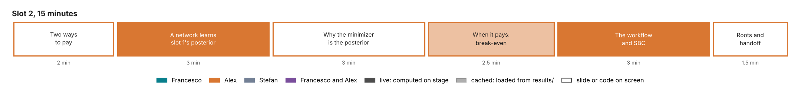

# Slot 2. What is amortized Bayes?

Alex · 15 minutes. A proposal for Alex's review. Part of the [curriculum](00-overview.md).

## The slot in three sentences

**The question.** How can a network trained on simulations return the posterior for any new data set, and when is that worth the training?

**The answer.**

1. A network trained to predict parameters from data simulated under the prior converges to the posterior for every data set the prior can produce, without ever evaluating the likelihood.
2. The cost moves from each data set to one training run, so it pays when many posteriors are needed: a book every morning, or the thousands that validation needs.
3. The network is an approximation, so the workflow wraps it in checks: a prior predictive check before training, simulation-based calibration (SBC) after it, and a correction of each real data set where its likelihood can be computed or estimated.

## Why this slot comes here

Slot 1 ends on a cost: the posterior is affordable for one smile under Heston and out of reach under rough Bergomi. Slot 2 explains the idea that removes the cost, on slot 1's own example, before slot 3 explains the networks and slot 4 builds one.

## Minute plan

| Min | Section | On screen | Live or cached | What is said |
| --- | --- | --- | --- | --- |
| 0–2 | 1. Two ways to pay | Two timelines: "infer per data set" (MCMC, sequential Monte Carlo, ABC, particle MCMC) against "train once, infer per data set in one pass" | slide | Every posterior so far was paid for data set by data set. Amortized inference pays once, up front, and then answers any data set in one pass. |
| 2–5 | 2. A network learns slot 1's posterior | The toy of §"The live demonstration" below: 20,000 simulated quotes, 20 seconds of training, the network's posterior of σ for the SPY quote over slot 1's grid posterior; then 10,000 quotes at once | live | The network never saw the likelihood. It saw only pairs of a volatility and a noisy price, and it returns the same posterior as slot 1's grid. Then it answers 10,000 quotes in one call. |
| 5–8 | 3. Why the minimizer is the posterior | The identity below, in one line, with its three consequences | slide | The loss is an average Kullback–Leibler divergence to the true posterior, so its minimizer is the posterior for every data set the prior can produce. |
| 8–10.5 | 4. When it pays | The break-even table below, and the cost of validation | cached | Amortization pays after a few dozen smiles for Heston and after about ten to twenty for rough Bergomi. Validation alone needs thousands of posteriors, which only amortization makes affordable. |
| 10.5–13.5 | 5. The workflow, and SBC | The workflow as a checklist; SBC run live on the toy, 1,000 simulated quotes in a second | live | The workflow is what slots 4 and 5 follow. SBC checks that the network's posteriors are calibrated on average: the rank of the true parameter among the draws must be uniform. |
| 13.5–15 | 6. Roots, and the handoff | A one-slide history and the finance alternatives | slide | The handoff to slot 3: the network must represent a conditional distribution $q_\phi(\theta \mid y)$ and read the data $y$. Which networks do that? |

## The live demonstration

The toy is slot 1's problem, so the audience knows its exact answer.

- **Simulator.** $\sigma \sim \mathcal U(0.05, 0.60)$, the prior of slot 1. The data is the at-the-money one-month Black–Scholes price at $\sigma$ plus Gaussian noise with slot 1's standard deviation.
- **Bank.** 20,000 pairs, simulated in milliseconds.
- **Network.** BayesFlow's `FlowMatching` with a small dense network (two layers of 64), one target ($\sigma$) and one condition (the price). The same class slot 4 and slot 5 use, at a toy size.
- **Training.** About 20 seconds on a laptop CPU; a saved checkpoint loads if training runs long.
- **Outputs.**
  1. The network's posterior of $\sigma$ for the SPY quote, over slot 1's grid posterior (12.8% ± 0.3 points).
  2. The posteriors of 10,000 different quotes in one call, with the time it takes.
  3. SBC on 1,000 simulated quotes: the ranks of the true $\sigma$ among 200 draws each, as an empirical distribution against the uniform, with its 95% band.
- **Optional extension.** Two quotes as data, the at-the-money quote and slot 1's put, with simulated quotes from Black–Scholes. The network learns a posterior that slot 1's grid also gives, and it shows that the condition can be a vector.

The demonstration needs a BayesFlow environment on the presenter's machine. It is the first live training of the afternoon, so it doubles as the check that the environment works before slot 4.

## The identity behind amortization

For pairs drawn from the joint distribution $p(\theta, y) = p(\theta)\,p(y \mid \theta)$,

$$\mathbb E_{p(\theta, y)}\big[-\log q_\phi(\theta \mid y)\big] = \mathbb E_{p(y)}\Big[\mathrm{KL}\big(p(\theta \mid y)\,\big\|\,q_\phi(\theta \mid y)\big)\Big] + \text{const},$$

where the constant does not depend on $\phi$. Flow matching (slot 3) reaches the same target with a different loss. Three consequences go on the slide:

1. **The prior and the simulator are trained in.** Changing either needs retraining or a correction (slot 6).
2. **The network is accurate only where the prior puts data.** A real data set unlike any simulation is an extrapolation, which the prior predictive check detects (slots 4 and 5).
3. **The minimum is reached only approximately.** The gap between the network and the posterior for one data set is the amortization gap. Where the likelihood can be evaluated or estimated, importance sampling with the network as proposal corrects it (slot 4 with the exact Heston likelihood, slot 5 with a Monte Carlo likelihood).

## When it pays

All costs are on one 4-core machine, from `costs/costs.json`, `heston/s1/bank-quality.json`, `checkpoints/heston/training.json` and the design document's S9.

| | Heston | Rough Bergomi |
| --- | --- | --- |
| One exact posterior | about 4 CPU-min (251 CPU-s) | at least 17 CPU-h (41 at the bank's average pricing cost) |
| The training bank | 60,000 smiles in 46 CPU-min | 112,000 smiles in about 370 CPU-h at the pilot's rate (⟨S1⟩) |
| Training the network | 32 minutes on 4 cores (500 epochs) | ⟨S2⟩ |
| Break-even | about 40 smiles | about 9 to 22 smiles, plus training |
| One posterior after training | 1.5 s on the clock (3.8 CPU-s) for 1,000 draws | 1.4 s on the clock (3.6 CPU-s) for 1,000 draws |
| SBC on 2,000 smiles, exact | about 140 CPU-h | at least 34,000 CPU-h |
| SBC on 2,000 smiles, amortized | about 2 CPU-h | about 2 CPU-h |

The last two rows carry the slot's sharpest point: a posterior method is validated by running it thousands of times, and only an amortized posterior makes that affordable.

## The workflow the afternoon follows

1. State the prior in units a practitioner can judge, and draw data from it: the prior predictive check.
2. Simulate the training bank.
3. Train the network.
4. Check it on held-out simulations: SBC, coverage, contraction, recovery.
5. Where an exact posterior exists, compare with it (slot 4).
6. Apply it to the real data.
7. Check the fit to the real data: the posterior predictive check.
8. Where the likelihood can be estimated, correct the posterior of the real data set by importance sampling, and flag the data set if the correction is unreliable (slot 5's audit).
9. Propagate the posterior into the quantity of interest (slots 4 and 5).

## Roots and alternatives, one slide

- **Simulation-based inference:** approximate Bayesian computation (Pritchard et al. 1999; Beaumont, Zhang and Balding 2002); synthetic likelihood (Wood 2010); neural posterior estimation (Papamakarios and Murray 2016; Greenberg, Nonnenmacher and Macke 2019); BayesFlow (Radev et al. 2020); flow matching for simulation-based inference (Wildberger et al. 2023). The proposal's references [7]–[10] and [18]–[22].
- **The alternatives finance knows:** closed-form likelihood expansions (Aït-Sahalia 2002; Aït-Sahalia and Kimmel 2007), indirect inference and the method of moments (Gouriéroux, Monfort and Renault 1993; Andersen and Sørensen 1996), particle MCMC (Andrieu, Doucet and Holenstein 2010). Each infers one data set at a time.

## Concepts slot 2 owns

The amortization identity; the economics and the break-even; the amortized workflow; SBC, coverage and contraction as concepts; the amortization gap and its correction by importance sampling. Slots 4 and 5 use them and refer back in one sentence.

## To build, by the freeze on Wed 4 Nov

1. `slot2_amortized_bayes.py`: the toy, its training, the overlay on slot 1's grid posterior, 10,000 quotes in one call, SBC.
2. The break-even slide from the table above; replace ⟨S1⟩ and ⟨S2⟩ when the rough bank and network exist.
3. One rehearsal on the presenter's laptop with the locked environment.

## Open choices for Alex

- Whether to train the toy live or load it. Live training is short and shows the idea; loading is safer.
- How much history to show. The proposal asks for "a brief history of classical simulation-based inference algorithms"; one slide meets it.
