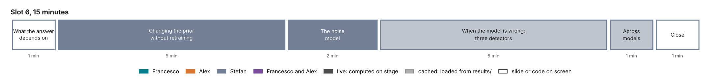

# Slot 6. Changing priors and dealing with misspecified models

Stefan · 15 minutes · last slot of the afternoon. A proposal for Stefan's review. Part of the [curriculum](00-overview.md).

## The slot in three sentences

**The question.** What does the answer depend on besides the data, and how is it found out when the model cannot produce the data?

**The answer.**

1. An amortized posterior has its prior and its noise model trained in, but both can be changed after training: by reweighting the draws, or by training once with the prior's and the noise's settings as extra conditions, so that a slider changes them.
2. A network answers every input with confidence, so misspecification has to be detected outside it: by checking that the data lie where the prior puts simulations, by re-pricing the posterior over the data, by the audit's weights, and by distances in a learned summary space.
3. When every model is misspecified, the honest report is the posterior within each model and the spread across models.

## Why this slot comes here

Slot 5 ends on four conditions: the prior, the noise model, the forward-variance curve and the model. Slot 6 changes the prior and the noise model, and tests the model, on the same SPY smile with the networks of slots 4 and 5; the forward-variance curve enters through the input check. It closes the afternoon.

## Minute plan

| Min | Section | On screen | Live or cached | What is said |
| --- | --- | --- | --- | --- |
| 0–1 | 1. What the answer depends on | Slot 5's last slide: the four conditions | slide | Each condition is a choice. This slot changes the prior and the noise, tests the model, and shows what moves. |
| 1–6 | 2. Changing the prior without retraining | (a) Reweighting: SPY's rough-Bergomi draws reweighted from the training prior on $H$ to a prior concentrated on small $H$, as a user persuaded by the rough-volatility literature might choose, with the effective sample size; the forward-start reserve before and after. (b) A Feller-respecting prior for Heston: slot 4's SPY draws restricted to $\sigma_v^2 \le 2\kappa\theta$; no draw survives. (c) Sensitivity-aware amortization: a Heston network trained once with the prior's centre and width as conditions; sliders change the prior and the posterior follows in one pass | (a) and (b) live, instant; (c) live with a network trained before the slot | A posterior's draws can be moved to a new prior by weights, as long as the new prior puts its mass where the posterior's draws are; the effective sample size says when that fails. When it fails completely, as for Heston under the Feller condition, the data and the prior disagree, which is itself a finding. Training with the prior's settings as conditions (Elsemüller et al. 2024) makes the sensitivity analysis a slider. |
| 6–8 | 3. The noise model is a choice | The Heston network of (c), with the noise multiplier $c$ as a second condition: $c$ from 0.5 to 3 on a slider, the posterior width and the variance-swap range following | live | The quotes' noise is an assumption, and the posterior's width scales with it. The noise model is stated, and the range is shown under alternatives. |
| 8–13 | 4. When the model is wrong: four detectors | One example per detector, all on the tutorial's smiles: (i) the input check: SPY's forward-variance curve against the pilot's curve prior (outside it, gate G0); (ii) the posterior predictive check: Heston's re-priced smiles on SPY, with their over-curved short smiles, and slot 4's variance swaps; (iii) the audit: Heston on a rough-Bergomi pilot smile, $\chi^2$ of 1,347 on 63 quotes, $\hat k$ = 154; (iv) a learned summary space: the distance of SPY and of rough-Bergomi smiles from the Heston training set (Schmitt et al. 2024) | (i)–(iii) cached; (iv) cached if built | The network gives a confident posterior for any input. Each detector looks from outside: at the inputs, at the fit, at the likelihood, or at the summaries. |
| 13–14 | 5. Across models | Slot 5's two forward-start distributions on SPY, Heston and rough Bergomi; if they are late, the pilot's three smiles | cached | When both models are wrong in different ways, report both and the spread between them, judged smile by smile. Model averaging and stacking are the formal versions. |
| 14–15 | 6. Close | What the afternoon showed, in three lines; the take-home track; the repository | slide | The method needs a simulator, a prior and a noise model, and it is only as good as its checks. |

**Optional slides.** The minute plan has no free minute, so two slides of the course's [version-2 plan](../../docs/course/v2-plan.md) are optional: pooling across names (Section 2.3) and the prior beyond the last quote (Section 2.2). Both are specified below, at one minute each. Each can take the time of a piece that is not built (Open choices for Stefan).

## The pieces, specified

### Reweighting to a new prior

For draws $\theta^{(i)}$ from the posterior under prior $p_0$, the posterior under prior $p_1$ is approximated by the weights

$$w^{(i)} \propto \frac{p_1(\theta^{(i)})}{p_0(\theta^{(i)})}, \qquad \text{ESS} = \frac{\big(\sum_i w^{(i)}\big)^2}{\sum_i \big(w^{(i)}\big)^2},$$

which works when $p_1$ puts its mass inside the posterior's support. The Pareto shape $\hat k$ of slot 5 diagnoses it.

- **Rough Bergomi on SPY.** The training prior on $H$, uniform on (0.02, 0.35), is replaced by one concentrated on small values, near the $H \approx 0.1$ that Gatheral, Jaisson and Rosenbaum (2018) estimate from realized volatility. That estimate is made under the real-world measure from returns, while slot 5 infers $H$ under the pricing measure from the smile, and Lecture 13, Section 13.1 shows how fragile it is on daily data (0.12 raw, 0.32 after correcting for measurement noise). The example is therefore a prior imported from another measure and another data set, which is exactly the kind of choice to make visible. The slide shows $H$'s posterior and the forward-start reserve under both priors, and the ESS. Needs slot 5's SPY draws (⟨S8⟩); if they are late, a synthetic pilot smile's draws stand in.
- **Heston on SPY under the Feller condition.** The new prior is the old one restricted to $\sigma_v^2 \le 2\kappa\theta$. On slot 4's exact draws the Feller ratio $\sigma_v^2 / (2\kappa\theta)$ ranges from 3.8 to 6.3 (median 5.0), so none of the 12,000 draws survives and reweighting is undefined. Reweighting cannot even approximate the new posterior; only a new chain or a retrained network can, and its best fit to the quotes can be no better than the unconstrained one, which lies outside the new prior. That is the measured form of "the prior and the data disagree", and it is a model diagnosis as much as a prior one.

### Sensitivity-aware amortization

Elsemüller et al. (2024, *Transactions on Machine Learning Research*) train one network with the settings of the prior and the likelihood as extra conditions, so that the posterior under any setting is one pass. The proposal for slot 6 is a Heston network with two conditions:

- the prior's centre $m$ and width $w$: each parameter drawn from a normal with mean $m$ and standard deviation $w$ times the box's half-width, truncated to the box, with $m$ drawn over the box and $w \in [0.1, 1]$ per smile. One choice sets $m$ to the last valuation's calibration, for example the previous month-end's, and $w$ to how far the parameters are believed to move between valuations. A centre fixed at the box's middle would not work: SPY's $v_0$ of 0.018 lies outside a box shrunk around its centre (0.085) by any factor below 0.89;
- the noise multiplier $c \in [0.5, 3]$: each quote's noise standard deviation multiplied by $c$.

The bank of slot 4 is regenerated with $(m, w, c)$ drawn per smile: about 46 CPU-minutes, plus about 32 minutes of training on 4 cores, perhaps more because the network has more conditions to learn. Built before the slot, it gives sections 2(c) and 3 their sliders.

### The four detectors

| Detector | What it checks | Example on the tutorial's data | Cost |
| --- | --- | --- | --- |
| Input check | That the data and their inputs lie where the prior puts simulations | SPY's forward-variance curve needs a log deviation of 0.36 against the pilot's bound of 0.2 | Seconds |
| Posterior predictive check | That the posterior re-prices the data within its noise | Heston on SPY: over-curved short smiles, and variance swaps 0.6 to 1.7 points below SPY's replicated strikes | Seconds for Heston, minutes for rough Bergomi |
| The audit | That the network's posterior survives reweighting by the likelihood | Heston on rough pilot smile 291: $\chi^2$ of 1,347 on 63 quotes, $\hat k$ = 154 | Seconds for Heston, about 7 CPU-minutes for rough Bergomi |
| Learned summary space | That the data's learned summaries lie inside the training set's (Schmitt et al. 2024) | SPY and rough-Bergomi smiles against the Heston training set | Needs a Heston network with a summary network trained with the distance term |

The fourth detector is the one slot 3 names. It needs a summary network, which slots 4 and 5 do not use: building it is a choice for Stefan (below).

### Optional slide: pooling across names

- **On screen.** Coverage of the 90% intervals of the illiquid names in a simulated Black–Scholes sector, for four methods ([`v2-pooling.png`](../../docs/course/images/v2-pooling.png)), with the table of v2-plan, Section 2.3.
- **Said.** The liquid names of the sector quote the full grid. Each illiquid name quotes one at-the-money option with 3 volatility points of noise. With 2 liquid and 6 illiquid names, the 90% intervals of the illiquid names cover the truth 89.7% of the time per name, 59.5% for the proxy (the liquid names' mean), 69.7% for empirical Bayes and 88.0% for hierarchical Bayes. The hierarchical intervals are 7.6 volatility points wide, against 9.9 per name. With 8 liquid and 32 illiquid names the four methods cover 89.6%, 83.3%, 87.5% and 89.4%. A small sector leaves its hyperparameters uncertain, and only the hierarchical model carries that uncertainty into each name. Pooling is a prior for each thin name, learned from the other names of its sector. The rules allow a proxy from similar instruments, without a recipe for it (Regulation (EU) 2016/101, Art. 3(3)(a)).

### Optional slide: the prior beyond the last quote

- **On screen.** [`long_end.png`](../checks/long_end/long_end.png): SPY's variance term structure, with no quotes beyond 2.2 years; the 90% range of five long-dated products under flat extrapolation and under the posterior; where the posterior's variance comes from.
- **Said.** SPY's chain ends with its LEAPs, at 2.2 years. Beyond them, rough Bergomi's forward-variance curve is not quoted. Holding it flat is a choice of zero width. For products to five years it gives 0.30 to 0.67 of the posterior's 90% range, and zero for the three-year variance swap. The posterior's range there depends on the width of the random-walk prior beyond the last quote. For the forward start from two to three years, the 90% range is 19.4% of its price with a prior sd of 0.1 per square-root year, and 36.8% with 0.3. No quote informs that prior, so it must be stated and tested. Study S10 tests it on EWG-like chains with two other laws for the unquoted level (slot 5, section 9).

## Numbers on screen, and their status

| Number | Source | Status |
| --- | --- | --- |
| SPY's curve: 0.36 against the bound of 0.2 | Design document, S8 | stated in the design document; register as a claim |
| Heston on SPY: Feller ratio 4.9; variance-swap gaps | Slot 4's feasibility run | to redo as S8-H |
| Pilot smile 291: $\chi^2$ 1,347, $\hat k$ 154 | `rough-pilot/s7-across/across-models.json` | pilot |
| The reweighted $H$ posterior and reserve | Slot 5's SPY draws | ⟨S8⟩ |
| The sensitivity-aware network's sliders | New network | to build |
| Pooling, 2 liquid and 6 illiquid names: coverage 89.7%, 59.5%, 69.7%, 88.0%; widths 9.9 and 7.6 vol points; 8 and 32 names: 89.6%, 83.3%, 87.5%, 89.4% (optional slide) | `tutorial_final/checks/bs_hierarchy.json`; v2-plan, Section 2.3 | quick check; register as a claim before it goes on screen |
| Long end: flat extrapolation 0.30 to 0.67 of the posterior's 90% range, zero for the variance swap; forward start 19.4% to 36.8% of its price for a prior sd of 0.1 to 0.3 (optional slide) | `tutorial_final/checks/long_end/long_end.json` and `long_end_extra.json`; v2-plan, Section 2.2 | quick check, with a Laplace posterior at SPY's fit; register as a claim before it goes on screen |

## To build, by the freeze on Fri 6 Nov

1. `slot6_priors_and_misspecification.py`: reweighting cells for rough Bergomi and Heston; the sliders of the sensitivity-aware network; the four detectors.
2. The sensitivity-aware Heston network: a bank with $(s, c)$ per smile and one training run.
3. Optionally, a Heston network with a summary network trained with the distance term of Schmitt et al. (2024), for the fourth detector.

## Open choices for Stefan

- Whether the sensitivity-aware network is built, or section 2(c) and section 3 use reweighting only. Reweighting a narrower posterior to a wider one (a larger noise) is unreliable, so the noise slider needs the network.
- Whether to build the summary-space detector, or show the first three detectors only.
- Whether to show the two optional slides, at one minute each. The time could come from section 2(c) if the sensitivity-aware network is not built, or from detector (iv) if the summary-space detector is not.
- Whether to keep a returns example. The crash-day example (branch `feat/tutorial-slot6-crash-risk`, #42), in which the prior decides much of the answer, is ready as a take-home notebook, and could replace section 2(a) if a returns example is preferred.

## References for the slot

- Elsemüller, L., Olischläger, H., Schmitt, M., Bürkner, P.-C., Köthe, U. and Radev, S. T. (2024). Sensitivity-aware amortized Bayesian inference. *Transactions on Machine Learning Research*. [arXiv:2310.11122](https://arxiv.org/abs/2310.11122)
- Schmitt, M., Bürkner, P.-C., Köthe, U. and Radev, S. T. (2024). Detecting model misspecification in amortized Bayesian inference with neural networks. *Pattern Recognition (DAGM GCPR 2023)*, Springer, 541–557. (The proposal's reference [12].)
- Gatheral, J., Jaisson, T. and Rosenbaum, M. (2018). Volatility is rough. *Quantitative Finance* 18(6), 933–949.
- Yao, Y., Vehtari, A., Simpson, D. and Gelman, A. (2018). Using stacking to average Bayesian predictive distributions. *Bayesian Analysis* 13(3), 917–1007.
